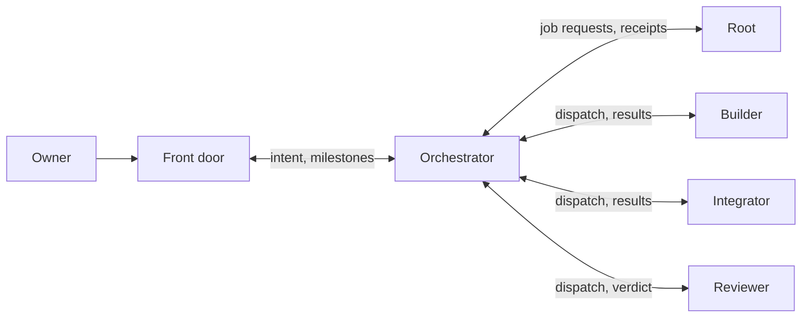

# Host-neutral hierarchy pilot prototype

This guide covers the source-checkout runtime prototype. Use the
[team surface chooser](../README.md#agent-teams) for repository lane leases or management audit.
For a team run, start with the [prerequisites and configuration](hierarchy-team.md#prerequisites).

This source-checkout prototype supplies eight role contracts, plain-file mailboxes,
stable endpoint bindings, checkpoint handoffs and a workspace controller. The stdlib-only
helper is `tools/hierarchy_mailbox.py`; it is outside Aegis core and is not installed
in the wheel. Nothing watches folders or tracks repository work for Aegis unless root starts
[the loop](#run-the-loop), which polls the journal and mailboxes and wakes sessions through
`tools/hierarchy_sweep.py`. Otherwise only `tools/hierarchy_wake.py` (with a reviewed profile) and
`tools/hierarchy_launcher.py` (`start` and `stop`) start or stop a host, and only when root runs them.
Host configuration, manager policy/membership and release gates are unchanged.

To move live sessions or run a trial with real sessions, follow the [dogfood guide](hierarchy-dogfood.md).
To take one feature through the M1 loop with real sessions, and induce its failure cases, follow the
[M1 loop runbook](hierarchy-m1-loop-runbook.md). Its setup, start, status and cleanup steps run through one command,
`tools/hierarchy_team.py`, described in [the team guide](hierarchy-team.md).

| Tool | Root uses it to |
| --- | --- |
| `tools/hierarchy_provision.py` | Set up an initiative, generate each role's connection and wake profile, and move a live hierarchy to a new root |
| `tools/hierarchy_launcher.py` | Start, resume and stop Codex role sessions, and record each outcome |
| `tools/hierarchy_sweep.py` | Wake sessions with unread mail across initiatives |
| `tools/hierarchy_jobs.py` | Run job requests through fixed recipes and answer them |
| `tools/hierarchy_review.py` | Prepare exact read-only copies for reviewers |
| `tools/hierarchy_meter.py` | Measure active time against the rotation limits |
| `tools/hierarchy_handoff.py` | Hand a session's endpoints to its successor |
| `tools/hierarchy_workspace.py` | Keep the initiative registry, capacity ledger and lease checks |
| `tools/hierarchy_router.py` | Route ROOT-approved canonical requests to each team's orchestrator, and report what is held |
| `tools/hierarchy_loop.py` | Keep routing, waking and running open jobs without a nudge, and report what waits on whom |
| `tools/hierarchy_board.py` | Keep [board](workspace-board-contract.md) channels and grants, and read digests |
| `tools/hierarchy_team.py` | Run one team from setup to cleanup with one config file ([team guide](hierarchy-team.md)) |

## Role contracts



| Role | Runs | Manifest form | Owns | Must not |
| --- | --- | --- | --- | --- |
| Front door | Always on | `<hierarchy>/front-door` | Owner intent, acceptance, escalation, plain-language status | Relay resources or technical traffic |
| Orchestrator | Always on | `<hierarchy>/orchestrator` | Task breakdown, lane briefs, judging evidence, draft PR metadata, reading CI | Edit source, run jobs, launch sessions |
| Root | Always on | `<hierarchy>/root` (optional) | Talking with the owner and approving or denying canonical requests through its decision adapter; read-only | Write files, send mail, launch sessions, run jobs, or make technical or acceptance calls |
| Builder | On demand | Lane kind `implementer` | Leased source edits, tests first | Push, use GitHub, start heavy jobs |
| Integrator | On demand | Lane kind `integrator` | Cross-cutting fixes and preparing the candidate from exact frozen source | Add feature scope, push, use GitHub, start heavy jobs |
| Reviewer | On demand | Lane kind `reviewer` | Independent verdict on exact source and baseline | Edit anything, or review its own work |
| Router | When listed in init `roles` | `<hierarchy>/router` | Intake, deduplication, routing and status, with root and the orchestrator | Read source, approve, run jobs, dispatch lanes |
| Decider | When listed in init `roles` | `<hierarchy>/decider` | Approval within explicit delegation; escalation to root | Edit anything, read the board, run jobs, dispatch lanes |

`tools/hierarchy_templates/role-registry.json` records every role as data: its kind, the
reads, writes, calls and approvals it may use, what it must never be given, its independence
rule, model profile and who it reports to. Actions come from a closed vocabulary in
`tools/hierarchy_roles.py`, and a role that both allows and prohibits an action is refused. The `reads`
vocabulary includes `loop_status` (the loop's `status.json`) and `team_evidence` (a run's evidence folder), which
ROOT's read tools need.

What reads the registry at this tier:

- **Provisioning and the mailbox adapter** take each role's file tools, workspace views, board access,
  Codex sandbox, reader shell, assistant list and team.json kind from it. A role with a fixed model
  profile (the Router, medium effort) always runs at that effort. On Codex its tier is passed as
  `service_tier` and the answer says `tier_applied: true`; Claude has no tier flag, so there it is
  recorded as not applied. Whether Codex serves the tier is for the native probe to show.
- **Lifecycle connections** come from each role's `provision.lifecycle_tools`: `router_status` for the
  Router and `decider_record` for the Decider. Every other role is refused `--lifecycle` and `--actor`
  with "the <role> role has no lifecycle connection". ROOT keeps its decision adapter, and its
  `provision.decision_tools` lists the read tools that adapter offers beside `root_decide`. Only the decision
  adapter may carry `decision_tools`, and each tool needs the reads it shows ROOT. The `serve`
  help text in `tools/hierarchy_mailbox.py` still calls `--lifecycle` and `--actor` ROOT only; it
  predates these connections and is pinned by the native foundation corpus.
- **Every bind refuses one session for both sides of an independence rule**, such as an implementer
  and the reviewer of its work, whether it comes from `add-role` or a direct `bind`.
- **Calls, approvals and prohibitions** are checked for consistency, and a test holds the lifecycle
  events against the journal's own permissions. The mailbox and the journal enforce them in their own
  code (dispatch, job requests, decisions), not by reading the registry at run time. Delegated Decider
  approvals are [a journal event](#delegated-decider-approvals). Routing is
  [its own tool](#route-approved-requests). The watch-supervisor's calls `router:route` and
  `jobs:run-open` name the tools [the loop](#run-the-loop) starts; those tools keep their own checks,
  and no code reads the registry to enforce the calls.

The endpoint grammar and vertical routes stay constants in
`tools/hierarchy_mailbox.py`, which the native foundation acceptance pins byte for byte, and the
registry refuses to load when the two disagree. Roles without an endpoint, such as the Test
Author hat, the model-free services and the roles used later, have entries and tests of what
they may and may not do; they get endpoints when work first needs them.

Only Builders and Integrators edit repository source. The owner approves scope, signs
governance/manager activation and merges every PR. Messages, receipts and SHIP
recommendations grant no authority.

**Why these roles.** Live use produced 61.1 mailbox messages per dispatch. Reviewers had
no file access, so source was mailed to them. Root did the physical work with no
endpoint, so its requests travelled through the front door as generic messages. Every
rotation was a front door or an orchestrator, because those roles stay in the loop for
every step.

**Decision.** A new role needs different authority or tools, or independence from
someone else's work, and cannot be something a script, assistant or assignment type
could do. Always-on roles stop at three. Further roles run on demand and are added one
at a time, kept only if they catch defects others miss or improve the baselines.

**Consequences.** Latency should fall through fewer relays and no mailed source; that is
a hypothesis until a trial beats the baselines. Complexity grows by one endpoint role,
two message types, a ledger and per-role launch profiles on each host. Cost adds no
always-on session or cloud resource. Root stays a single point of waiting.

Host-neutral role prompts and hierarchy/lane briefs are under
`tools/hierarchy_templates/`. Front doors write intent; orchestrators turn it into
executable lane briefs after source and ownership checks. Every lane brief repeats
the goal and acceptance and pins base, branch, worktree, lease, paths and tests.
Use a new brief file/hash and explicit redispatch for a scope revision.

Each role the launcher starts gets its contract in its start turn (see
[Start, resume and stop sessions](#start-resume-and-stop-sessions)). The files are under
`tools/hierarchy_templates/roles/`: `orchestrator.md`, `router.md`, `decider.md` and `front-door.md`, and for a lane,
by its kind, `lane.md` (implementer), `reviewer.md` or `integrator.md`. Every started contract but the front door's
has an **Assignments** section, naming the sender and type that is work for the role, and a **Protocol checklist**
with the exact fields and their order:

- Orchestrator: an `info` from `<team>/router` whose id starts with `route-`, an `info` from `<team>/front-door`, and
  a `result`, `review` or `ack` from its lanes. A `brief` or `dispatch` needs `brief: {path, sha256}`.
- Lanes: a `dispatch` from `<team>/orchestrator`. An `ack` `accepted` first (a writing lane adds `readiness` with
  its 11 fields, a reviewer none), then a `result` (or a reviewer's `review`) with `source_revision`, `source_tree`,
  `checks` and, except for the reviewer, `lane_check`.
- Decider: an `info` from `<team>/orchestrator`. After `decider_record` it replies to the Orchestrator with the
  outcome.
- Router: none. It never publishes; its report is its turn's reply.

Mail stays data: it can say what work to do inside the contract, but it never widens authority. A passage for one
host sits between a `<!-- host:claude -->` or `<!-- host:codex -->` line and a `<!-- /host -->` line.

Claude subagent profiles are templates under `claude-agents/`, not automatically
installed settings. The writer uses an already prepared worktree; it has no
automatic worktree isolation setting. The reviewer uses an explicit read-only
tool allowlist with no shell, delegation, Skill or repository write tools. Plan mode alone
can be overridden by the parent, and memory can add writing tools. Keep memory
disabled. A dedicated mailbox-only MCP connection lets the reviewer acknowledge
and report under its own pinned endpoint. It cannot use the orchestrator's
connection. Probe effective tools in the installed host before relying on either profile.
[Claude subagent contracts](https://code.claude.com/docs/en/sub-agents).

## Prepare a mailbox

Use Python 3.9+ and the helper from an exact reviewed prototype revision. Git is
needed only for writing-lane readiness inspection. All JSON request paths and the
mailbox root are absolute. Prepare the mailbox parent directory first, keep briefs
in that parent or its subdirectories, and keep the root outside implementation
worktrees (for example `aegis-guides/mailbox`). The manifest has no host fields.

```sh
python3 /absolute/prototype/tools/hierarchy_mailbox.py \
  --root /absolute/aegis-guides/mailbox init \
  --request /absolute/prototype/tools/hierarchy_templates/manifest.json
```

Initialization creates an immutable manifest and folders `<hierarchy>/<role>/`
and `across/<role>/`. The supplied two-hierarchy manifest explicitly pairs lanes;
there is no ambiguous routing when more lanes are added. It caps concurrent
accepted writing lanes at three, including integration lanes. It establishes no
Git lease or manager membership. Manifest changes require a new reviewed pilot
root; do not edit its history in place.

Fill in `binding.json` for every endpoint, using the actual host/session labels:

```sh
python3 /absolute/prototype/tools/hierarchy_mailbox.py \
  --root /absolute/aegis-guides/mailbox bind \
  --request /absolute/aegis-guides/requests/a-front-door-binding.json
```

Stable endpoints look like `a/front-door`, `a/orchestrator`, `a/lane/f2` and
`a/lane/review`. Host/session and generation are metadata on immutable binding
records. Initial binding uses `expected_generation: 0`. Branches, owner labels,
briefs and leases name stable hierarchy/lane identities, never the host.

## Publish and receive

Substitute the message template's current sender binding, brief path and SHA256
of its exact bytes. A front-door intent message uses type `brief`; an orchestrator
assignment to its own lane uses type `dispatch`. Generic peer information uses
type `info`. Each file has a JSON header between Markdown frontmatter delimiters
and a plain-text body. The helper adds UTC time and explicit information-only and
verification metadata. Host-native messaging may nudge a reader but is not the record.

Publication returns the file's `path` and raw-byte `sha256`. A front door with
only mailbox tools can author its complete intent as an `info` message to its
orchestrator, then send a `brief` message referencing that immutable file/hash.
The informational Markdown file itself is the hierarchy brief; its hash covers
the header and body together. An orchestrator can author a lane brief the same
way, then reference it in the lane's dispatch. No extra file writer or hash tool
is required. Keep these artifacts immutable; a revision is a new file/message.

```sh
python3 /absolute/prototype/tools/hierarchy_mailbox.py \
  --root /absolute/aegis-guides/mailbox publish \
  --request /absolute/aegis-guides/requests/a-f2-dispatch.json
python3 /absolute/prototype/tools/hierarchy_mailbox.py \
  --root /absolute/aegis-guides/mailbox inbox --endpoint a/lane/f2
python3 /absolute/prototype/tools/hierarchy_mailbox.py \
  --root /absolute/aegis-guides/mailbox status
```

`publish` and `ack-handoff` also take `--request -`, which reads the same strict JSON
(at most 262144 bytes) from stdin before taking the writer lock, so a caller that keeps
stdin open never blocks other writers. `init`, `bind` and `draft-handoff` still need an
absolute file. A relative or traversing `--root`, `--request` or `--spec` is refused
with the argument and its value named. `inbox --limit` defaults to 20, at most 100.
`inbox --binding-only` (the adapter's `binding_only`) is the startup and triage view:
the binding, each checkpoint brief as `{path, sha256, ok}`, where `ok` means the file
still hashes to `sha256`, and `messages_total`. It returns no messages or brief text,
records no read, and refuses `--include-briefs`, `--limit`, `--after` and `--mark-read`.
A `hierarchy_handoff.py` spec entry and an `add-role` request may carry `kind`. When
present it must equal the endpoint's manifest kind (only lanes declare one), or that
entry or request is refused with both kinds named.

Inside one hierarchy, front door and orchestrator communicate vertically, as do
orchestrator and lanes. Across hierarchies, only explicitly paired counterparts
communicate. No front-door/lane or cross-hierarchy diagonal route is accepted.
A counterpart can exchange a brief but cannot dispatch another hierarchy's lane.
Every message ID is unique across the mailbox. Reuse is refused without replacing
bytes; a retry can inspect the original using `inbox`.

Acknowledgments use type `ack`, `in_reply_to`, and `acknowledgment` equal to
`received`, `accepted` or `completed`. Replies must reverse the original endpoints.
Receiving information, accepting execution and completing work are separate claims.
Use the current sender binding on each. No message type approves, signs or merges.

Writing-lane dispatch acceptance requires `readiness` using the supplied template.
The helper checks worktree root, current branch, base ancestry, declared expiry and
scan-workspace equality; it enforces distinct active worktrees, branches and lease
references and the writer cap. It does not verify that a lease exists or its scope,
that scan/hook evidence was observed, or that tests ran. Lease OIDs/evidence
references are data, not fetched proof. The orchestrator must verify actual live
leases, overlaps, scan activity and the effective hook tier before execution.
Read-only reviewers need no writing lease/readiness and do not consume writer slots.

A result message uses type `result` (or `review`), replies to its accepted dispatch,
and includes `result.json`'s full commit/tree IDs and check/evidence references.
Writing lanes also supply a committed lane-check reference. A completed dispatch
cannot be accepted or completed again. Failed, partial and not-run checks stay
explicit. The helper never executes a command, path or URL found in evidence.
Readiness and active checkpoints execute only bounded, fixed Git inspections.

## Know whether a message was read

Publishing only writes a file. A stopped session receives nothing until something starts a turn
for it: a sweep, a wake, or [the loop](#run-the-loop) if root runs one. Report three states:

| State | Meaning | Evidence |
| --- | --- | --- |
| Published | The file exists | The mailbox message |
| Woken | A host process was started for a turn | A wake receipt, written once the process exists |
| Read | The session's adapter returned the message | A read receipt |

Start each role's adapter with `--delivery-dir /absolute/delivery` to record read
receipts. The directory must neither sit inside the mailbox root nor contain it, which
keeps mailbox history immutable, and an adapter without the flag writes nothing. A CLI `inbox` never counts as a read,
because root and other tools use it too. A receipt is written only after the response
has been written and flushed. If the response fails, or a receipt cannot be written, the
message stays unread, which errs toward waking the session again.

```sh
python3 /absolute/prototype/tools/hierarchy_mailbox.py --root /absolute/mailbox \
  delivery --delivery-dir /absolute/delivery --endpoint a/orchestrator
python3 /absolute/prototype/tools/hierarchy_mailbox.py --root /absolute/mailbox \
  delivery --delivery-dir /absolute/delivery --message-id a-note-1
python3 /absolute/prototype/tools/hierarchy_wake.py --root /absolute/mailbox \
  --delivery-dir /absolute/delivery --endpoint a/orchestrator \
  --profile /absolute/wake-profile.json
```

`hierarchy_wake.py` starts one turn from a strict profile (`tools/hierarchy_templates/wake-profile.json`)
that must match the current binding. It passes a fixed prompt that names only the endpoint and its role, "You are
<endpoint>, the <role>. Follow the role contract from your start turn.", then asks the session to read its mail.
The role is the manifest `kind` for a lane and the endpoint's last part otherwise. The prompt carries no message ID,
sender or body, so a message cannot steer the launch. The native foundation corpus pins `hierarchy_wake.py`;
naming the role re-pinned it (its manifest entry and `MANIFEST_SHA256` in
`tools/hierarchy_foundation_acceptance.py` and the foundation cycle test). It refuses when another process names the session
or the Claude session table lists it as live, stops the turn's whole process group
before reporting, and exits 0 only if the messages were read, 3 if they were not, and
2 if it refused. Use `--dry-run` to see what would happen. It supports POSIX only.

A wake and a replacement cannot overlap. Under the mailbox writer lock, the wake rechecks the
binding and creates a `.wake-<endpoint>.lock` file in the mailbox root, so it never starts a
session that was just replaced. It releases the writer lock before launching, so the session
can read its mail at once, and holds the wake file until the turn ends; `bind` refuses while
that file exists. Other mailbox writes keep working during the turn. A crashed wake leaves the file behind, which blocks wakes and replacements for
that endpoint. Check that its process has stopped before removing the file.

Each endpoint keeps at most 10,000 read receipts and 10,000 wake receipts. A full ledger
refuses more and stays readable: new reads stay unread, and a wake refuses before it
launches. Hosts offer no handshake, so a wake receipt proves a process existed, not that the host
ran a turn; check `last_wake` for its exit code. If the process cannot be created, the
message is not counted as woken. If its start cannot be recorded, the process is stopped.
A read receipt shows the adapter returned the message to the connection configured for
that binding. It does not prove the session understood or acted on it, and a session
that reads the mailbox files directly leaves no receipt.

## Scoped mailbox MCP access

A host without general workspace writes can use the same file protocol through a
dedicated stdio adapter. `tools/hierarchy_templates/mailbox-mcp.json` is a registration
proposal only; nothing installs or activates it. Replace its exact source-pinned
interpreter/helper, mailbox root, endpoint, host, session and generation. Each role
needs its own connection. The reviewer profile embeds its own server definition;
it must not inherit the orchestrator's sender binding.

By default the adapter advertises exactly `mailbox_inbox`, `mailbox_publish`,
`mailbox_ack_handoff` and `mailbox_self`. Root gets no mailbox adapter, because grants and job runs stay out of
anything a model session can call. Its only adapter is the decision adapter, `serve --endpoint <h>/root
--lifecycle <journal> --actor <ROOT CID>`. Its one writing tool is `root_decide`: approve or deny an existing
canonical request by ID and raw SHA-256 in the lifecycle journal. Beside it, the adapter offers the read-only tools
ROOT's registry entry lists in `provision.decision_tools`: `team_status`, `team_pending` and `team_request` (see
**ROOT's read tools** below). The ROOT actor is configuration
and every answer says it is not authenticated. A replaced ROOT session, a successor that has not
acknowledged its checkpoint and a ROOT fenced by lifecycle succession are refused before anything
is written, and retrying the same `event_id` returns the original receipt. Sender identity and root come only from process startup;
tool arguments cannot choose them. Every call rechecks the current binding and
the manifest digest; mutations check under the same exclusive writer lock. An
old running adapter is refused after replacement. This is configured provenance,
not authenticated host identity. The adapter speaks baseline stdio MCP 2024-11-05.

`mailbox_inbox` returns only this endpoint's incoming messages. `include_briefs: true`
adds their hash-verified brief text, so a front door needs no arbitrary filesystem
reader. `limit` defaults to 20, up to 100; the response byte budget can shorten a
page. While `remaining` is nonzero, pass the returned `next_after` as
`after_message_id` to read the next page. The cursor is exclusive: that message
will not be repeated. Read every page before treating an inbox walk as complete.
`status` and historical files remain available.

The adapter selects its inbox behavior from the `host-plan.json` in the mailbox
root's parent directory; a plan held only by another provision base does not apply.
An invalid plan refuses the call; it does not select legacy behavior.

| Connection | Inbox behavior |
| --- | --- |
| No host plan (legacy) | Accepts `include_briefs`, `limit`, `after_message_id` and the separate `binding_only` view. Returns the full current `binding`, including checkpoint, canonical checkpoint hash and readiness. With `include_briefs`, `checkpoint_briefs` contains hash-verified text, including outgoing briefs absent from incoming messages. |
| Validated host plan | Also accepts `order`, `since` and `briefs`. Later pages can slim `binding` and replace checkpoint brief text with hash checks, as described below. These options are MCP-only. |

The CLI's `--include-briefs`, `--limit`, `--after` and `--binding-only` retain the
legacy behavior; it has no equivalents for `order`, `since` or `briefs`.

On a planned connection, `order` defaults to `"oldest"`; `"newest"` reverses
the `(created_at, message_id)` order. Keep `order` and `since` unchanged through a
walk and use its returned cursor. If a cursor is refused, restart without
`after_message_id`. For example, these are successive `mailbox_inbox` arguments;
replace `a-note-1` with the first response's actual `next_after`:

```json
{"include_briefs": true, "limit": 20, "order": "oldest"}
```

```json
{"include_briefs": true, "limit": 20, "order": "oldest", "after_message_id": "a-note-1"}
```

For recent-generation triage on a planned connection:

```json
{"order": "newest", "since": "current_generation", "limit": 20}
```

`since: "current_generation"` selects messages at or after the current binding's
creation time, plus its checkpoint's pending message IDs. The response's `excluded`
count reports how many messages fall outside that selection; `remaining` counts only the selected
walk. This is a timestamp filter, not an unread-mail filter. To recover older unread
mail, restart oldest-first without `since` or `after_message_id` and drain every page.
A changed cutoff, a cutoff more than five seconds in the future, or ambiguous
timestamp ordering refuses the filtered read; recover with that same unfiltered walk.

On a planned connection, a successfully flushed response of at most 60,000 bytes
allows later responses on that connection, for the same binding and checkpoint, to
return a slim `binding`: `endpoint`, `host`, `session`, `generation`,
`checkpoint_sha256` and `ready`. Once checkpoint brief text has been included in
such a response, later `include_briefs` reads may return `{path, sha256, ok}` checks
instead of that text (`reason` explains a failed check). A later flushed planned inbox
response over 60,000 bytes clears this suppression, so the next inbox read returns
the full binding and, when requested, checkpoint brief text. Incoming message brief
text is still included when requested. `binding_only` returns no text and does not
advance this suppression state. A stdout flush proves transport progress, not model receipt
or understanding; host truncation or context compaction can lose the text.

After compaction or truncation, use this planned-connection recovery call:

```json
{"briefs": "full", "order": "oldest", "limit": 20}
```

`briefs: "full"` implies `include_briefs: true` and forces the full binding and
hash-verified checkpoint brief text, so a successor can inspect its checkpoint
before acknowledging it without a controller relay. It does not remove message
filters or paging: omit `since` and the old cursor on the first recovery call.
For continuation pages, use `include_briefs: true` without `briefs`, replacing
`a-note-1` with the preceding response's actual `next_after`:

```json
{"include_briefs": true, "order": "oldest", "limit": 20, "after_message_id": "a-note-1"}
```

The cursor remains valid when switching these brief options. This keeps incoming
message brief text while allowing checkpoint hash checks and a slim binding when
the preceding response qualifies. Repeating `briefs: "full"` re-sends the full
binding and every checkpoint brief's text on every page. Dropping `briefs` without
adding `include_briefs: true` omits incoming messages' brief text. Continue with
each `next_after` until `remaining` is zero. Read receipts cover only returned
messages; stopping early can leave a wake reporting `woken_unread`.

`mailbox_publish` takes the message fields except `from`, `host`, `session` and
`binding_generation`, which the adapter supplies. It validates nested fields with
the same file protocol and cannot claim leases, edit source, run supplied commands
or invoke manager policy. Its schema types `readiness` (the 11 required fields, with
`enforcement_tier` `advisory` or `best-effort`) and `result` (`source_revision`,
`source_tree` and `checks` of `{check, outcome, reference}` with `outcome` `pass`,
`fail`, `not_run` or `partial`, plus an optional `lane_check`). Both come from the
pinned validator in `tools/hierarchy_mailbox.py`, a test compares them with it, and
the validator stays the check. The tool's description gives the order for answering
a dispatch: 1. an `ack` `accepted` in reply to it (a writing lane adds `readiness`, a
reviewer none); 2. then a `result` or `review` in reply to the same dispatch; 3. on a
refusal, read its text and fix exactly the field it names, never re-sending unchanged.
`mailbox_ack_handoff` accepts only `checkpoint_sha256`
and is available to a successor before its binding is ready. A restricted reviewer
can thus receive, accept and report independently with source-read tools plus these
narrowly scoped mailbox tools.

`mailbox_self` takes no arguments and changes nothing. It returns the connection's endpoint,
registry role, host, session and generation, whether the binding has acknowledged its checkpoint,
and the tools offered. Like every other call it is refused for a replaced session, so an answer
always means `current: true`. The identity is configuration (`authenticated: false`).

**ROOT's read tools.** They change nothing and are marked `readOnlyHint`. Each reads the journal under its writer
lock, as router `status` does, through `tools/hierarchy_team_view.py`; `hierarchy_team.py status` calls the same
functions, so the owner and ROOT read one JSON contract.

- `team_pending` returns `aegis.team-pending/v1`: one row per request ROOT owes a decision on, with `request_id`,
  `request_sha256` (the journal's raw hash), `team`, `operation`, `phase`, `owner`, `paths`, `source`, `why` and
  `root_decide` (`request_id`, `request_sha256`, `event_id_approve`, `event_id_deny`), so ROOT adds only the
  decision and a reason. `why` is `awaiting_decision` (no ROOT decision, not routed, not closed), `escalated` (the
  Decider escalated it; the row adds `delegation_id` and `escalation_reason`) or `within_delegation` (an undecided
  merge a live delegation still covers; the row adds `delegation_id`). A `within_delegation` request is the
  Decider's to decide first: once ROOT decides it, the Decider's decision is refused.
- `team_status` returns `aegis.team-status/v1`: `loop` (`state`, `pass_id`, `finished_at`, `current_step`,
  `step_started_at`, `interval`), `holds_by_act` (`root`, `owner`, `router`), `pending` (the ids `team_pending`
  lists), `requests` (each id and its `state`), `delegated_decisions` (each with ROOT's last decision on its target)
  and `evidence` (the folder, its file count, and the `SHA256SUMS` path and line count). `loop` and `evidence` are
  null when the connection has no folder for them. `loop.state` is `absent` (no `status.json`), `fresh` or `stale`
  (no pass finished and no step began within three intervals). It reads only the file, so it is not liveness;
  `hierarchy_loop.py status` checks the loop's lock. A request's `state` is `awaiting_decision`,
  `within_delegation`, `escalated`, `delegated_approved`, `approved`, `approval_expired`, `denied`, `delegation`,
  `routed`, `closed` or `continuation_member`.
- `team_request` takes a request's fields and returns `aegis.team-request/v1`: the canonical `raw` text, its
  `sha256`, the exact publish `event` (id `publish-<id>`, the journal's current coordinator, ROOT's custody) and
  `published`. The draft meets the journal's own checks on a copy of its state and writes nothing. ROOT cannot
  publish: the owner publishes the draft with `hierarchy_team.py request`.

The decision adapter runs from its own entry, because the pinned mailbox CLI cannot carry the two read-only
folders:

```sh
python3 -I -B tools/hierarchy_mailbox_mcp.py --root /abs/mailbox serve --endpoint m1/root --host codex-cli \
  --session <ROOT session> --generation 1 --lifecycle /abs/lifecycle --actor root-1 \
  [--loop-state /abs/loop] [--evidence /abs/evidence]
```

That entry serves only `<h>/root`, and it still refuses the mailbox, workspace, board and source options. `add-role`
for ROOT with `lifecycle` and `actor` writes a connection that runs it. The optional request keys `loop_state` and
`evidence` (absolute paths, which need not exist yet) add `--loop-state` and `--evidence`; for any other role they
are refused with "loop_state and evidence are only for ROOT's decision adapter, with its lifecycle and actor".

**The write fence.** Every write checks, under the mailbox writer lock, that the configured sender
is the endpoint's current binding, so a replaced session is refused. A write the session authors
(a publish, a board post or a board disposition) also needs the handoff acknowledged; the
acknowledgment is the one such write an unacknowledged successor may make. Records of what was
returned (read receipts and the board read position) need only the current binding, so they name
the successor's own generation. A board write takes the board lock first, then the mailbox lock
only for the check and the write itself, so a rebinding cannot land between the two and a busy
board never makes other mailbox writes busy. Each lock is waited for up to five seconds.
Service writes that publish under an endpoint's current binding, such as job receipts and a
move's carried-work brief, are checked against that binding, not against the session that asked.

**Independence on every bind.** Every bind checks the role registry's `separate_session` flag,
whether it comes from the mailbox CLI, `add-role`, a provisioning move or `hierarchy_handoff.py`.
A session that currently holds one endpoint in a mailbox root cannot be bound to another endpoint
in that root when the two roles differ and either needs a separate session (Reviewer, Decider and
ROOT today). One session may hold the same role on several endpoints, such as one ROOT for
hierarchies `a` and `b` in a shared root. The same session name on another host counts as another
session. The registry's `not-author` and `not-requester` rules are not checked mechanically.

**Source views.** With `--source-repo /absolute/git/repository`, a role that reads source and
writes none (Reviewer, Decider, Orchestrator) also gets `source_show` and `source_grep`. Any other
role is refused at startup, and so is ROOT. Both take a full 40-character commit id and read Git
objects only: never the working tree, the index or untracked files. `source_show` returns one file
a page at a time (`start_line`, `max_lines` up to 2,000; lines over 4,096 characters are cut and
listed in `cut_lines`). `source_grep` searches for a fixed string, optionally under literal
`paths`, and returns up to 500 matches, with `truncated` when there were more. Each answer stays
under about 192 KiB as sent, so a page or a match list may stop early. The repository is fixed at
startup, so no argument can point a view elsewhere. Global and system Git configuration is
ignored, and settings in the repository's own configuration cannot run a command or reshape the
output: every Git call refuses all transports, so nothing is ever fetched, and a partial clone is
refused at startup. Each Git run has a 30-second deadline; a timeout is an error answer. `add-role` takes `source_repo` and writes the option into
the role's connection and allowlist.

With `--workspace-store /absolute/store --initiative <id>`, the adapter adds read-only
views by role. Grants, releases, claims and other changes are never offered.

| Role | Extra tools |
| --- | --- |
| Front door | `workspace_initiative` |
| Orchestrator | `workspace_capacity`, `workspace_initiative` |
| Builder, Integrator | `workspace_path_overlap` |
| Reviewer | None |

A tool list limits a session only if it has no shell or write tools.

## Replace a host/session

Stop the outgoing session first. Then generate the replacement request, or use the
command below for several endpoints at once:

```sh
python3 /absolute/prototype/tools/hierarchy_mailbox.py --root /absolute/mailbox \
  draft-handoff --request /absolute/draft-request.json
python3 /absolute/prototype/tools/hierarchy_handoff.py --spec /absolute/handoff-spec.json
```

A draft request has `endpoint`, `host`, `session` and `outgoing_stopped`, plus optional
`completed_checks`, `briefs`, `evidence_dir` and `delivery_dir`. The draft collects
active dispatches, open job requests, their briefs, lease refs and source witnesses
from the record. Its output is the request for `bind`. `hierarchy_handoff.py` drafts
and binds each entry in `tools/hierarchy_templates/handoff-spec.json`, reports a failure
on one without hiding or blocking the others, and leaves finished entries alone when
run again. Each successor still acknowledges separately through its own connection.

With `delivery_dir`, the draft includes every unread message ID, including messages
that were woken but not read. The delivery status page's 100-ID display limit does
not limit the handoff. Pending IDs and checkpoint brief references are deduplicated;
the existing checkpoint limits remain 256 each. An overflow refuses the draft and
preserves the current binding instead of omitting work. Resolve pending work or
prepare a complete bounded handoff before rotating; marking a message read is not
evidence that its assignment or job finished.

Ordinary unread messages retain their hash-bound brief references in the inbox.
The successor reads them with `include_briefs` and follows `next_after` while
`remaining` is nonzero. Their contents stay pageable instead of accumulating in
mandatory checkpoint metadata. Active/job, explicit and inherited checkpoint
briefs retain their existing validation and response limits.

For a mailbox move, current carry briefs retain each open job's original full ID
and the path and SHA-256 of its original request. Missing terminal receipts can
hide running, completed or uncertain effects. Before any replacement request, the
operator must identify the original workspace store and reconcile its claims,
results, receipts and reservations with `hierarchy_jobs.py --store
<original-workspace-store> recovery-status --initiative <id>`. A mailbox move
neither settles nor restarts those jobs. Hold if the original store cannot be verified.

A source witness carries a digest of the exact `git status --porcelain=v1 -z
--untracked-files=all` bytes and an entry count, with the raw status in `evidence_dir`
if given. This replaced a literal status field whose 4096-character limit blocked real
rotations; one worktree reported 3,079,233 bytes. Bindings that hold the literal form
still validate.

By hand, fill in `checkpoint.json` with unchanged brief
hashes, source revision/tree and dirty state, lease refs, completed checks, pending
message IDs and last acknowledgment IDs. Active dispatches and their unchanged
briefs must be retained. Accepted writing work also requires its lease reference
and a source snapshot matching the current commit/tree/dirty state and original
branch. The original acceptance record retains the lease object/expiry and branch.
Front doors without a checkout may have an empty source list. Quiescence is an operator claim, not
native enforcement.

Publish a replacement binding request with the same endpoint, a new host/session,
`expected_generation` equal to the current generation, and the checkpoint object.
The new binding is immutable and initially not ready. Its returned
`checkpoint_sha256` hashes canonical checkpoint JSON. The successor reads the
checkpoint and inbox, then acknowledges it:

```sh
python3 /absolute/prototype/tools/hierarchy_mailbox.py \
  --root /absolute/aegis-guides/mailbox ack-handoff \
  --request /absolute/aegis-guides/requests/a-f2-handoff-ack.json
```

Bind checks each snapshot exactly, but a writing lane that is still working keeps
moving after the draft. So, for each open accepted dispatch, acknowledgment checks
lineage instead: the branch still matches the acceptance, the lease ref is in the
checkpoint, and the snapshot's `source_revision` is HEAD or an ancestor of it. The tree
and dirty state may differ. A lane reset off its snapshot is refused with
`checkpoint source moved off its snapshot: <worktree>`. Dispatches already closed by a
result, a review or a `completed` ack are not checked. The ack output adds
`observed_sources`: one `{worktree, source_revision, source_tree, dirty_entries,
dirty_state_sha256}` per checked worktree, in checkpoint order, or an empty list. The
`.ack` file and the binding are unchanged.

The acknowledgment JSON has exactly `endpoint`, `generation`, `session` and
`checkpoint_sha256`. The old sender generation is rejected after replacement; the
successor cannot publish or receive a new dispatch until this acknowledgment.
Historical messages retain their original provenance. Existing accepted assignments
belong to the stable endpoint and survive the handoff. The protocol cannot prevent
the old same-user process from editing directly. Rotate root after 90 active minutes
and every other session after 60; the pilot's deliberate mid-wave replacement tests this
same handoff.

## Root and job requests

A hierarchy can declare `<hierarchy>/root`, routed only to its own orchestrator. An
orchestrator sends `job_request` with a hash-bound packet in `brief`. Root answers with
`job_receipt`, which replies to that request and carries a `receipt`:

| State | Requires | Closes the job |
| --- | --- | --- |
| `started` | Nothing | No |
| `unknown` | `reason` | No, so an uncertain job stays open |
| `refused` | `reason` | Yes |
| `completed` | `exit_code` 0 and `evidence` | Yes |
| `failed` | Nonzero `exit_code` and `evidence` | Yes |

Evidence entries are `{"path", "sha256"}` references. They stay inert: the mailbox
checks their shape and never reads them. A receipt is a claim, and it stays
`information_only`. Open jobs must appear in a replacement checkpoint. Manifests without
a root endpoint keep working, but cannot receive job requests.

`tools/hierarchy_jobs.py run-open` does this work. The packet is strict JSON naming a recipe
and an exact source, either as a whole `.md` file or as the body of an earlier message, which is
how a role with no file writer sends one. A job is refused unless its checkout is registered
for the initiative and its revision, tree and status digest match the packet. The argv comes
only from root's recipe file, by exact-word substitution with no shell; a recipe word may also be
`$scratch/<plain relative path>`, which joins only the job's scratch folder (`scratch/run`) with a
suffix fixed in the recipe file, never a packet value. The source is witnessed
again afterward, so a clean exit over changed source is reported as `failed`, with an `exit_code`
of -1 meaning that no command's own exit decided the result. A heavy job holds a ledger slot, and
outside heavy processes count against the same limit. The result is written before its receipt,
so a busy mailbox or store only delays a receipt or a release until the next run. A lost runner
leaves `unknown` and keeps the slot until root runs `resolve`. See the
[dogfood guide](hierarchy-dogfood.md) for packets and recipes.

For pre-submitted checks on one fixed source, the opt-in
[v2 dependency packet](hierarchy-job-dependencies.md) lets `run-open` advance from
verified predecessor evidence without another relay turn.

A recipe with `require_clean` refuses a checkout with local changes and a path that is not in the
packet's commit. It then runs on an export of that commit, not on the checkout:
- Every blob is written from `git cat-file`, with no filters, attributes or LFS smudging, so LFS
  files arrive as their pointer files.
- A symlink that leads outside the export is refused, and so are submodules, any `.git` entry, and a
  partial clone (fetching its missing objects could run a command from the repository's config).
- `$checkout`, the working folder and `PYTHONPATH` name the export, and the export is removed after
  the run.
- In bubblewrap the live checkout is hidden, so ignored and untracked files there cannot run. With
  `sandbox: none` they are still readable by absolute path.
The result's `source_export` names the commit, tree, entry count and size. Use a recipe without the
flag, such as `lint`, for uncommitted work. One with `expects_tests` keeps pytest's `junit.xml`, and `result.json` gains `tests` (total,
passed, failed, errors, skipped). A run that reports no tests, passes none (all skipped, for
example), or leaves no readable junit file, is `failed` even with exit 0. Every result `run-open`
writes, refusals included, records `recipes_sha256`, the hash of the exact recipe file, and a command
job's result records `python`, the interpreter's version. A root `resolve` copies the hash recorded
when the job was admitted, or `null` if none was. Each time root pins or changes the recipe file, it
publishes the hash `check-recipes` prints, so a Reviewer has a value to compare. The template's `targeted-tests` and `full-suite` set
both flags. Its `lint` runs the same command as `make lint`, takes no paths, and so cannot be narrowed.

A `require_clean` recipe may add `export_git` for a build that asks Git about itself, such as a
`build.rs` that runs `git rev-parse HEAD`. The export then gets a read-only `.git` holding only `HEAD`
(the packet's full commit id, so HEAD is detached there), empty `objects/` and `refs/`, and a
`config` with only `repositoryformatversion = 0` and `bare = false`: no hooks, alternates, packed refs
or `info/`. It is not counted in the export's entries or bytes, and `source_export` gains
`git_stub: true`. A commit that itself holds a `.git` is still refused. `GIT_CEILING_DIRECTORIES` is
the job folder, so Git in any folder of the export finds the stub and never a repository around the
store. Every export job also runs with `safe.bareRepository=explicit` as command-line config, so a
committed folder shaped like a bare repository (`HEAD`, `objects/`, `refs/`) makes Git there fail
instead of answering with that folder's HEAD, config and alternates. The template's
`rust-targeted-tests` and `rust-lint` set `require_clean`, `export_git` and `heavy_tests`, and run
cargo offline (`--frozen`, `CARGO_NET_OFFLINE`) with `CARGO_HOME` and `RUSTUP_HOME` bound read-only through `ro_binds` and the build in the job's cargo target folder.
`rust-targeted-tests` first writes a nextest config into `$scratch` that sends nextest's store there
and its JUnit report to `$scratch/junit.xml`, so `expects_tests` counts the run and nothing is
written into the commit. Nextest leaves `#[ignore]` tests out of that report, so `tests.skipped` stays
0 for them; its log's summary line shows how many it skipped. Both name the crate
(`-p stormheir-sim`); change it for another workspace.

**Reviewing with job evidence.** The orchestrator files `targeted-tests` on the exact commit under
review and forwards the receipt's evidence references (paths and sha256) in the review dispatch. The
Reviewer then checks:
1. Every evidence file still has its sha256.
2. `result.json` says `completed` and `exit_code` 0, with `tests.passed` above 0 and
   `tests.failed` and `tests.errors` both 0. Weigh `tests.skipped` against the selection.
3. The `before` and `after` source revisions are the reviewed commit, with the empty dirty digest.
4. `recipes_sha256` is the recipe file root published.
5. The test selection fits the change.

pytest runs the change's own `conftest.py` and configuration, so a hostile change could fake its
counts. Read those files in the diff. Hosted CI on the PR head stays the merge gate.

## Route approved requests

`tools/hierarchy_router.py` is the Router's model-free code. It never approves or executes. It reads
the lifecycle journal and routes each authority request whose last ROOT decision is an unexpired
`approve` and that has not been routed. Continuation members are not routed on their own: the authority
request's bytes name each one by ID and hash, and `--request` takes only an authority ID.

The team registry is the workspace initiative registry. A request's `team` must be an active
initiative with a `mailbox_root`. That mailbox needs a bound `<team>/router` that has acknowledged
its handoff, and a bound `<team>/orchestrator`. The request goes out as an `info` message from
`<team>/router`, under that endpoint's current binding, and its body is strict JSON:

```json
{"schema": "aegis.routed-request/v1", "request_id": "...", "request_sha256": "...",
 "request": {"raw": "<exact canonical bytes>", "sha256": "..."}}
```

The router then records a `route` event, with `to` set to `<team>/orchestrator`. Before it sends,
it replays that event on a copy of the journal state, so a router at its active-time cap or a full
journal sends nothing. The message ID and the event ID are both `route-<request sha256>`, so routing
again changes nothing. A run that delivered but lost its journal write is finished by the next run
without a second message, even if ROOT has denied the request or its approval has expired since. An
existing message under that ID with a different sender, recipient, type or body is held as
`route_message_conflict`.

```sh
python3 tools/hierarchy_router.py --lifecycle /abs/lifecycle --store /abs/store status
python3 tools/hierarchy_router.py --lifecycle /abs/lifecycle --store /abs/store \
  route --actor router-1 --evidence-only [--request <id>]
```

`status` changes nothing. It names the journal's current router actor (`router`), which a caller such
as [the loop](#run-the-loop) passes to `route`, so routing follows a router succession without new
configuration. It lists each authority request as one of these states:

- `awaiting_decision`, `denied`, `closed` or `ready`.
- `delegation`: an approved `delegate-merge` request. It is the team Decider's scope, never work,
  so it is not routed.
- `held`, with a `reason`: `approval_expired`, `team_unregistered`, `team_inactive`,
  `team_has_no_mailbox`, `router_endpoint_missing`, `router_unbound`, `orchestrator_unbound`,
  `router_handoff_unacknowledged`, `route_message_conflict`, `request_too_large` (the routed body
  would exceed the 64 KiB message limit) or `team_mailbox_unreadable` (with a `detail`). One team's
  unreadable mailbox holds only that team's requests. A route run can also hold a request with
  `delivery_error` and a `detail`, for example when the team mailbox is busy or the router is at its
  active-time cap.
- `delivered_unrecorded`: the message is in the team mailbox but the journal has no route yet. The
  next route run records it.
- `routed`, with `to` and the route mark. A routed request is never routed again. If ROOT denies it
  after delivery, it shows `revoked_after_route: true`, as does `delivered_unrecorded`.

Each entry in a route run's `routed` list says whether this run sent the message (`delivered`) or only
recorded an earlier delivery. If the closing report fails, the run still returns `routed`, with
`report_error` in place of `requests`.

Escalation is the Router session's job, not this code's. The session reads `status` and tells ROOT
about anything held. Its connection offers this as the read-only `router_status` tool when `add-role`
is given the journal (`lifecycle`, and no actor: routing stays this code's). The tool reads under the
journal's writer lock, waiting up to 2 s, as `status` does. `route` refuses the whole run before writing anything if `--actor` is not the
journal's current router actor. The journal itself accepts a `route` event from the router actor
without checking approval, so this code is where that check lives. The router actor and the
borrowed binding are configuration, not authenticated identities.

`status` also lists `escalations`: each request the team Decider escalated, with its delegation,
reason, time and ROOT's last decision on it (`null` until ROOT decides). The Router session voices
them to ROOT, which approves or denies the escalated request itself.

When `status` refuses (exit 2), its answer has a `source`: `journal` (the journal could not be read
under its lock), `store` (the workspace store could not be read) or `arguments`.

## Run the loop

`tools/hierarchy_loop.py` is the watch-supervisor's service. It is model-free and has no endpoint.
Root starts it once per lifecycle journal, outside any model session, and it keeps working after
sessions end:

```sh
python3 -I -B tools/hierarchy_loop.py --lifecycle /abs/lifecycle --store /abs/store \
  --recipes /abs/recipes.json --state-dir /abs/loop run [--interval 30] [--passes N]
python3 -I -B tools/hierarchy_loop.py ... once        # one pass
python3 -I -B tools/hierarchy_loop.py ... status [--text]
```

For a team run, [`hierarchy_team.py up`](hierarchy-team.md) starts the loop detached with the run's `CODEX_HOME`
and checks its environment, `status` reads it, and `down` stops it.

Each pass runs these tools as child processes, in order, with a read-only durable planning projection immediately before sweep:

1. `hierarchy_router.py status`, to read the journal under its lock and learn the current router.
2. `hierarchy_router.py route --actor <current router> --evidence-only`, only when a request is
   `ready` or `delivered_unrecorded`.
3. `hierarchy_router.py dispatch --recipes <configured recipes> --evidence-only`, for registered
   small-change rows. With none, this stage is inert and the canonical report stays unchanged.
4. `hierarchy_sweep.py --rounds 1 --durable`, to wake sessions with unread mail, excluding planning
   endpoints whose team still has open small-change rows.
5. `hierarchy_jobs.py run-open`, last, so a long job does not hold up the pass's wakes. Its answers
   are mail, which the next pass wakes the requester for.

The loop writes no mail, journal event or approval itself, and it never wakes root. Children get an
explicit environment with inherited `CLAUDECODE`, `CLAUDE_PID` and `CLAUDE_CODE_*` removed; a host can
set its own indicators afterward. They run in their own session with no timeout: killing one could
leave a mailbox or journal `.write.lock` behind.
A hung child therefore stalls the loop, and `status` shows which step and for how long. A SIGTERM or
SIGINT stops the loop between steps. Only one loop runs per journal and per store: it holds a lock on
`<lifecycle>.loop.lock` and `<store>.loop.lock`, and a second one is refused with "loop already active
for <path>".

`<state-dir>/status.json` (`aegis.loop-status/v1`) records the last pass, each step, and every
**hold**: something only a person or a role can settle, with the step, kind, who must act (`root`,
`owner` or `router`), first and last seen and a count. `status` reads `running` (with the current
step and its age), `stale` (no pass or heartbeat within 3 intervals) or `not_running` (no loop holds
the lock); it never reads a stale file as quiet. `status --text` groups the holds by who must act.
Among them:

- `journal_unavailable` for root; after 3 such passes in a row, `journal_lock` for the owner, naming
  `<lifecycle>/.write.lock`. The loop never removes a lock. `store_unavailable` and
  `router_status_error` are for root and do not count toward `journal_lock`.
  When the independent durable planning projection cannot be read or validated, dispatch has an owner
  `planning_exclusions_unavailable` hold and sweep is skipped. This delays wakes across teams
  until durable inputs are readable; canonical run-open still runs and unread mail is retained.
  A malformed canonical or dispatch child report holds its own step; it does not prevent that independent read.
- Requests the router holds, `delivered_unrecorded`, `revoked_after_route` and unanswered
  escalations, for the Router session or root.
- Sweep rows such as `ignored_mail`, `wake_marker_held`, `start_failed`, `start_backoff`, root's queue
  and rotation; and jobs that need root (`job_<state>`).
- `silent_role` and `stalled_dispatch` for root, one per row of the sweep's `silent_roles` and
  `stalled_dispatches` (see [Run several initiatives](#run-several-initiatives) for the rules). The detail names
  what the role read, or the dispatches it accepted, and its last wake. The sweep recomputes both from mailbox files
  every pass, so a hold clears once its rule stops holding. The owner answers a silent role with one trusted turn,
  `hierarchy_team.py turn` ([team guide](hierarchy-team.md)).
- `start_failing` for the owner, once an endpoint failed to start in 3 passes in a row. The loop then
  skips that endpoint (`sweep --skip`) until the owner deletes `status.json`, which also clears the
  other counts. A malformed `status.json` restarts the counts with a one-pass `status_reset` hold.

## Small-change dispatcher foundation

The [R4 design and narrow canonical-compatibility successor](teams-t1-dispatcher.md) define this model-free progression. The public router
`status --recipes <configured recipes>` and `dispatch --recipes <configured recipes> --evidence-only`
commands expose `small_changes` separately from canonical `requests`; even already-routed small changes
never become Orchestrator route candidates. `team_pending` keeps canonical rows and `root_decide`
arguments unchanged and adds the optional sibling `small_change_pending` for plan decisions. That
sibling grants ROOT no new tool or recording authority.

An admitted row addresses exactly its first writing lane, of kind implementer or integrator, and the
team's unique independent Reviewer lane. Both lifecycle participants and mailbox bindings are checked.
Publication borrows only the ready Orchestrator mailbox binding; the router records only its own
route event. Stable writer/check/Reviewer IDs (`scw-`, `scj-`, `scr-`) derive from the admitted plan
hash and check identity. Published briefs and receipts are reused with their historical bindings.
The writer's result must name the raw passed terminal hash as `lifecycle-terminal:<sha256>`; terminal
and review remain on the request base, while results and check packets identify the new commit/tree.
Before first writer publication, remaining expiry must exceed `2 * wait + 30` seconds. The 30-second
scan/publish reserve is modelled, not an observed host latency bound.

Before any check publication, all admitted checks must pass preflight. This foundation supports fixed
v1 packets for command recipes with `require_clean=true` and no `$paths`; it infers no path selection.
Each publish rechecks denial, expiry and the configured recipe file hash. Admission, claim and result
hashes must agree at settlement. Partial batches resume only missing original IDs while those checks
still hold. Existing global run-open keeps its recipes, budgets and scheduling; unrelated canonical
jobs continue even when a small-change row holds on recipe drift. A successful receipt also needs
retained packet/source/evidence hashes, stopped processes and settled reservations before review.

Receipt validation captures retained artifacts through validated directory/file descriptors and consumes that snapshot
through evidence hashing, result/body validation and process checks. Every step entry is checked, including unlisted
entries; symlinks, nonregular files, changed identity/content metadata or directory membership hold before review.
This fixed-v1 path refuses exact execution.json, derivation.json and admitted.json names at anchored discovery,
before content opens for any file type or apparent execution liveness. These are unsupported version metadata,
reported as small_change_receipt_invalid; no dependent-job or newer runner semantics are inferred. D5 adoption
remains separately held, and source comparison supplies no current-base runtime qualification.
Each regular-file capture reads at most its initial N bytes using bounded requests, then validates unchanged
identity/content metadata/membership. Short reads, growth and rewrites hold without following appends to EOF.
Large valid logs have no mailbox-size cap; result metadata keeps the runner's 4 MiB bound and exact numeric-log
2000-byte tail rendering. A retained failed/refused result holds a partial batch even when its terminal receipt was
not published. Only the original runner settles it; the dispatcher publishes no replacement or remaining batch work.

Missing or conflicting messages, duplicate results/terminal receipts, unknown or failed effects,
expiry, denial, stale participants and recipe drift hold without a replacement attempt. A legacy
canonical router-to-Orchestrator delivery takes precedence over new-work configuration checks:
`small_change_legacy_delivery` shows its original message ID and hashed file evidence; a conflicting
route ID shows `route_message_conflict`. Neither can be converted into a small-change lane route.
A published writer message with no route receipt stays `delivered_unrecorded`; the loop excludes that
writer until recovery verifies the original route receipt. It never removes an abandoned lock.

The loop reconstructs team-scoped Orchestrator/Decider exclusions immediately before sweep through
public `hierarchy_small_change_dispatch.project(..., mutate=False)`, independently of canonical child
output. It preflights raw lifecycle/store paths before constructing readers, then validates with the
separate dispatcher projection decoder. Malformed child holds remain visible while healthy independent
work proceeds. Actual durable read/validation failure holds sweep without an empty-set fallback;
canonical run-open still runs. Query locks are released before wakes, and an empty canonical projection
omits `small_changes`. This read records no publication or lifecycle event and grants no authority.
Malformed durable policy role types also hold this reconstruction boundary without suppressing canonical run-open.
Mixed canonical/small-change initiative queues hold. Canonical delivery checks fresh journal state inside the mailbox
lock after classifying original delivery: an identical lost receipt recovers once even if newly mixed, while a new
publication refuses. Valid completed foreign writer/Reviewer history requires unique correlated acceptance/completion
and historical bindings; it permits later work without granting current lifecycle or check evidence. Ambiguous history
holds, and live canonical conflicts still apply. Planning exclusions are separate
from `start_failing`; deleting status.json cannot release them. Retained scw/scj/scr replies list IDs,
paths and actual recorded read state, never fabricated reads. The team's planning skip lifts only
after every small-change row is complete or has an owned blocked disposition. A `next` disposition,
denial or derived status edit cannot stand in for independent early release. Existing sweep
`stalled_dispatch` holds remain available for accepted lanes that stopped without answering.

After validated checks and review, `small_change_close_due` exposes exact delivery/disposition or
blocker-resolve envelopes. The owner records those through `hierarchy_lifecycle.py record --event
<draft file> --evidence-only`. The dispatcher never records coordinator events, grants/releases
capacity or leases, meters actors, resets starts, or marks unknown/failed/revoked work complete.
Closed rows are audited too: lost evidence becomes `small_change_closed_unverified` without undoing
an owner's recorded disposition.

All host behavior here is **modelled** by public subprocess tests, with participant events injected
through the public lifecycle CLI. This is a foundation, not real end-to-end activation. D4 requires
the separately qualified dispatcher registry companion, serialized after T2(a). D5's producer,
connection, atomic staging, consumer and Reviewer tool seams, including Claude writers, require
separately designed and qualified successors. D7's independent skip-only early-release record seam
is still absent; automatic exclusions remain until it qualifies. No free-form message, HOLD or denial
substitutes for it. Continuity and native/real-host qualification also remain open. Manual wakes,
launcher resume and `team turn` remain owner actions outside the loop-only wake guarantee.

## Delegated Decider approvals

ROOT delegates by approving an ordinary canonical request with `operation: "delegate-merge"` and no
continuation members. Its `team` and `paths` are the scope, `continuation.max_starts` is how many
approvals it allows, and `continuation.expires_at` ends it. A deny after the approve revokes it, as
for any request. The approval makes the delegation the Decider's scope and nothing else: the journal
never admits a delegation as work, and the Router never routes it.

The team Decider records a `delegated_decision` in the lifecycle journal, with the target request ID
and hash, the delegation's ID and hash, the reviewed `commit`, `review` (evidence references to the
reviewer's verdict), `decision` and `reason`. Either choice needs a real delegation and a target
that is an authority request, which ROOT could decide itself. The journal accepts `approve` only
when the delegation is ROOT-approved and unexpired, names the target's team, covers every target
path component by component (the same path or a parent directory, never `/`), still has approvals
left, the commit is the target's source commit, and the Decider did not publish the target. Anything
else can only be `escalate`. A target gets one delegated decision, and none after ROOT has decided
it. Only the coordinator and router can publish, so the publisher rule holds by role separation;
the journal checks it anyway.

The event never admits work: it does not count as a ROOT decision, does not use a continuation budget
and does not make a request admissible. The Decider cannot record `decision`, `admit`, `intent` or
`publish`. A policy's `current` may omit the decider, so five-role journals load and replay exactly as
before. Decider identity is configuration-bound, like every journal actor; the separate-session rule
is enforced when the mailbox binds the endpoint.

Limits in M1:

- A journal has one current Decider, as it has one Router. The journal checks the delegation's team
  against the target's, not against the Decider's, so with several teams on one journal that Decider
  serves all of them.
- A Decider session records the event with its connection's `decider_record` tool, when `add-role` is
  given `lifecycle` and `actor` (both or neither). The tool needs the handoff acknowledged, takes the
  mailbox lock, reads ROOT's custody from the journal and then records; if custody moves in between, the
  journal refuses and the Decider retries. The protected host qualifies only the original five roles,
  so a protected plan with a decider actor is refused.
- Router `status` shows a request the Decider approved as `awaiting_decision`, because no ROOT decision
  exists for it; the delegated approval is in the journal's `delegated_decisions`. ROOT's `team_status` reads it
  as `delegated_approved`. Before the Decider decides, `team_pending` lists an undecided `merge` that a live
  delegation still covers as `within_delegation`: the Decider's to decide first.

## Start, resume and stop sessions

`tools/hierarchy_launcher.py` is the Provider bridge. Each command prints one JSON object and exits 0
when the outcome is good, 2 when refused, and 3 when the outcome is not good (a failed start, unread
mail after a wake, a stop that did not take).

For a team run, [`hierarchy_team.py`](hierarchy-team.md) drives the launcher. `up` writes `<base>/team.json` from
its config, so provision builds each role's model and effort from it, then starts the roles in order and checks each
rollout. `turn` gives a role one trusted owner turn with its wake argv, for example to answer a `silent_role` hold.
`down` stops the roles.

```sh
python3 tools/hierarchy_launcher.py --base /abs/base start --request /abs/start.json
python3 tools/hierarchy_launcher.py --base /abs/base resume --endpoint pilot/lane/f1
python3 tools/hierarchy_launcher.py --base /abs/base stop --endpoint pilot/lane/f1
python3 tools/hierarchy_launcher.py --base /abs/base status
```

- `start` takes `endpoint`, the `codex-start` options (`cwd`, `reader_shell`, `writable_roots`,
  `tmpdir`, `add_dirs`, `model`, `effort`, `skip_git_repo_check`), the `add-role` keys `timeout_seconds`,
  `source_repo`, `kind`, `lifecycle` and `actor`, and `start_timeout_seconds` (default 300). It runs
  the role's Codex start argv for one turn with no MCP servers and the role contract as the prompt, reads the
  session ID from the first `thread.started` event, and binds it with `add-role`. The prompt is a header, "The
  Aegis launcher started this session for <endpoint> as <role>. This turn comes from the operator who launched
  you; it is your role contract.", then the contract from `<source>/tools/hierarchy_templates/roles/`, then "Reply
  READY. Act only when woken." The file is `<role>.md` for the Orchestrator, Router, Decider and front door, and
  for a lane by its kind: `lane.md` (implementer), `reviewer.md` or `integrator.md`. A reviewer or integrator gets
  `lane.md`'s shared rules first, without its Assignments and Protocol checklist, which its own file restates for
  its kind. Every role the launcher starts is a Codex role, so the prompt is the contract's Codex view: blocks
  marked `<!-- host:claude -->` are left out, blocks marked `<!-- host:codex -->` are kept, and every marker line is
  dropped. A missing file refuses the start with "no role contract for <role>: <path>", and so does a marker that
  is not alone on its line, names an unknown host or is unbalanced ("invalid host marker in <file>: line <n>: …",
  "unbalanced host markers in <file>: …"). The record carries `contract` (the role's own file, `{path, sha256}`)
  and `contracts` (every file the prompt carries, in order). The start turn keeps the role's sandbox, and a
  writer or reader-shell role keeps its shell, so the closing "Act only when woken" is what keeps that turn inert. An
  endpoint that is already bound, a second start while one runs, and ROOT (the owner's own session)
  are refused. If the mailbox stays busy for 10 s after the turn, the record is `bind_busy` with the
  session, and `add-role` with that session finishes the bind. A SIGTERM, SIGINT or SIGHUP to the
  launcher stops the start's process group and is recorded (`start_incomplete` once a session is known,
  else `failed_to_start`, error "the launcher was interrupted"); during the bind wait it ends the wait
  instead, and the session can still be bound with `add-role`. The start lock is released either way.
- `resume` runs `tools/hierarchy_wake.py` with the current binding's wake profile, unchanged, and
  leaves every timeout to it.
- `stop` signals the processes whose arguments name the bound session: SIGTERM, then SIGKILL after
  `--grace-seconds` (default 5). It never removes a wake marker; the answer says whether one remains.
  A Claude background session is refused, since it stops through `claude stop`, and so are a native
  thread (its own app stops it) and ROOT. A process census that fails after signals were sent is
  `stop_failed` with the signalled pids, not `refused`.
- Once the endpoint is known to the mailbox manifest, every outcome, refusals included, is a record
  under `<base>/launches/<endpoint>/` (schema
  `aegis.hierarchy-launch/v1`); `status` reads them back. These are not lifecycle events.

For a Codex role other than ROOT, `add-role` also writes `profiles/<endpoint>-g<N>.codex.json`
(`aegis.hierarchy-codex-profile/v1`; `codex-start` returns the same record without writing it):
sandbox mode, writable roots, network, approval policy, disabled features, MCP servers with their
enabled tools, model, effort and service tier. The argv is built from
that record as inline `-c` settings under `--ignore-user-config`; no file is written to `~/.codex`.
The disabled features include `multi_agent` and `multi_agent_v2`: live M1 sessions with only `multi_agent` off
were still offered the v2 sub-agent tools. Whether Codex honours either flag under an account's managed settings
is unverified; the native probe's `multi_agent` row and `hierarchy_team.py up` read each rollout for an offer.
ROOT given `lifecycle` and `actor` gets a connection file for its decision adapter (`aegis_decision`)
and, on Codex, the matching `mcp_config` setting, but no wake profile: the supervisor never wakes ROOT. That
setting enables `root_decide` and the read tools, each with an approve entry, because ROOT runs with
`approval_policy="never"`.

## Run several initiatives

| Level | Who | How many |
| --- | --- | --- |
| Workspace | Root, initiative registry, capacity ledger | One |
| Project | Front door | One per project |
| Initiative | Orchestrator and its own mailbox root | One per initiative |
| Assignment | Builder, Integrator, Reviewer | On demand |

Give each initiative its own mailbox root. Manifests are immutable, so a new initiative
then needs no change to any other root, and calls stay fast because each one rereads its
root's whole history. Root runs `tools/hierarchy_workspace.py` against one store:

```sh
python3 /absolute/prototype/tools/hierarchy_workspace.py --store /absolute/store init --request /absolute/limits.json
python3 /absolute/prototype/tools/hierarchy_workspace.py --store /absolute/store register --request /absolute/initiative.json
python3 /absolute/prototype/tools/hierarchy_workspace.py --store /absolute/store request --request /absolute/slot-request.json
python3 /absolute/prototype/tools/hierarchy_workspace.py --store /absolute/store grant-next --kind writer
python3 /absolute/prototype/tools/hierarchy_workspace.py --store /absolute/store check-paths --request /absolute/paths.json
python3 /absolute/prototype/tools/hierarchy_workspace.py --store /absolute/store report --format text
```

The other commands are `update`, `withdraw`, `release`, `status`, `mark-merge`,
`clear-base-moved` and `check-delivery`. Exit 0 means success, 3 means a rule said no
(no grant, a path conflict, not ready for delivery), and 2 means refused or malformed.

- **Same repository:** `check-paths` reads leases from every registered checkout, using
  the real Aegis reader and overlap rule, because leases in independent clones cannot
  see each other. The reader must come from the `aegis_core` beside these tools in
  the same source checkout. A missing reader or a foreign package already loaded
  by the host is refused; an installed wheel is not a fallback. This refusal leaves
  the capacity ledger unchanged. Each initiative lists its `lanes`, because linked worktrees share
  lease refs, so seeing a lease proves nothing about who holds it. A lease is an
  initiative's own only if its lane is assigned there and it is visible through that
  initiative's checkout. Any other overlapping lease, or an unreadable checkout, is a
  refusal, and the shared front door settles it using the owner's priority order.
  Declared `touched_paths` only warn. A clear result is advice, not a lock.
- **Writers and heavy jobs:** `grant-next` applies the owner's priority, oldest request
  first. Accepted work is not preempted, and an unlisted initiative is refused. A
  reservation is released only with terminal evidence whose hash matches.
- **Dependencies:** `blocked_by` holds an initiative until its blockers are done. An
  unknown blocker holds until it is removed. After an owner merge, `mark-merge` marks
  other initiatives on that branch, and `check-delivery` refuses them until
  `clear-base-moved` names the latest moved base with evidence.
- **Across projects:** information belongs on the board described in
  [the board contract](workspace-board-contract.md), once one exists. Work goes through
  each project's own orchestrator, because separate mailbox roots have no route and an
  endpoint can have only one counterpart.

Many initiatives can be open at once, but at most three can be writing at any moment and
at most three heavy jobs can run at once. Those are the owner's current limits. A store
sets its own limits at `init`, up to those ceilings, and raising the ceilings is a
reviewed change for the owner to decide after measuring the machine. The store is a
same-user record, not a security boundary, and it detects damage only when that breaks
its history. A store holds at most 10,000 events. A full store refuses every further
change, including capacity releases, and stays readable, so plan to start a new one
before it fills.

`tools/hierarchy_sweep.py` goes through active initiatives in the owner's priority order and
wakes each endpoint that has unread mail and a current wake profile, one turn at a time. With
`--rounds` it repeats, so a conversation continues without anyone starting each turn. A session
past 60 active minutes or one whose time cannot be measured is not woken, and one that ignored
its mail gets no second turn for it in the same sweep. With `--durable`, as the loop runs it, that holds
across sweeps: the wake receipts of the current binding generation show which unread mail a turn was
already given for (`ignored_mail`), and only new mail or a successor generation earns another turn.
Durable mode also reports a held wake marker (`wake_marker_held`, never removed), stops after 3 failed
starts for the same unread mail (`start_failed`), waits 300 s after a failed start (`start_backoff`),
and re-reads each endpoint just before waking it (`binding_changed` if its binding moved meanwhile).
`--skip ENDPOINT` reports that endpoint as `skipped` and never wakes it. It never wakes root, and instead reports
root's unread mail, open jobs and active time against its 90 minutes. Root reads its own mail
with `inbox --mark-read --host <host> --session <session> --generation <n>`, giving its own
binding, so its unread count means what it means for everyone else. A replaced root's read is
not recorded.

Every sweep also reports two lists, judged from the mailbox's own files with nothing kept between sweeps. Neither
changes `quiet`, which stays about mail. [The loop](#run-the-loop) turns each row into a root hold.

- `silent_roles`: an Orchestrator, lane or Decider whose latest finished wake read work it owes an answer to, and
  that has published nothing since. Work is a message from its own team: for the Orchestrator an `info` from the
  Router or the front door, or a `result` or `review` from a lane; for a lane a `dispatch` from the Orchestrator;
  for the Decider an `info` from the Orchestrator. The Router publishes nothing by design and is exempt, as is every
  other role. Only the latest started wake of the binding's current generation counts, and only once it has a
  finish receipt and no wake marker remains. A read belongs to that wake when it has the wake's session and
  generation, comes after the previous finished wake of the generation, and comes no later than this wake's finish.
  The start receipt is not the bound, because a background wake writes it only once its launcher returns. A
  publish counts from 5 s before the start receipt, or from the first read charged to the wake when that is
  earlier. A row has `initiative`, `endpoint`, `wake_id`, `started_at`, `finished_at`, `ended`, `exit_code`,
  `read` (each `message_id`, `type` and `from`) and `silent_since`. Any later publish, or a later wake, clears it.
  A refused publish writes nothing, so a role whose every answer was refused stays silent.
- `stalled_dispatches`: a lane that accepted a dispatch no `result`, `review` or `completed` ack has answered, with
  no unread mail and no wake marker, and whose last finished wake ended after the acceptance. A session that died
  after accepting gets no further wakes, so this cannot wait on a wake count. A row has `initiative`, `endpoint`,
  `wake_id`, `finished_at` and `dispatches` (each `dispatch`, `accepted` and `accepted_at`). An answer, unread mail
  or a running turn clears it.

Known false negatives: work that arrives under a type outside that list; a partial answer, because any publish
clears the silent hold; and a publish by an earlier turn within 5 s before a wake's start. A Decider that records
with `decider_record` and sends no mail is reported silent, so its contract has it reply to the Orchestrator. A
`stalled_dispatch` can also fire while a lane waits for the answer to its own question; the answer arrives as
unread mail and clears it.

The [workspace board](workspace-board-contract.md) carries information across initiatives
through a server of its own, when a connection starts with `--board`. It cannot change bindings,
dispatches or leases.

## Role-based assistants

Each role can have a fixed list of assistants with one small job each. They read and
report, and the main session decides. The lists are in
`tools/hierarchy_templates/claude-agents/assistants-*.json`, and each file is a valid
`--agents` value. Nothing installs them.

| Role | Assistants |
| --- | --- |
| Front door | `inbox-digest` |
| Orchestrator | `brief-checker`, `log-reader` |
| Root | None; routine work belongs in scripts |
| Builder, Integrator | `code-locator`, `failure-reader` |
| Reviewer | `usage-tracer`, `coverage-mapper` |

Assistants use `Read`, `Grep` and `Glob` only, one level deep and two at a time, with no
sender, lease or job slot and no tests or builds. Their time counts against the main
session's active-time limit. Their output is a lead to verify, never evidence, and it cannot
count as independent review. For a Claude session, launch with `claude --agent <role>`
and `Agent(<names>)`, set `CLAUDE_CODE_MAX_SUBAGENT_SPAWN_DEPTH=1` and
`CLAUDE_CODE_MAX_CONCURRENT_SUBAGENTS=2`, and leave `memory` unset because it adds write
tools. A parent can override `permissionMode`, so the allowlist has to be the control.

Keep Codex assistants off with `agents.enabled = false` until a live probe. Codex
documents that assistants inherit the parent's sandbox and approvals, that a custom
agent cannot override `mcp_servers`, and no allowlist of named agents. See the
[Claude](https://code.claude.com/docs/en/sub-agents) and
[Codex](https://learn.chatgpt.com/docs/agent-configuration/subagents.md) docs. Using
assistants needs the owner's go-ahead, and these definitions have not been run on a
live host.

## Evidence and manager overlay

The manifest, immutable bindings and messages supply external attribution by
hierarchy, role, lane, host and generation. Preserve raw Aegis `team metrics` as
repository totals: linked worktrees share the events log while scan activity is
per worktree. Record tool/source versions, worktree, branch and time interval with
each evidence artifact; never relabel repository totals as per-host observations.
`status.mailbox_message_counts` counts only this mailbox's files by sender host
and endpoint; `accepted_writers` lists unclosed writing assignments, not observed
running processes. These counters provide no Aegis metrics or native activity proof.

The existing manager API can audit `hierarchy`, `delegation`, `checkpoint`,
`handoff` and `evidence_review` decisions. Reference mailbox IDs and hashes in its
bounded summary and qualified evidence references. No new manager arguments or
tools are introduced. Manager audit acknowledgments, mailbox delivery, acceptance,
claimed completion, owner approval and verified repository evidence stay distinct.
New lane worktrees are not manager-enrolled by this helper; their membership needs
the existing separate owner review/activation. See [manager mode](manager-workspaces.md).

## Acceptance and limitations

The native foundation corpus pins some guides byte for byte, so they predate [the loop](#run-the-loop)
and durable sweeps: `docs/hierarchy-dogfood.md` still says nothing runs on a timer and that ignored
mail gets no second turn only within one sweep, and its packet example adds `dirty_content_sha256` to
run `targeted-tests` on uncommitted changes, which that recipe now refuses (`require_clean`), and `docs/hierarchy-watch-supervisor.md` describes the
pinned evidence-only supervisor, not the loop the watch-supervisor role now runs. Where they differ,
this guide is current. If the loop runs, do not also run sweep or `run-open` by hand for the same
store.

The public subprocess suites are `tests/integration/test_hierarchy_mailbox.py`,
`test_hierarchy_mailbox_mcp.py`, `test_hierarchy_delivery.py`, `test_hierarchy_handoff.py`,
`test_hierarchy_root_role.py`, `test_hierarchy_workspace.py`, `test_hierarchy_role_tools.py`,
`test_hierarchy_templates.py`, `test_hierarchy_meter.py`, `test_hierarchy_provision.py`,
`test_hierarchy_sweep.py`, `test_hierarchy_jobs.py`, `test_hierarchy_review.py`,
`test_hierarchy_board.py`, `test_hierarchy_router.py`, `test_hierarchy_decider.py`, `test_hierarchy_loop.py` and `test_hierarchy_dogfood.py`. They stub host processes at the
subprocess boundary, so they do not show that a real Claude or Codex session wakes, reads its
mail or honors a tool list. Those are live gates and remain open for this code.
`tests/integration/test_hierarchy_scenario.py` adds a simulated two-hierarchy run
with real linked worktrees, public Aegis lease/scan/lane commands, acted-on peer
messages at all three layers and a host-label replacement preserving assignment.
It exercises routing, hashes, immutable publication, acknowledgments, readiness,
writer isolation, handoff and malformed/corrupt inputs in temporary directories.
Local simulated host labels do not establish that actual Claude/Codex sessions
read messages or that host hooks fire. Before the live pilot, verify exact host
versions, Git worktree metadata after the directory move, lane-local scan/MCP
binding, blocked unscanned edits and live warning/startup context. S1 delivery and
C1/C2/C3 host integration remain separately gated; this helper implements none of
those hook changes. Keep release work and Stormheir out of the pilot.

For live Phase 1, exchange an acted-on message at each counterpart layer, perform
one stopped-session host replacement with the same brief/lease/branch, and collect
lane-check, independent-review and exact-commit CI evidence. The owner merges the
two PRs. Delivery/acknowledgment alone cannot close that gate.

Mutation uses one exclusive local writer lock and complete-file hard-link
publication with no overwrite. A contending writer fails explicitly; retry only
after checking the original message/binding. A crashed writer can leave a lock or
pending file: inspect the process/history before manual recovery. The helper does
not delete/repair history or hide malformed records. `status`, `inbox` and `delivery`
are read only. Inputs and every serialized durable record are bounded to 256 KiB, including
Unicode expansion. Histories are capped before append at 10,000 messages per
mailbox and 10,000 bindings per endpoint; refusal leaves prior history readable.
Symlinks and nonregular inputs are refused. Storage runs under the same local user,
does not authenticate a host/session, and is not a hostile-process security boundary.
Atomic visibility is not a claim of filesystem crash recovery. Local Linux checks
establish no Windows filesystem or physical-host acceptance.

The hierarchy tools are POSIX-only. Linux supports all of them. macOS supports everything
except what reads Linux `/proc`: the job runner (`tools/hierarchy_jobs.py`, which also runs
recipes under bubblewrap), host-authority protected control and provider-recovery process
checks. The fixture broker and the watch bridge's process supervision need `os.waitid`, which
macOS Python 3.9 and 3.11 lack. Windows supports only the core Aegis suite. Each hierarchy test that cannot run on a
platform carries a skip marker with its reason, and CI runs the Linux legs with bubblewrap
installed and probed. See [Platforms and CI](../CONTRIBUTING.md#platforms-and-ci).
