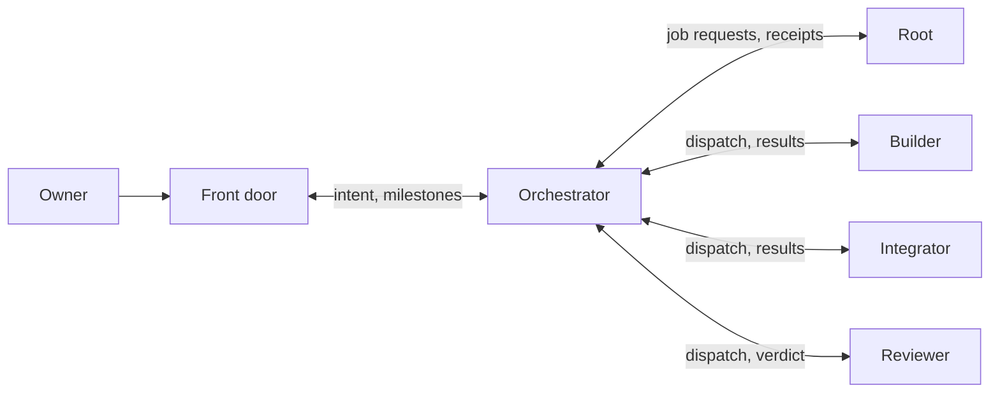

# Host-neutral hierarchy pilot prototype

This source-checkout prototype supplies six role contracts, plain-file mailboxes,
stable endpoint bindings, checkpoint handoffs and a workspace controller. The stdlib-only
helper is `tools/hierarchy_mailbox.py`; it is outside Aegis core and is not installed
in the wheel. No process watches folders or tracks repository work for Aegis, and only
`tools/hierarchy_wake.py` starts a host, when root runs it with a reviewed profile.
Host configuration, manager policy/membership and release gates are unchanged.

## Role contracts



| Role | Runs | Manifest form | Owns | Must not |
| --- | --- | --- | --- | --- |
| Front door | Always on | `<hierarchy>/front-door` | Owner intent, acceptance, escalation, plain-language status | Relay resources or technical traffic |
| Orchestrator | Always on | `<hierarchy>/orchestrator` | Task breakdown, lane briefs, judging evidence, draft PR metadata, reading CI | Edit source, run jobs, launch sessions |
| Root | Always on | `<hierarchy>/root` (optional) | Launching and binding sessions, capacity ledger, jobs through its fixed controller | Make technical or acceptance calls |
| Builder | On demand | Lane kind `implementer` | Leased source edits, tests first | Push, use GitHub, start heavy jobs |
| Integrator | On demand | Lane kind `integrator` | Cross-cutting fixes and preparing the candidate from exact frozen source | Add feature scope, push, use GitHub, start heavy jobs |
| Reviewer | On demand | Lane kind `reviewer` | Independent verdict on exact source and baseline | Edit anything, or review its own work |

Only Builders and Integrators edit repository source. The owner approves scope, signs
governance/manager activation and merges every PR. Messages, receipts and SHIP
recommendations grant no authority.

**Why these roles.** Live use produced 61.1 mailbox messages per dispatch. Reviewers had
no file access, so source was mailed to them. Root did the physical work with no
endpoint, so its requests travelled through the front door as generic messages. Every
rotation was a front door or an orchestrator, because those roles stay in the loop for
every step.

**Decision.** A new role needs different authority or tools, or independence from
someone else's work, and cannot be something a script, assistant or assignment type
could do. Always-on roles stop at three. Further roles run on demand and are added one
at a time, kept only if they catch defects others miss or improve the baselines.

**Consequences.** Latency should fall through fewer relays and no mailed source; that is
a hypothesis until a trial beats the baselines. Complexity grows by one endpoint role,
two message types, a ledger and per-role launch profiles on each host. Cost adds no
always-on session or cloud resource. Root stays a single point of waiting.

Host-neutral role prompts and hierarchy/lane briefs are under
`tools/hierarchy_templates/`. Front doors write intent; orchestrators turn it into
executable lane briefs after source and ownership checks. Every lane brief repeats
the goal and acceptance and pins base, branch, worktree, lease, paths and tests.
Use a new brief file/hash and explicit redispatch for a scope revision.

Claude subagent profiles are templates under `claude-agents/`, not automatically
installed settings. The writer uses an already prepared worktree; it has no
automatic worktree isolation setting. The reviewer uses an explicit read-only
tool allowlist with no shell, delegation, Skill or repository write tools. Plan mode alone
can be overridden by the parent, and memory can add writing tools. Keep memory
disabled. A dedicated mailbox-only MCP connection lets the reviewer acknowledge
and report under its own pinned endpoint. It cannot use the orchestrator's
connection. Probe effective tools in the installed host before relying on either profile.
[Claude subagent contracts](https://code.claude.com/docs/en/sub-agents).

## Prepare a mailbox

Use Python 3.9+ and the helper from an exact reviewed prototype revision. Git is
needed only for writing-lane readiness inspection. All JSON request paths and the
mailbox root are absolute. Prepare the mailbox parent directory first, keep briefs
in that parent or its subdirectories, and keep the root outside implementation
worktrees (for example `aegis-guides/mailbox`). The manifest has no host fields.

```sh
python3 /absolute/prototype/tools/hierarchy_mailbox.py \
  --root /absolute/aegis-guides/mailbox init \
  --request /absolute/prototype/tools/hierarchy_templates/manifest.json
```

Initialization creates an immutable manifest and folders `<hierarchy>/<role>/`
and `across/<role>/`. The supplied two-hierarchy manifest explicitly pairs lanes;
there is no ambiguous routing when more lanes are added. It caps concurrent
accepted writing lanes at three, including integration lanes. It establishes no
Git lease or manager membership. Manifest changes require a new reviewed pilot
root; do not edit its history in place.

Fill in `binding.json` for every endpoint, using the actual host/session labels:

```sh
python3 /absolute/prototype/tools/hierarchy_mailbox.py \
  --root /absolute/aegis-guides/mailbox bind \
  --request /absolute/aegis-guides/requests/a-front-door-binding.json
```

Stable endpoints look like `a/front-door`, `a/orchestrator`, `a/lane/f2` and
`a/lane/review`. Host/session and generation are metadata on immutable binding
records. Initial binding uses `expected_generation: 0`. Branches, owner labels,
briefs and leases name stable hierarchy/lane identities, never the host.

## Publish and receive

Substitute the message template's current sender binding, brief path and SHA256
of its exact bytes. A front-door intent message uses type `brief`; an orchestrator
assignment to its own lane uses type `dispatch`. Generic peer information uses
type `info`. Each file has a JSON header between Markdown frontmatter delimiters
and a plain-text body. The helper adds UTC time and explicit information-only and
verification metadata. Host-native messaging may nudge a reader but is not the record.

Publication returns the file's `path` and raw-byte `sha256`. A front door with
only mailbox tools can author its complete intent as an `info` message to its
orchestrator, then send a `brief` message referencing that immutable file/hash.
The informational Markdown file itself is the hierarchy brief; its hash covers
the header and body together. An orchestrator can author a lane brief the same
way, then reference it in the lane's dispatch. No extra file writer or hash tool
is required. Keep these artifacts immutable; a revision is a new file/message.

```sh
python3 /absolute/prototype/tools/hierarchy_mailbox.py \
  --root /absolute/aegis-guides/mailbox publish \
  --request /absolute/aegis-guides/requests/a-f2-dispatch.json
python3 /absolute/prototype/tools/hierarchy_mailbox.py \
  --root /absolute/aegis-guides/mailbox inbox --endpoint a/lane/f2
python3 /absolute/prototype/tools/hierarchy_mailbox.py \
  --root /absolute/aegis-guides/mailbox status
```

Inside one hierarchy, front door and orchestrator communicate vertically, as do
orchestrator and lanes. Across hierarchies, only explicitly paired counterparts
communicate. No front-door/lane or cross-hierarchy diagonal route is accepted.
A counterpart can exchange a brief but cannot dispatch another hierarchy's lane.
Every message ID is unique across the mailbox. Reuse is refused without replacing
bytes; a retry can inspect the original using `inbox`.

Acknowledgments use type `ack`, `in_reply_to`, and `acknowledgment` equal to
`received`, `accepted` or `completed`. Replies must reverse the original endpoints.
Receiving information, accepting execution and completing work are separate claims.
Use the current sender binding on each. No message type approves, signs or merges.

Writing-lane dispatch acceptance requires `readiness` using the supplied template.
The helper checks worktree root, current branch, base ancestry, declared expiry and
scan-workspace equality; it enforces distinct active worktrees, branches and lease
references and the writer cap. It does not verify that a lease exists or its scope,
that scan/hook evidence was observed, or that tests ran. Lease OIDs/evidence
references are data, not fetched proof. The orchestrator must verify actual live
leases, overlaps, scan activity and the effective hook tier before execution.
Read-only reviewers need no writing lease/readiness and do not consume writer slots.

A result message uses type `result` (or `review`), replies to its accepted dispatch,
and includes `result.json`'s full commit/tree IDs and check/evidence references.
Writing lanes also supply a committed lane-check reference. A completed dispatch
cannot be accepted or completed again. Failed, partial and not-run checks stay
explicit. The helper never executes a command, path or URL found in evidence.
Readiness and active checkpoints execute only bounded, fixed Git inspections.

## Know whether a message was read

Publishing only writes a file, and nothing watches the folders. A stopped session
receives nothing until something starts a turn for it, so report three states:

| State | Meaning | Evidence |
| --- | --- | --- |
| Published | The file exists | The mailbox message |
| Woken | A host process was started for a turn | A wake receipt, written once the process exists |
| Read | The session's adapter returned the message | A read receipt |

Start each role's adapter with `--delivery-dir /absolute/delivery` to record read
receipts. The directory must be outside the mailbox root, which stays immutable, and
an adapter without the flag writes nothing. A CLI `inbox` never counts as a read,
because root and other tools use it too. A receipt is written only after the response
has been written and flushed. If the response fails, or a receipt cannot be written, the
message stays unread, which errs toward waking the session again.

```sh
python3 /absolute/prototype/tools/hierarchy_mailbox.py --root /absolute/mailbox \
  delivery --delivery-dir /absolute/delivery --endpoint a/orchestrator
python3 /absolute/prototype/tools/hierarchy_mailbox.py --root /absolute/mailbox \
  delivery --delivery-dir /absolute/delivery --message-id a-note-1
python3 /absolute/prototype/tools/hierarchy_wake.py --root /absolute/mailbox \
  --delivery-dir /absolute/delivery --endpoint a/orchestrator \
  --profile /absolute/wake-profile.json
```

`hierarchy_wake.py` starts one turn from a strict profile (`tools/hierarchy_templates/wake-profile.json`)
that must match the current binding. It passes a fixed prompt with no message content,
so a message cannot steer the launch. It refuses when another process names the session
or the Claude session table lists it as live, stops the turn's whole process group
before reporting, and exits 0 only if the messages were read, 3 if they were not, and
2 if it refused. Use `--dry-run` to see what would happen. It supports POSIX only.

Hosts offer no handshake, so a wake receipt proves a process existed, not that the host
ran a turn; check `last_wake` for its exit code. If the process cannot be created, the
message is not counted as woken. If its start cannot be recorded, the process is stopped.
A read receipt shows the adapter returned the message to the connection configured for
that binding. It does not prove the session understood or acted on it, and a session
that reads the mailbox files directly leaves no receipt.

## Scoped mailbox MCP access

A host without general workspace writes can use the same file protocol through a
dedicated stdio adapter. `tools/hierarchy_templates/mailbox-mcp.json` is a registration
proposal only; nothing installs or activates it. Replace its exact source-pinned
interpreter/helper, mailbox root, endpoint, host, session and generation. Each role
needs its own connection. The reviewer profile embeds its own server definition;
it must not inherit the orchestrator's sender binding.

By default the adapter advertises exactly `mailbox_inbox`, `mailbox_publish` and
`mailbox_ack_handoff`. Root gets no adapter, because grants and job runs stay out of
anything a model session can call. Sender identity and root come only from process startup;
tool arguments cannot choose them. Every call rechecks the current binding and
the manifest digest; mutations check under the same exclusive writer lock. An
old running adapter is refused after replacement. This is configured provenance,
not authenticated host identity. The adapter speaks baseline stdio MCP 2024-11-05.

`mailbox_inbox` accepts optional `include_briefs`, `limit` and `after_message_id`.
It returns only this endpoint's incoming messages and, when requested, their
hash-verified brief text. A front door therefore needs no arbitrary filesystem
reader. Results page at 20 messages by default, up to 100; `remaining` and
`next_after` make omissions explicit. The CLI offers `--include-briefs`, `--limit`
and `--after` for the same behavior. `status` and historical files remain available.
The inbox also returns only this endpoint's current `binding`, including its
checkpoint, canonical checkpoint hash and readiness. With `include_briefs`,
`checkpoint_briefs` contains the checkpoint's hash-verified brief text, including
outgoing briefs that would not occur in incoming messages. A replacement can
inspect its own checkpoint before acknowledging it without a controller relay.

`mailbox_publish` takes the message fields except `from`, `host`, `session` and
`binding_generation`, which the adapter supplies. It validates nested fields with
the same file protocol and cannot claim leases, edit source, run supplied commands
or invoke manager policy. `mailbox_ack_handoff` accepts only `checkpoint_sha256`
and is available to a successor before its binding is ready. A restricted reviewer
can thus receive, accept and report independently with source-read tools plus these
three narrowly scoped mailbox tools.

With `--workspace-store /absolute/store --initiative <id>`, the adapter adds read-only
views by role. Grants, releases, claims and other changes are never offered.

| Role | Extra tools |
| --- | --- |
| Front door | `workspace_initiative` |
| Orchestrator | `workspace_capacity`, `workspace_initiative` |
| Builder, Integrator | `workspace_path_overlap` |
| Reviewer | None |

A tool list limits a session only if it has no shell or write tools.

## Replace a host/session

Stop the outgoing session first. Then generate the replacement request, or use the
command below for several endpoints at once:

```sh
python3 /absolute/prototype/tools/hierarchy_mailbox.py --root /absolute/mailbox \
  draft-handoff --request /absolute/draft-request.json
python3 /absolute/prototype/tools/hierarchy_handoff.py --spec /absolute/handoff-spec.json
```

A draft request has `endpoint`, `host`, `session` and `outgoing_stopped`, plus optional
`completed_checks`, `briefs`, `evidence_dir` and `delivery_dir`. The draft collects
active dispatches, open job requests, their briefs, lease refs and source witnesses
from the record. Its output is the request for `bind`. `hierarchy_handoff.py` drafts
and binds each entry in `tools/hierarchy_templates/handoff-spec.json`, reports a failure
on one without hiding or blocking the others, and leaves finished entries alone when
run again. Each successor still acknowledges separately through its own connection.

A source witness carries a digest of the exact `git status --porcelain=v1 -z
--untracked-files=all` bytes and an entry count, with the raw status in `evidence_dir`
if given. This replaced a literal status field whose 4096-character limit blocked real
rotations; one worktree reported 3,079,233 bytes. Bindings that hold the literal form
still validate.

By hand, fill in `checkpoint.json` with unchanged brief
hashes, source revision/tree and dirty state, lease refs, completed checks, pending
message IDs and last acknowledgment IDs. Active dispatches and their unchanged
briefs must be retained. Accepted writing work also requires its lease reference
and a source snapshot matching the current commit/tree/dirty state and original
branch. The original acceptance record retains the lease object/expiry and branch.
Front doors without a checkout may have an empty source list. Quiescence is an operator claim, not
native enforcement.

Publish a replacement binding request with the same endpoint, a new host/session,
`expected_generation` equal to the current generation, and the checkpoint object.
The new binding is immutable and initially not ready. Its returned
`checkpoint_sha256` hashes canonical checkpoint JSON. The successor reads the
checkpoint and inbox, then acknowledges it:

```sh
python3 /absolute/prototype/tools/hierarchy_mailbox.py \
  --root /absolute/aegis-guides/mailbox ack-handoff \
  --request /absolute/aegis-guides/requests/a-f2-handoff-ack.json
```

The acknowledgment JSON has exactly `endpoint`, `generation`, `session` and
`checkpoint_sha256`. The old sender generation is rejected after replacement; the
successor cannot publish or receive a new dispatch until this acknowledgment.
Historical messages retain their original provenance. Existing accepted assignments
belong to the stable endpoint and survive the handoff. The protocol cannot prevent
the old same-user process from editing directly. Rotate sessions after 45 minutes
active; the pilot's deliberate mid-wave replacement tests this same handoff.

## Root and job requests

A hierarchy can declare `<hierarchy>/root`, routed only to its own orchestrator. An
orchestrator sends `job_request` with a hash-bound packet in `brief`. Root answers with
`job_receipt`, which replies to that request and carries a `receipt`:

| State | Requires | Closes the job |
| --- | --- | --- |
| `started` | Nothing | No |
| `unknown` | `reason` | No, so an uncertain job stays open |
| `refused` | `reason` | Yes |
| `completed` | `exit_code` 0 and `evidence` | Yes |
| `failed` | Nonzero `exit_code` and `evidence` | Yes |

Evidence entries are `{"path", "sha256"}` references. They stay inert: the mailbox
checks their shape and never reads them. A receipt is a claim, and it stays
`information_only`. Open jobs must appear in a replacement checkpoint. Root publishes
receipts with the CLI, and manifests without a root endpoint keep working.

## Run several initiatives

| Level | Who | How many |
| --- | --- | --- |
| Workspace | Root, initiative registry, capacity ledger | One |
| Project | Front door | One per project |
| Initiative | Orchestrator and its own mailbox root | One per initiative |
| Assignment | Builder, Integrator, Reviewer | On demand |

Give each initiative its own mailbox root. Manifests are immutable, so a new initiative
then needs no change to any other root, and calls stay fast because each one rereads its
root's whole history. Root runs `tools/hierarchy_workspace.py` against one store:

```sh
python3 /absolute/prototype/tools/hierarchy_workspace.py --store /absolute/store init --request /absolute/limits.json
python3 /absolute/prototype/tools/hierarchy_workspace.py --store /absolute/store register --request /absolute/initiative.json
python3 /absolute/prototype/tools/hierarchy_workspace.py --store /absolute/store request --request /absolute/slot-request.json
python3 /absolute/prototype/tools/hierarchy_workspace.py --store /absolute/store grant-next --kind writer
python3 /absolute/prototype/tools/hierarchy_workspace.py --store /absolute/store check-paths --request /absolute/paths.json
python3 /absolute/prototype/tools/hierarchy_workspace.py --store /absolute/store report --format text
```

The other commands are `update`, `withdraw`, `release`, `status`, `mark-merge`,
`clear-base-moved` and `check-delivery`. Exit 0 means success, 3 means a rule said no
(no grant, a path conflict, not ready for delivery), and 2 means refused or malformed.

- **Same repository:** `check-paths` reads leases from every registered checkout, using
  the real Aegis reader and overlap rule, because leases in independent clones cannot
  see each other. Each initiative lists its `lanes`, because linked worktrees share
  lease refs, so seeing a lease proves nothing about who holds it. A lease is an
  initiative's own only if its lane is assigned there and it is visible through that
  initiative's checkout. Any other overlapping lease, or an unreadable checkout, is a
  refusal, and the shared front door settles it using the owner's priority order.
  Declared `touched_paths` only warn. A clear result is advice, not a lock.
- **Writers and heavy jobs:** `grant-next` applies the owner's priority, oldest request
  first. Accepted work is not preempted, and an unlisted initiative is refused. A
  reservation is released only with terminal evidence whose hash matches.
- **Dependencies:** `blocked_by` holds an initiative until its blockers are done. An
  unknown blocker holds until it is removed. After an owner merge, `mark-merge` marks
  other initiatives on that branch, and `check-delivery` refuses them until
  `clear-base-moved` names the latest moved base with evidence.
- **Across projects:** information belongs on the board described in
  [the board contract](workspace-board-contract.md), once one exists. Work goes through
  each project's own orchestrator, because separate mailbox roots have no route and an
  endpoint can have only one counterpart.

Many initiatives can be open at once, but only three can be writing at any moment and
heavy jobs run one at a time. The limits are code constants, so raising them is a
reviewed change for the owner to decide after measuring the machine. The store is a
same-user record, not a security boundary, and it detects damage only when that breaks
its history.

## Role-based assistants

Each role can have a fixed list of assistants with one small job each. They read and
report, and the main session decides. The lists are in
`tools/hierarchy_templates/claude-agents/assistants-*.json`, and each file is a valid
`--agents` value. Nothing installs them.

| Role | Assistants |
| --- | --- |
| Front door | `inbox-digest` |
| Orchestrator | `brief-checker`, `log-reader` |
| Root | None; routine work belongs in scripts |
| Builder, Integrator | `code-locator`, `failure-reader` |
| Reviewer | `usage-tracer`, `coverage-mapper` |

Assistants use `Read`, `Grep` and `Glob` only, one level deep and two at a time, with no
sender, lease or job slot and no tests or builds. Their time counts against the main
session's 45 minutes. Their output is a lead to verify, never evidence, and it cannot
count as independent review. For a Claude session, launch with `claude --agent <role>`
and `Agent(<names>)`, set `CLAUDE_CODE_MAX_SUBAGENT_SPAWN_DEPTH=1` and
`CLAUDE_CODE_MAX_CONCURRENT_SUBAGENTS=2`, and leave `memory` unset because it adds write
tools. A parent can override `permissionMode`, so the allowlist has to be the control.

Keep Codex assistants off with `agents.enabled = false` until a live probe. Codex
documents that assistants inherit the parent's sandbox and approvals, that a custom
agent cannot override `mcp_servers`, and no allowlist of named agents. See the
[Claude](https://code.claude.com/docs/en/sub-agents) and
[Codex](https://learn.chatgpt.com/docs/agent-configuration/subagents.md) docs. Using
assistants needs the owner's go-ahead, and these definitions have not been run on a
live host.

## Evidence and manager overlay

The manifest, immutable bindings and messages supply external attribution by
hierarchy, role, lane, host and generation. Preserve raw Aegis `team metrics` as
repository totals: linked worktrees share the events log while scan activity is
per worktree. Record tool/source versions, worktree, branch and time interval with
each evidence artifact; never relabel repository totals as per-host observations.
`status.mailbox_message_counts` counts only this mailbox's files by sender host
and endpoint; `accepted_writers` lists unclosed writing assignments, not observed
running processes. These counters provide no Aegis metrics or native activity proof.

The existing manager API can audit `hierarchy`, `delegation`, `checkpoint`,
`handoff` and `evidence_review` decisions. Reference mailbox IDs and hashes in its
bounded summary and qualified evidence references. No new manager arguments or
tools are introduced. Manager audit acknowledgments, mailbox delivery, acceptance,
claimed completion, owner approval and verified repository evidence stay distinct.
New lane worktrees are not manager-enrolled by this helper; their membership needs
the existing separate owner review/activation. See [manager mode](manager-workspaces.md).

## Acceptance and limitations

The public subprocess suites are `tests/integration/test_hierarchy_mailbox.py`,
`test_hierarchy_mailbox_mcp.py`, `test_hierarchy_delivery.py`, `test_hierarchy_handoff.py`,
`test_hierarchy_root_role.py`, `test_hierarchy_workspace.py`, `test_hierarchy_role_tools.py`
and `test_hierarchy_templates.py`. They stub host processes at the subprocess boundary, so
they do not show that a real Claude or Codex session wakes, reads its mail or honors a
tool list. Those are live gates and remain open for this code.
`tests/integration/test_hierarchy_scenario.py` adds a simulated two-hierarchy run
with real linked worktrees, public Aegis lease/scan/lane commands, acted-on peer
messages at all three layers and a host-label replacement preserving assignment.
It exercises routing, hashes, immutable publication, acknowledgments, readiness,
writer isolation, handoff and malformed/corrupt inputs in temporary directories.
Local simulated host labels do not establish that actual Claude/Codex sessions
read messages or that host hooks fire. Before the live pilot, verify exact host
versions, Git worktree metadata after the directory move, lane-local scan/MCP
binding, blocked unscanned edits and live warning/startup context. S1 delivery and
C1/C2/C3 host integration remain separately gated; this helper implements none of
those hook changes. Keep release work and Stormheir out of the pilot.

For live Phase 1, exchange an acted-on message at each counterpart layer, perform
one stopped-session host replacement with the same brief/lease/branch, and collect
lane-check, independent-review and exact-commit CI evidence. The owner merges the
two PRs. Delivery/acknowledgment alone cannot close that gate.

Mutation uses one exclusive local writer lock and complete-file hard-link
publication with no overwrite. A contending writer fails explicitly; retry only
after checking the original message/binding. A crashed writer can leave a lock or
pending file: inspect the process/history before manual recovery. The helper does
not delete/repair history or hide malformed records. `status`, `inbox` and `delivery`
are read only. Inputs and every serialized durable record are bounded to 256 KiB, including
Unicode expansion. Histories are capped before append at 10,000 messages per
mailbox and 10,000 bindings per endpoint; refusal leaves prior history readable.
Symlinks and nonregular inputs are refused. Storage runs under the same local user,
does not authenticate a host/session, and is not a hostile-process security boundary.
Atomic visibility is not a claim of filesystem crash recovery. Local Linux checks
establish no Windows filesystem or physical-host acceptance.
