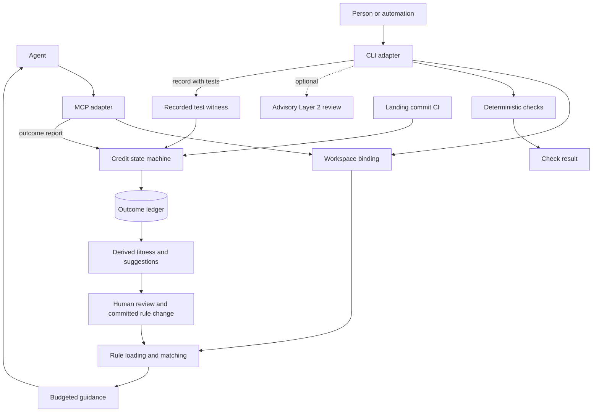

# Architecture

Aegis keeps rules in the repository, delivers matching guidance before an edit,
checks changes, and records evidence about the result. The CLI and MCP server use
the same core services. The agent's report, a local test result, and confirmation
from the landing commit's CI are separate inputs with different authority.

Start with [how Aegis works](how-it-works.md) for the workflow and rule format.
The [reference](reference.md) lists every public command and MCP schema.

## Components

| Component | Responsibility | Boundary |
|---|---|---|
| `aegis_core` | Workspace resolution, rules, matching, checks, evidence and fitness | Imports no CLI, MCP or SDK code; internal layers depend only on their own layer or lower layers |
| `aegis_cli` | Commands, installation, host hooks and human-readable output | Calls core services; does not import MCP or SDK adapters |
| `aegis_mcp` | Tool schemas, session binding and tool handlers | Calls core services; does not import CLI or SDK adapters |
| `aegis_sdk` | External Python facade through `Governance` and `parse_rule_file` | Calls core services; production adapters do not depend on it |
| Host integrations | Bootstrap instructions, MCP registration and optional hooks | Run with the user's permissions; host behavior determines what reaches Aegis |
| Git and CI | Commit identity, reviewed policy and landing evidence | Local hooks are bypassable; required CI and branch protection provide the review boundary |

The Python runtime uses only the standard library. Some operations invoke external
programs: Git for repository operations, the user's `gh` for GitHub evidence,
configured test commands, the opt-in Go parser and user drivers, and an explicitly requested
Layer 2 model command. Zero runtime dependencies does not mean every operation is
self-contained or offline.

## A scan and a check answer different questions

A scan answers which guidance applies to the named files. The shared rule loader
fails if any rule file cannot be loaded. Matching uses repository-relative paths;
mandatory rules take priority, with a slot cap and explicit omission reporting.
The response also has a token budget. In Git, binding rules come from the selected
base rather than branch-local edits; the response identifies that base and whether
it is review-witnessed. A local-HEAD fallback is not reviewed-base evidence.

A check asks whether a change meets the enabled deterministic checks. Layer 1
covers rule validity, applicable AST constraints, introduced security findings and
other code checks. The Git pre-commit hook checks staged content. CI checks the
candidate commit and governance changes. The optional Layer 2 verdict is advisory:
it does not change the exit status determined by Layer 1 or award rule credit.
A failed model invocation or test discovery still makes the command fail.

Workspace resolution happens before guidance is served. An operator pin has
priority, followed by host context, registered workspaces and a bounded directory
walk. Conflicting context holds the request rather than choosing silently. When no
workspace is governed, MCP can serve the read-only personal rule layer without
writing repository state. See [workspace binding](hosts-and-hooks.md#workspace-binding).

## Evidence and state

| State | Writer and purpose | Authority |
|---|---|---|
| `.aegis/rules/`, repository configuration and team policy | Reviewed repository changes | Policy; repository settings cannot choose arbitrary executable commands |
| `~/.aegis/config.json` | Operator | Command-like settings, including test and custom driver commands |
| `.aegis/state/activity.jsonl` | Scans and edit bookkeeping | Recent scan coverage; not proof that guidance was followed |
| `<git common dir>/aegis/state/<ws-id>/ledger.jsonl` | Checks, reports and evidence processing | Append-only rule evidence, shared by worktrees of the same workspace |
| `<git common dir>/aegis/events.jsonl` | Hooks, teams and other commands | Operational events; never used for fitness or scan compliance |
| `refs/aegis/lanes/<lane>` | Team commands | Cooperative path claims, not locks or identity |

Outside Git, the ledger and events log live under `.aegis/state/`. The full storage
map and retention details are in [how Aegis works](how-it-works.md) and
[PRIVACY](../PRIVACY.md).

For an outcome report to use a local test witness, a passing
`aegis check --record --tests` row must cover the exact Git tree. A report without
that witness is an unwitnessed claim and earns no rule credit. A `--record` check
without tests is not a test witness. Rules eligible for report credit come from
the session's scans and matching diff, not an agent-supplied list of rule IDs.
Confirmation from the landing commit's CI is a further step; local success alone
does not establish it. Reviewed adjudications are a separate evidence path.

Fitness is derived from the ledger; `aegis sync` computes suggestions. Applying a
suggestion is an explicit action that changes files for review. Host hooks and
team events do not silently promote rules.

## Failure and extension boundaries

Rule-load failures stop scans and checks rather than serving a partial rule set.
An enabled AST check cannot treat an unparseable governed file as a pass. A host
hook has a different contract: errors and deadlines fail open so the host can
continue. Missing evidence cannot be promoted into confirmed evidence. These
boundaries are described in [SECURITY](../SECURITY.md),
[hosts and hooks](hosts-and-hooks.md), and [trust tiers](trust-tiers.md).

Python, TypeScript/JavaScript and Rust parse in process; native JS/TS and Rust
need no language runtime or repository dependencies. Opted-in Go uses a packaged
standard-library parser built into the user cache, then one bounded NDJSON batch
process per check. A check-local AST session reuses parsed facts across rules,
security head/base comparisons and structural checks. Custom user-scope drivers
retain the per-file protocol; repository settings cannot select a command.

Missing driver coverage produces advisory `unverified no_driver` evidence, blocking
under ordinary `--strict`. Oversized native sources produce advisory `too_large`;
a configured driver or active parser failure fails closed. Parsing is syntactic,
without type resolution or Rust macro expansion. [Language checks](languages.md)
describes extraction coverage, matching and evasion bounds.

Test execution consumes pure user-command plans, prepares installed runtimes outside
the repository, and retains namespaced outcomes with completeness and mapping errors.
Recorded checks and commit replay share the same snapshot recipe. A global command
has precedence; automatic language runs require complete evidence from every selected
language. Coverage keeps per-language availability and remains report-only. User
commands execute repository code: offline defaults are not a network sandbox.

The SDK offers a Python integration surface, while host adapters supply workspace
and tool-call context. Shared operations keep the same core semantics and authority;
CLI-only setup, checks and release actions do not require duplicate MCP tools.
Neither adapter gives model output authority over deterministic checks.
