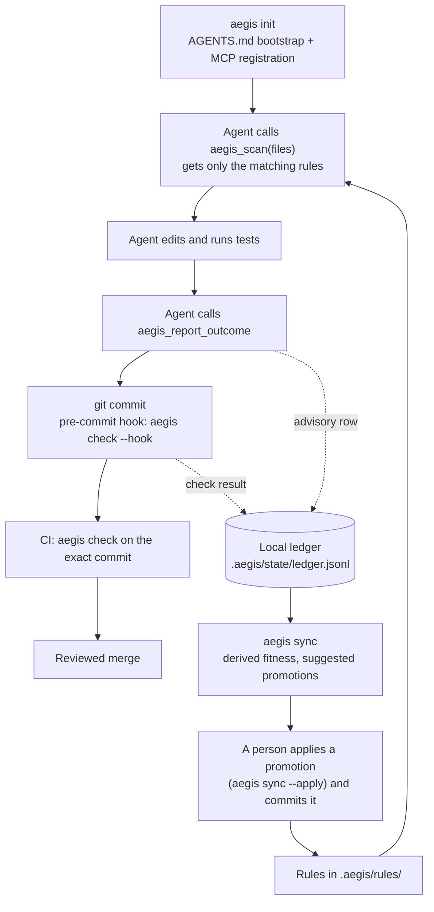

# How Aegis works, end to end

This page follows one change from an agent's first tool call to a merged commit, and explains each part of Aegis on the way: rules, just-in-time delivery over MCP, checks, the evidence ledger, hosts and enforcement. It describes Aegis 4.3: section 8 covers what 4.1 adds (agent hooks, teams and skills), section 9 covers what 4.2 adds (adoption tools), and section 10 covers what 4.3 adds (trust and evidence).

For a two-minute setup, start with the [README](../README.md). For every command, flag and MCP tool schema, see the generated [reference](reference.md). For why Aegis is built this way, and what went wrong before v4, see [Why Aegis is built this way](why-aegis.md). The decisions behind this page are in ADR 0005 and ADR 0006.

## 1. The loop



1. **Bootstrap.** `aegis init` writes a short marked block into `AGENTS.md` and registers the `aegis` MCP server with the hosts you name. The block holds no rule text; it tells the agent to call `aegis_scan` before editing and `aegis_report_outcome` after verifying.
2. **Scan.** Before editing, the agent calls `aegis_scan` with the files it plans to change. Aegis returns the few rules whose `target_paths` match those files.
3. **Edit and report.** The agent edits, runs its tests and calls `aegis_report_outcome` with the rules it used. When a passing `aegis check --record` row exists for the exact git tree, it credits the rules served in that session; otherwise it records one `claimed` row that never counts as evidence.
4. **Check.** `git commit` runs `aegis check --hook` (Layer 1 only, never a model call). CI runs `aegis check` and `aegis check --ci` on the pull request (section 5).
5. **Learn.** `aegis sync` rebuilds each rule's standing from the ledger and suggests promotions or demotions. Nothing changes until a person applies a suggestion (`aegis sync --apply` or `aegis sync --pr`) and commits it.

## 2. What lives where

| Path | Committed? | What it holds |
|---|---|---|
| `.aegis/config.json` | yes | `hosts`, `jit.max_tokens`, `jit.scan_window_s` (how recent a scan must be for the edit hook, section 8), rule `expiry`, `ast.packaged_drivers`. It can never name a command: such keys are ignored with a warning. |
| `.aegis/rules/<type>/*.md` | yes | the rules, one file each |
| `.aegis/team.json` | yes | optional: the `shared` globs any lane may change and committed per-lane paths (section 8) |
| `.aegis/.gitignore` | yes | ignores `state/` |
| `.aegis/state/` | no | `ledger.jsonl` (outcomes), `activity.jsonl` (scans and edits per session), `derived.json` (written by `aegis sync`), `lock` |
| `AGENTS.md` | yes | one marked bootstrap block; the rest of the file is yours |
| `.claude/skills/`, `.agents/skills/` | yes | skill copies written by `aegis skills sync`, each with an Aegis marker line |
| `refs/aegis/lanes/<lane>` | git ref | a lane's lease, written by `aegis team` |
| `<git common dir>/aegis/` | no | `events.jsonl`, the events log every worktree shares, and its lock |
| `CLAUDE.md` | yes | an `@AGENTS.md` block, only if the file already existed |
| `~/.aegis/workspaces.json` | user | the repos you ran `aegis init` in on this machine |
| `~/.aegis/rules/` | user | an optional personal rule layer, served read-only where no repo is governed |
| `~/.aegis/config.json` | user | the only place for command-like settings, such as an AST driver command |
| `~/.claude/settings.json`, `~/.codex/hooks.json`, `~/.codex/rules/aegis.rules`, `~/.gemini/config/hooks.json` | user | the hook entries `aegis hook install --host` writes (or the repository's `.claude/settings.json`, `.codex/hooks.json` and `.agents/hooks.json` with `--scope project`) |
| `~/.aegis/backups/` | user | a copy of each file taken before Aegis changes it, one timestamped folder per run: the host config `aegis init --host` and `aegis uninstall` merge (Antigravity's `mcp_config.json`), the files `aegis doctor --fix` edits, the host hook files `aegis hook install --host`, `aegis rule insight enable` and `uninstall --host` change, and the pre-commit hook `aegis hook install` (or `init`) rewrites |

Four environment variables are read: `AEGIS_WORKSPACE` (pin the server to one repo, which must hold `.aegis/`; `aegis init --pin` writes it into the registration, and the CLI honors it too, as section 4 describes), `AEGIS_CLIENT` (host identity, written by `aegis init`), `AEGIS_MAX_JIT_TOKENS` (scan budget) and `AEGIS_LLM_CMD` (the Layer 2 model command).

## 3. Rules

A rule is a markdown file with YAML frontmatter. Its directory names its type:

| Type | Directory | Meaning | Served before advisory rules? |
|---|---|---|---|
| `trap` | `traps/` | a known failure mode to watch for | no |
| `invariant` | `invariants/` | must always hold | yes |
| `gate` | `gates/` | a check that blocks a change until it passes | yes |
| `boundary` | `boundaries/` | a sensitive area that needs elevated review | no |
| `persona` | `personas/` | an idiomatic pattern to follow | no |
| `contract` | `contracts/` | an API or data-shape agreement across services | no |

Any rule that declares `enforcement: gate` is also served first. Type and enforcement decide how a rule is ranked and labeled when it is served; what `aegis check` blocks on is a rule's `forbid_ast` patterns (section 5). Here is a rule that `aegis check` enforces:

```markdown
---
id: no-eval
type: invariant
domain: security
enforcement: gate
hypothesis: Agents reach for eval() to parse input
target_paths:
  - "**/*.py"
forbid_ast:
  calls:
    - name: eval
      builtin: true
    - name: exec
      builtin: true
---
Never call `eval` or `exec` on data. Parse it with `json.loads` or `ast.literal_eval`.
```

- **Required fields**: `id`, `type` and `domain`, plus `enforcement` (`gate` or `advisory`) for invariants and traps. An invariant or gate whose enforcement is not `gate` is a "paper gate": it claims to block and enforces nothing, so `aegis check` fails until it is fixed. `hypothesis`, `prediction` and `falsification` say what the rule expects to prevent and what would prove it wrong.
- **`target_paths`** are globs on repository-relative paths. `*` crosses `/`, `**/` matches zero or more directories, a pattern without `/` also matches the file name alone, matching is case-sensitive everywhere, and there is no substring matching. A rule without `target_paths` applies to no file, except a `forbid_ast` rule, which applies to every file.
- **`forbid_ast`** bans `imports`, `calls` or `decorators`. Setting `builtin: true` on a call predicate targets Python's builtin `eval()` and `exec()` (including `builtins.eval` and `__builtins__.eval`) while allowing method calls such as pandas `df.eval()`, PyTorch `model.eval()` and SQLModel `session.exec()`; omitting `builtin: true` (for example `calls: [eval]`) matches any call or method named `eval`. Aliases count (`sp.run()` after `import subprocess as sp` is `subprocess.run()`), and so do `__import__` and `importlib.import_module` with literal names. Computed names, `getattr` and rebinding by assignment are out of reach, because the check is syntactic. A `forbid_ast` rule skips test files unless its `target_paths` name them.
- **Creating rules**: `aegis rule create --type trap --name ID --hypothesis "..." --target-paths 'src/**/*.py' --body-file rule.md` writes the frontmatter for you (`--hypothesis` is required). The `aegis_create_rule` MCP tool turns a concern into a drafting prompt for the agent and writes nothing. `forbid_ast` is added by hand.
- **Starter rules**: `aegis init --rules minimal|standard|full` seeds 2, 5 or all 12 of the shipped [rules](../rules/) as `persona` rules with `target_paths: []`. They apply to no file until you name the files each one governs; `aegis status` and `aegis sync` list them until you do. `aegis init` also seeds one active invariant (`.aegis/rules/invariants/no-eval.md`) from day one unless you pass `--rules none-active`.
- **A file that cannot be loaded stops everything**: the scan fails and names it, and `aegis check` blocks, so a partial rule set is never presented as the whole one.

## 4. Just-in-time delivery over MCP

**The bootstrap.** The `AGENTS.md` block that `aegis init` writes is 572 bytes in a fresh repo. The MCP server sends the same guidance as its `initialize` instructions, which editing files cannot remove. Rule text is never inlined into an instructions file, so it never pushes a host past its size limit.

**The five tools** (schemas in the [reference](reference.md)):

| Tool | What it does |
|---|---|
| `aegis_scan` | the rules that apply to the files about to change (read-only), serving mandatory rules from the reviewed base commit (`rules_base`) |
| `aegis_report_outcome` | records an outcome for the rules served in this session: `recorded` when a passing `aegis check --record` row exists for the exact git tree, otherwise `claimed` (unwitnessed, never counted as rule evidence) |
| `aegis_create_rule` | a prompt for drafting a rule; writes nothing |
| `aegis_list_rules` | every rule with its type, hypothesis and ledger fitness, plus the rules edited since the last `aegis sync` |
| `aegis_capture_insight` | records a redacted human correction at `~/.aegis/insights/<workspace-id>.jsonl` (`suggestion` level, upgraded to `W2` when matched to a hook-captured prompt in the same session) |

**What a scan returns.** One loader reads every rule; if any file fails to load, the scan fails. Rules are matched to the files, then ranked: gates, invariants and other `enforcement: gate` rules first, but they take at most two of the three slots a scan has by default, so a broad mandatory rule cannot starve every advisory one. Mandatory rules that do not get a slot are named in `omitted_mandatory`. Advisory rules are ranked by ledger fitness, read from the ledger alone: scan, `aegis_list_rules`, `aegis status`, `aegis rule list`, metrics and packs never call GitHub, so in a fresh process they rank without CI-confirmed credit (`aegis sync` and the promote, demote and archive decisions verify it). The whole response is clamped to the token budget, 2,000 estimated tokens by default (`AEGIS_MAX_JIT_TOKENS` or `jit.max_tokens`); a rule that does not fit is counted, never silently dropped. `view: "summary"` or `"ids"` returns less. For the rule above, a summary scan of `app.py` returns:

```json
{
  "relevant_rules_count": 1,
  "relevant_rules": [
    {"name": "no-eval", "type": "invariant", "enforcement": "INVARIANT (must not violate)", "fitness": 0.0}
  ],
  "invariant_warnings_count": 1,
  "invariant_warnings": [{"name": "no-eval", "type": "invariant", "tier": "gate"}],
  "rules_staged": 1,
  "omitted_mandatory_count": 0,
  "omitted_mandatory": [],
  "stale_rules_count": 0,
  "stale_rules": []
}
```

Without MCP, `aegis scan FILE...` prints the same rules for a person or a shell-only agent, and records the scan as `aegis_scan` does, so it also satisfies the scan-before-edit hook (section 8).

**Which repository a call governs.** One `aegis-mcp` process can serve sessions in several repos, so every call is bound to a workspace. The first source that names a governed repo (one with `.aegis/`) wins:

1. an operator pin, `AEGIS_WORKSPACE` in the registration; it is strict: a pin that does not resolve, or names a directory without `.aegis/`, is an error, not a fallback, and a pin that disagrees with the workspace the host reports is a hold;
2. what the host itself reports: Codex's per-turn workspace metadata, Claude Code's `CLAUDE_PROJECT_DIR`, or MCP roots;
3. the registry `~/.aegis/workspaces.json`: the files in the call may only choose among repos you registered with `aegis init`;
4. a walk up from the server's working directory that stops at the git top level.

There is no workspace argument a model could set, and `$HOME` or `/` is never a workspace. When sources disagree, the call is held with a machine-readable reason instead of governing the wrong repo. When nothing resolves, the server answers "not governed here", and `aegis_scan` serves only the read-only personal layer in `~/.aegis/rules/`, writing nothing.

The CLI reads the same pin. A command run inside another workspace, or in a git repository that does not hold the pinned one (where that repository's pre-commit hook runs), holds with the reason `pin_conflicts_with_cwd` and exits 1 instead of acting on the pinned workspace: unset the pin there. From outside any workspace and repository, the pin decides.

**Who is calling.** The host id comes from `AEGIS_CLIENT` in the registration (written by `aegis init`, so the model cannot set it), otherwise from the MCP client name, otherwise `generic`. Ledger rows carry `host` and `session` set by the server; a tool argument with the same name is ignored.

## 5. Verification: `aegis check`

**Which files.** Files you name; with `--hook` (the pre-commit hook), the staged files, read as staged; or else the working-tree changes (`git diff HEAD` plus staged), or else what the branch adds to its base (`origin/$GITHUB_BASE_REF` in a GitHub pull request, then `main` or `develop`), or else the last commit. Untracked files are never picked up on their own: `git add` a new file or name it (`aegis check app.py`).

**Layer 1** runs without a network or a model:

- **Checkpoint checks** over the repository: a test file for each source file, hard-coded absolute paths, assertions per test, rules the ledger says misfire, rule conventions and paper gates. They warn unless you pass `--strict`; a paper gate and a rule file that cannot be loaded always block.
- **Per changed file**: a call-graph check (code that is defined but never wired in), an import guard (every import is standard library, allowed or guarded) and every `forbid_ast` rule that applies. A file a `forbid_ast` rule cannot parse fails; it is never skipped. Mutation tests run only with `--full`.
- **Languages**: Python is parsed in process. Drivers for Rust, TypeScript/JavaScript (needs `node`) and Go (needs `go`) ship in the wheel, and `aegis init` turns them on for the languages it detects (`ast.packaged_drivers`). A repository can only opt in to those packaged drivers; any other driver command comes from `~/.aegis/config.json`, so a cloned repo cannot make Aegis run a program it chose. The driver protocol is in ADR 0015.

**Layer 2** is optional: `aegis check --full --plan "what the change should do" --llm-cmd 'claude -p'`. The plan comes from `--plan`, `--plan-file`, or else the first of `docs/plan.md`, `.aegis/plan.md` and `PLAN.md` in the repository; without one, Layer 2 refuses to run. Any command that reads a prompt on stdin and prints a reply works (`codex exec --skip-git-repo-check`, a script). Aegis builds two prompts that never see each other's input: a spec reviewer gets the plan and the function signatures and predicts what could go wrong; a code reviewer gets the implementation, the tests and the Layer 1 results and makes claims about them. An arbiter compares the two by risk category, using Layer 1 as the tiebreaker, without asking a model to judge, and returns `SHIP`, `REVISE` or `BLOCK`. The verdict is advisory: `aegis check --full` exits on Layer 1 alone, a review that does not complete prints `UNVERIFIED`, and only a model command that cannot run, or a test discovery that fails, still makes the check exit 1. The command runs in an empty temporary directory, never in the repository, so the code under review cannot steer its reviewer through project config; and it comes only from `--llm-cmd` or `AEGIS_LLM_CMD`, never from a file in the repository. **This sends your change to whichever vendor the command calls.**

Use a reviewer from a different vendor than the agent that wrote the change. A model reviewing its own vendor's output tends to share its blind spots, and the Aegis release process itself requires a cross-vendor `--llm-cmd` review (ADR 0005 AD-10). `aegis check --calibration` scores the arbiter's logged predictions against outcomes with Wilson 95% confidence intervals and Brier skill scores (section 10); in v4.3 the arbiter's LLM predictions stay log-only until their calibrated record earns a binding gate.

**The git hook.** `aegis init` installs a pre-commit hook (`aegis hook install|status|uninstall` manage it) that runs `aegis check --hook`: Layer 1 only, never a model, on the staged content, which is what `git commit` records, whatever the working tree holds. In an existing shell hook the Aegis block goes right after the shebang, so it runs before the hook's own lines (an `exec` or `exit` there would otherwise skip it), and the old file is first copied to `~/.aegis/backups/<UTC stamp>/`. A hook written in another language is refused, and `aegis init` then writes nothing: `aegis hook install --force` replaces it (keeping the copy), or call `aegis check --hook` from it yourself. `aegis hook status` and `aegis doctor` report a block git never reaches, such as a hook file that is not executable or an `exec` before the block. `git commit --no-verify` skips the hook, which is why CI matters.

**CI.** On GitHub Actions, check out with `fetch-depth: 0` so the base branch is there, then run `pip install aegis-guardrails && aegis check` (the [README](../README.md) has a complete snippet). Plain `aegis check` checks the pull request against the rules in the pull request itself: a pull request that deletes a rule and breaks it passes. `aegis check --ci` catches that (section 10): it compares mandatory rules against the merge base and passes a rule weakening only when the branch carries a signed `aegis approve` commit. Review changes under `.aegis/` and to the CI workflow like code.

## 6. Evidence: the ledger and `aegis sync`

**The ledger** is `<git common dir>/aegis/ledger.jsonl` (or `.aegis/state/ledger.jsonl` outside git), append-only, one JSON row per event:

- `aegis check` (and the pre-commit hook) appends one row per matched rule per run, and `aegis check --record [--tests]` binds the working tree to its exact git tree hash (`witness: aegis`).
- `aegis_report_outcome` credits the rules served in that session when a passing check row exists for the exact tree; otherwise it records one `claimed` row per session and tree that never counts as evidence.

**Fitness and sample-size states** are computed on read: `aegis sync` evaluates CI-confirmed checks, git detector replay over merged history for `forbid_ast` rules (`caught` vs `leaked`), and human-adjudicated labels, with session-count decay `w = 2^(-delta / H)` over heartbeat-alive eligible sessions. Each rule reports one of four sample-size states: `untestable`, `insufficient (n=K)` (no precision number shown below `n = 25`), `inconclusive` or `decided`.

**`aegis sync`** is the one writer of derived state. Under the workspace lock it reads the rules and the ledger, writes `derived.json` and prints a suggestion per rule:

- **promote** (trap to invariant, invariant to gate) once independent evidence reaches the promotion threshold (`>= 25` labels with `0` FP or `>= 42` with `1` FP across `>= 3` sessions and `>= 2` repos or `>= 14` days; agent-only self-reports never promote);
- **demote** or **archive** when the bound on the rule's false-positive rate exceeds the demotion threshold.

`aegis sync --apply`, `aegis sync --pr` (which opens a human-reviewed pull request with up to 3 sampled examples per rule, never auto-merging), `aegis rule promote|demote RULE_ID` or `aegis rule archive` moves the rule file; commit it and review it like code. `derived.json` also records a hash of each rule file, which is how `aegis_scan` and `aegis_list_rules` flag rules edited since the last sync. It is not a signature and never excludes a rule.

**Why Aegis never rewrites a rule file on its own.** v3 wrote fitness numbers back into each rule's frontmatter. Its integrity manifest then saw "edited" rules and dropped them, so a scan in the author's own session returned 0 rules, and unlocked rewrites lost about 80 of 120 updates under concurrency. In v4 the ledger is the only record of outcomes and rule files change only when a person changes them (the full account is in [Why Aegis is built this way](why-aegis.md)).

**What the score means today.** When several rules apply to the same file in a check run, they share that check's pass or fail, while `forbid_ast` rules also get per-rule `caught` vs `leaked` replay over git history and `# aegis: allow` contested-override tracking (section 10 and ADR 0006). Unwitnessed agent self-reports (`claimed`) never count as evidence, and promotion stays a reviewed human step.

**Compliance.** `aegis status --compliance` reports each host's scan-before-edit rate from `.aegis/state/activity.jsonl`: per session, how many edited files were scanned first. An edit is a file named in `aegis_report_outcome`, or a file in a commit made during exactly one session. The output states its own limits; a session with no observed edit counts as unknown, never as 0.

## 7. Hosts and enforcement

| Host | Registered by `aegis init --host` | How the server learns the repo | Instructions file (size limit) |
|---|---|---|---|
| `claude-code` | `claude mcp add --scope user aegis -e AEGIS_CLIENT=claude-code -- <aegis-mcp>` | `CLAUDE_PROJECT_DIR`, MCP roots | `AGENTS.md` only when no `CLAUDE.md` exists; otherwise the `@AGENTS.md` block in `CLAUDE.md` |
| `codex-cli` | `codex mcp add aegis --env AEGIS_CLIENT=codex-cli -- <aegis-mcp>` | per-turn workspace metadata | `AGENTS.md` (32 KiB, truncated silently) |
| `antigravity` (app, IDE, `agy`) | an `aegis` entry in `~/.gemini/config/mcp_config.json` | the registry only: it sends no roots | `AGENTS.md` (24,000 bytes per file) |
| `gemini-cli` | never: retired (`init` exits 2 and names `--host antigravity`) | — | — |
| `claude-desktop` | never: identity only | — | — |

A host is the config plane its apps share: `codex-cli` covers the Codex CLI, IDE extension and ChatGPT desktop app; `claude-code` covers the CLI, IDE extensions and the desktop app's Code tab; `antigravity` covers the app, IDE and `agy`; `kiro` (experimental) covers the Kiro IDE and CLI. `--host` accepts surface names too (such as `codex-app` or `kiro-ide`), and `--host auto` discovers hosts via config directories and desktop app bundles as well as CLIs on `PATH`. `<aegis-mcp>` is an absolute command that never depends on the directory a host starts it in (the project, which a cloned repository controls). `init` takes, in order: the `aegis-mcp` script in an absolute `PATH` entry; the `aegis-mcp` script installed next to the Python running `aegis` (a virtual environment's `bin/`, or the user scripts directory after `pip install --user`); else that Python in isolated mode, `<python> -I -c "<run aegis_mcp.server>" <directory aegis is installed in>`, which keeps the current directory off `sys.path`. It never registers `python -m aegis_mcp`: `-m` imports from the current directory first, so a repository with its own `aegis_mcp` package would run its code. `aegis doctor` compares each host's registered command with this one and reports as an unsafe registration one that is not an absolute path, a Python that runs `-m` or `-c` without `-I` or a script by a relative path, or either behind `env`; it starts none of them. Gemini CLI is retired: Google refuses the client for individual Code Assist accounts, so `aegis init --host gemini-cli` and `aegis uninstall --host gemini-cli` exit with status 2 and point to `--host antigravity`, the Gemini-family host. Every host runs `aegis-mcp` unsandboxed with your user's permissions, so the server's own confinement is the only boundary. Repository files never register a server: a committed `.mcp.json` would run whatever command a pull request put there.

**Enforcement tiers**, as `aegis doctor` prints them:

| Tier | Mechanism | Status in 4.1 |
|---|---|---|
| Advisory | AGENTS.md bootstrap, MCP instructions, JIT rules | every host |
| Best-effort | per-host pre-tool hooks | after `aegis hook install --host <h>`: Claude Code blocking (documented; fails open on error); Codex blocking once trusted in /hooks (documented; fails open); Antigravity blocks destructive commands (live), scan gate records only, and is unavailable on Windows (section 8) |
| Local floor | git pre-commit runs aegis check --hook (--no-verify bypasses it) | every host that commits through git |
| Authoritative | CI runs aegis check on the exact SHA; a human merges | your CI and branch protection |

**`aegis doctor`** reads; it changes nothing, reads GitHub only through your own `gh` (read-only requests for the trust tier) and starts no host CLI except `codex mcp get aegis --json` (Codex keeps its registrations in TOML). For each host it reports one state: `missing_binary`, `unregistered`, `auth_unknown` (it cannot confirm the host loads `aegis`), `policy_gap` (the server loads, but the rules do not fully reach the agent, for example a `CLAUDE.md` shadowing `AGENTS.md` or an instructions file past the host's limit) or `ok`. It also shows the host's hook entries and their tier (section 8), and reports the strongest tier known to be in force for that host (`local_floor`, `advisory`, `none` or `unknown`), never a guess: the local floor counts only when the Aegis pre-commit hook is installed, current and reached by git (an earlier `exec` or `exit` in the hook, or a hook that is not a shell script, means it never runs). `--json` prints the same as one document. `aegis doctor --fix` removes only what doctor reported, such as stale v3 `soma` entries, v3 hook entries and legacy instruction blocks, after confirmation, and copies each file to `~/.aegis/backups/` first.

**`aegis uninstall`** removes the hook block, the `AGENTS.md`/`CLAUDE.md` blocks, the registry entry and the host registrations, keeping a host that another registered repo still uses. It never deletes `.aegis/`.

**Upgrading from v3.** `aegis migrate` shows the plan and `aegis migrate --apply` performs it: the v3 ledger becomes `.aegis/state/ledger.jsonl`, the old config files become `.aegis/config.json`, `.soma` rules move to `.aegis/rules/<type>/`, and every changed file is backed up first (the [changelog](../CHANGELOG.md#upgrading-from-3x) lists every file it converts). Then run `aegis init --host <hosts>` to register the server and write the bootstrap, and `aegis doctor --fix` to remove v3 leftovers. Until the workspace is migrated, `aegis status`, `aegis scan` and `aegis sync` refuse to run in it and name the v3 state v4 does not read (a v3 or v2 ledger, `aegis.conf` or `soma.conf`, `.aegis/slots.yaml` or `.aegis/config.yaml`, v3 keys, receipts or rule manifest); `aegis check` warns and still runs, `aegis init` refuses while `.soma/` holds rules, and `aegis doctor` lists the files. In a `.soma` workspace, `aegis doctor` says to run `aegis migrate`, not `aegis init`.

## 8. Agent hooks, teams and skills

New in 4.1. The design is in ADR 0005 AD-7 and AD-8, as amended on 2026-10-16. Claims below carry the evidence labels doctor uses: **LIVE** (probed on a real host), **DOC** (the host's official docs or source, not probed) and **UNVERIFIED** (neither).

### Per-host hooks

`aegis hook install --host <h>` registers one handler, `aegis hook run pre-tool --host <h>`, as the PreToolUse hook of Claude Code, Codex CLI or Antigravity. `aegis hook install` without `--host` still manages the git pre-commit hook, and `aegis hook uninstall --host <h>` removes only Aegis's entries, including the insight capture (UserPromptSubmit) entry `aegis rule insight enable` writes. That entry is written by the same merge, refusal, backup and re-read rules as the PreToolUse hook below, and runs the interpreter that wrote it.

| Host | User scope (default) | `--scope project` | How it runs |
|---|---|---|---|
| Claude Code | `~/.claude/settings.json` (or `$CLAUDE_CONFIG_DIR/settings.json`) | `.claude/settings.json` | exec form, no shell (Claude Code 2.1.139 or later, DOC); no `permissions.deny` entries are written, because the hook parses commands and deny patterns cannot |
| Codex CLI | `~/.codex/hooks.json` (or `$CODEX_HOME/hooks.json`), plus `~/.codex/rules/aegis.rules` | `.codex/hooks.json` (Codex loads it only in trusted projects) | through `$SHELL -lc` (DOC). Codex runs a new or changed hook only after you trust it in its `/hooks` screen, and skips it silently until then; `codex exec` has no documented trust path besides `--dangerously-bypass-hook-trust` on each run |
| Antigravity | `~/.gemini/config/hooks.json` (LIVE) | `.agents/hooks.json` (LIVE) | through a shell wrapper that turns the handler's exit 75 into agy's blocking exit 1 and every other exit code into 0. Not available on Windows, where agy's hook shell is unverified |

The hook matchers keep the handler off read-only tools: `Bash|PowerShell|Monitor|Write|Edit|NotebookEdit` on Claude Code, `Bash|apply_patch` on Codex and `run_command|write_to_file|replace_file_content|multi_replace_file_content` on Antigravity (only `*` was probed live there; if agy ignored the regex, the hook would never fire, which fails open). Every registration has a 10 s timeout. The install merges into the file and keeps everything else in it, refuses a file it cannot parse or one that is a symlink or hard-linked, copies the old file to `~/.aegis/backups/<stamp>/<scope>/`, writes atomically and re-reads the result: a broken Claude settings file silently drops all of its hooks (DOC). A host never gets an Aegis entry at both scopes. `--scope project` writes a file your teammates' hosts will execute once they pull it. The Codex entry stays byte-identical across upgrades, because any change makes Codex ask for trust again.

**What the handler sees.** It reads the payload on stdin and turns it into one shape: the tool, whether it is a shell command or an edit, the command, the edited paths and the workspace.

- Claude Code: `Bash`, `PowerShell` and `Monitor` carry `tool_input.command`; `Write` and `Edit` carry `tool_input.file_path`, `NotebookEdit` `tool_input.notebook_path`. The workspace is `CLAUDE_PROJECT_DIR`, then the payload's `cwd`.
- Codex CLI: `Bash` carries `tool_input.command`; for `apply_patch` (and a `Bash` command that runs an `apply_patch` heredoc, which Codex intercepts) the paths come from the patch's `*** Add File:`, `*** Update File:`, `*** Delete File:` and `*** Move to:` headers. The workspace is the payload's `cwd`.
- Antigravity: `run_command` carries `toolCall.args.CommandLine`; `write_to_file`, `replace_file_content` and `multi_replace_file_content` carry `toolCall.args.TargetFile`. The workspace is `workspacePaths[0]`.

The workspace goes through the same resolver `aegis-mcp` binds with (section 4): the nearest `.aegis/` inside the git top level, never `$HOME`. User-scope hooks fire in every repository, so in one without `.aegis/` the handler does nothing. Edited paths are made relative to that workspace; a path outside it is not checked.

**Fail-open is the design.** The handler keeps a 5 s deadline and catches every error. An error, the deadline, a payload it cannot read, an unknown host or event and an ungoverned workspace all exit 0, which lets the call through, and it never writes to stdout. It blocks with exit 2 and the reason on stderr on Claude Code and Codex CLI, and with exit 75 on Antigravity, which the wrapper turns into exit 1. It never answers `ask`.

**Scan-before-edit** (edit tools). An edit passes when one `scan` row in `.aegis/state/activity.jsonl`, from any host or session, names every edited path and was written within `jit.scan_window_s` (default 3600, from 60 to 86400) seconds. Rows are matched on workspace and path, never on session id, because a Claude Code `/clear` starts a new hook session while `aegis-mcp` keeps the old one (LIVE). `aegis_scan` writes such a row, and writes it again once the last one for the same session and files is older than half the window; `aegis scan FILE...` writes one with host `cli`; and `aegis_scan` accepts a file that does not exist yet, so a new file can be scanned before it is created. A path is covered only by itself: scanning a directory does not cover its files. When no row covers the edit:

- Claude Code exits 2 with `aegis: call aegis_scan with <paths> before editing (or run: aegis scan <paths>)` on stderr, which blocks the edit (DOC).
- Codex CLI does the same, which blocks once you trust the hook (DOC).
- Antigravity only records it: stderr after exit 0 has no visible effect there (LIVE), and a visible deny waits for a live probe.

Edits to the rule files under `.aegis/rules/` are only recorded on every host: one broken rule file makes every scan fail and write no row, so blocking its repair would block every edit for good.

**Destructive-command guard** (shell tools). The command is parsed with the same tokenizer as `aegis hook safety-gate`. An empty or unparseable command never matches.

- The **block set** is irreversible operations only: `git-push-force` (`--force`, `-f`, `--force-with-lease`), `git-push-refspec` (`+refspec`), `git-reset-hard`, `git-clean-force` (`git clean -f`), `rm-recursive-dangerous` (`rm -r` of `/`, `~`, `$HOME`, `*`, `.` or `..`), `mkfs` and `dd-device` (`dd of=/dev/…`). It blocks with `aegis: blocked <rule>: <reason>` on stderr, on all three hosts (on Codex, once trusted). Codex also gets the same set as `forbidden` prefix rules in `~/.codex/rules/aegis.rules`; Aegis never touches `default.rules`.
- The **record set** is only recorded: `git-merge`, `gh-pr-merge`, `git-add-bulk` (`git add -A`, `--all` or `.`), `git-push-protected` (a push to `main` or `master`), `sudo`, `chmod-777` and `sql-destructive`. Merges are never blocked, because ADR 0005 AD-10 lets agents merge after the release gates.

**What doctor reports.** For each host, `aegis doctor` shows whether Aegis's entries are present at each scope and point at an executable `aegis`, and the tier such an entry gives, with its evidence label:

| Host | Tier | Evidence |
|---|---|---|
| Claude Code | `blocking (documented; fails open on error)` | DOC: documented by Anthropic, never probed |
| Codex CLI | `blocking once trusted in /hooks (documented; fails open)`, and `needs approval in /hooks (cannot be checked)` | DOC: documented by OpenAI, never probed; exit 1 was verified live to fail open |
| Antigravity | `blocks destructive commands (live); scan gate records only`, or `unavailable` on Windows | LIVE: exit-1 blocking probed on `agy` 1.3.6 |

Doctor reads files only, so a registered hook never counts as enforcement in force: the Best-effort tier then reads `unknown`. It also flags duplicate entries, entries edited by hand, and v3 leftovers: the stale Antigravity plugin `~/.gemini/config/plugins/governance/hooks.json` and hook entries that call `soma hook …` or a removed `aegis hook` phase. `aegis doctor --fix` removes those leftovers, backing each file up first.

**Known gaps.** The hooks are guardrails, not a security boundary, as OpenAI's own docs say of Codex hooks. Doctor prints these, and they hold on 4.1:

- Edits made through shell commands never reach the edit gate on any host.
- Codex write_stdin into an interactive shell has no PreToolUse payload, and the Codex Bash payload carries no working directory.
- Antigravity manage_task with send_input types into a background terminal past run_command.
- Aegis never emits an 'ask' decision (it fails open on Codex and soft-denies in agy headless runs).
- The hooks fail open on any Aegis error: they are guardrails, not a security boundary.

### Agent teams: leases and the lane gate

A lane is one agent's worktree and branch. Whoever dispatches the agents, usually a script or a person, declares each lane's paths with `aegis team claim <lane> --paths <globs> [--role R] [--owner O] [--ttl S] [--branch B]`. There is no MCP tool for teams and nothing renews on tool calls.

- **A lease** is the ref `refs/aegis/lanes/<lane>`, pointing to a small JSON record (`lane`, `role`, `owner`, `claim_id`, `gen`, `branch`, `paths`, `ts`, `ttl_s`). It is written by compare-and-swap through `git update-ref --stdin`, so every worktree sees it, and it expires after its time-to-live (at most 86400 s), so no daemon is needed. Lane names match `[a-z0-9][a-z0-9._-]{0,62}`.
- **A claim is refused** when a live lease of another lane may overlap its paths. The check is conservative: two globs overlap when the literal text before the first wildcard of one, compared without case, starts the other's, and a glob without `/` overlaps everything, because it matches a file name at any depth. An expired lease is taken over with a new `claim_id`.
- `renew`, `transfer` and `release` take `--expect <oid>`, the lease they last saw; `gc` deletes expired leases and `list [--json]` shows them, with `expired`, `clock_skew` (written more than 300 s in the reader's future; still live) and `overlaps`.
- **A lease is cooperative conflict input**: not a lock, not an identity and not proof that an agent is alive. Claims of different lanes can race, and `owner` and `role` are display labels that nothing compares. Anyone, a person included, may release a lease.

**`.aegis/team.json`** (optional, committed) is `{"v":1,"shared":["CHANGELOG.md"],"lanes":{"docs":["docs/**","README.md"]}}`. `shared` lists globs any lane may change; `lanes` holds committed path sets per lane. It is parsed strictly: an unknown key, a bad glob or an invalid lane name exits 2. Globs match as rule `target_paths` do, so `shared: ["CHANGELOG.md"]` also admits `docs/CHANGELOG.md`.

**The post-lane gate**, `aegis check --lane <lane> [--base <ref>] [--paths G...] [--base-policy]`, looks at every change from the merge base of the base branch and `HEAD` to `HEAD`. A shallow clone fails: fetch with `fetch-depth: 0`.

- **Containment**: every changed path, including deletions, type changes, both sides of a move and submodules, must be inside the allowed set. `.aegis/**` and `.github/workflows/**` are allowed only through the base branch's `team.json`, never through a lease or `--paths`.
- **Test integrity** (Python test files; other test files are listed as not checked): a test present at the base and gone at `HEAD`; a skip or xfail added at `HEAD` (pytest and unittest decorators, `pytestmark`, `pytest.skip`, `pytest.xfail`, `pytest.importorskip`, `self.skipTest`, `raise unittest.SkipTest`); and changes to pytest collection (`collect_ignore`, `pytest_collection_modifyitems` in `conftest.py`, or `addopts`, `testpaths` and the `python_*` and `norecursedirs` settings in the pytest config). Assert weakening is not detected.
- **Provenance**: by default the allowed paths come from the lane's live lease or `--paths`, plus `shared` from the working tree, and the result is labeled **self-attested**: the lane can write all of those. With `--base-policy` they come from `lanes.<lane>` and `shared` in `team.json` at the base branch's tip, never the merge base or the candidate, `--paths` is refused, and the result is labeled **witnessed: base policy**.
- Any finding fails the check, and there is no exemption flag: the reviewer or the person merging decides with the itemized findings in view.
- **In CI** the `check --lane` job is advisory (not a required check) in v4.1. Under `pull_request` the workflow itself comes from the candidate, so a witness is only as strong as the protection on `.github/**` and on the base branch. Run the gate from a workflow defined on the base branch.

**`aegis team metrics [--base REF]`** counts claims and denials from the events log and, for each first-parent merge since the base, whether both sides changed a common path and whether `git merge-tree` reports a conflict (git 2.38 or later; GitHub's synthetic `refs/pull/*/merge` commits are left out). These numbers decide whether leases earn their place: if no lease is denied in 30 days of multi-lane use, leases go, and `check --lane` and the metrics stay. For scale: of the 23 lane merges that built v4.0 up to `2965be5`, 8 had both sides change a common path and 7 had textual conflicts.

A read-only reviewer claims nothing and never blocks a writer; its verdict applies to the exact tree it read. Aegis records no review verdicts in 4.1: the record is the pull request review.

### Skills projection

`aegis skills sync [--host ...] [--force] [--dry-run]`, or `aegis init --skills`, copies the 15 packaged [skills](../skills/) into the workspace for the hosts in `.aegis/config.json` (or `--host`):

- `.claude/skills/<id>/SKILL.md` for Claude Code (DOC), with Claude Code's wording;
- `.agents/skills/<id>/SKILL.md` for Codex CLI and Antigravity, which share the directory, with neutral wording (Antigravity DOC, Codex UNVERIFIED). Neither directory has been checked on a real install yet, and sync says so.

Each copy keeps only `name` and `description` in its frontmatter, renders the slots and is otherwise the packaged file byte for byte. Right after the frontmatter it carries the marker `<!-- aegis:skill id=<id> v=1 sha=<12 hex> -->`, where the sha covers the rest of the file with LF line endings. A later sync replaces a copy whose sha still matches (CRLF line endings and a byte order mark are no edit), skips a copy edited since unless `--force`, and leaves a file without the marker alone: it is yours and is never replaced, even with `--force`. Every directory on the way must be a real directory inside the workspace and `SKILL.md` a regular file with one link; `--force` never overrides a link or a path that leaves the workspace. Whether a host then uses a skill is up to the host and cannot be measured.

### The events log

The commands above record what the prune conditions count in an events log: `<git common dir>/aegis/events.jsonl`, shared by every worktree of the repository (`.aegis/state/events.jsonl` outside git), under its own lock. Each row is `{"v":1,"ts","event","worktree","host"?,"result","detail"}`. 4.1 writes `lease_claimed` and `lease_denied` (`aegis team`), `lane_check` (`aegis check --lane`), `scan_gate` and `guard_match` (the hooks) and `skills_sync`. Fitness and `aegis status --compliance` never read it, and it is not the ledger. Rows written on a CI runner are lost with the runner unless you upload them.

## 9. Adoption tools (v4.2)

New in 4.2. Each feature ships with a stated metric and a prune condition, and is removed if it does not earn its place.

- **Day-0 card**: `aegis check --card`, also printed at the end of `aegis init`: languages, drivers, rule counts, the Layer 1 pass rate and the files with the most findings, for an existing repository.
- **Ratchet baseline**: `aegis check --write-baseline` records today's findings in `.aegis/baseline.json`, so `aegis check` fails only on new ones (`--prune-baseline` drops entries that no longer match). With `--base`, the baseline is read from the base branch, never from the change under review.
- **Rule packs**: `aegis rule export` and `aegis rule import` move rules between repositories in a bundle checked by sha256 digests. Packs are not signed.
- **Benchmark**: `aegis benchmark` measures scan and hook latency, payload size and Layer 1 throughput. It measures speed, not whether rules help.
- **Also**: a report of the call and import edges between planned lanes (`aegis check --partition`), experimental rows for Cursor, Copilot, Kiro and Windsurf, a ledger shared by all worktrees, and an experimental Claude Code plugin directory (`aegis package --host claude-code`; nothing is published).

## 10. Trust and evidence (v4.3)

v4.0 removed claims the v3 code could not back, such as self-written release receipts and a manifest that excluded rules it should have protected. v4.3 (ADR 0006, [SECURITY.md](../SECURITY.md#trust-tiers)) replaces them with verifiable guarantees across three trust tiers (`A` separation of duties, `B` solo and signed, `C` self-attested), which `aegis doctor` detects read-only and prints on every report:

- **Witnessed checks** (`aegis check --record [--tests]`): binds the work tree to its exact git tree hash, runs Layer 1 and (with `--tests`) `tests.command` from `~/.aegis/config.json` on an isolated snapshot export, and writes a `check` row (`witness: aegis`). `aegis_report_outcome` credits rules only when a passing check row exists for the tree; otherwise it records a `claimed` row that earns no credit.
- **Rule integrity and human approvals** (`aegis_scan`, `aegis check --ci`, `aegis approve`): `aegis_scan` serves gates and invariants from the reviewed base commit (`rules_base`), listing branch-local mandatory edits only in `unreviewed_rules`. `aegis check --ci` flags rule weakenings and unowned governance/workflow files in `CODEOWNERS`, passing a governance change only when signed with `aegis approve` (`Aegis-Approve: <governance tree hash>`) by a key in the base branch's `allowed_signers`.
- **Per-rule credit model** (`aegis sync [--pr]`): standing is computed from CI-confirmed checks, git detector replay (`caught` vs `leaked`), and human-adjudicated labels, with four sample-size states (`untestable`, `insufficient (n=K)`, `inconclusive`, `decided`), session-count decay `w = 2^(-delta / H)`, and inline `# aegis: allow` contested-override tracking. `aegis sync --pr` opens a human-reviewed pull request with sampled examples and never auto-merges.
- **Regression discipline** (`aegis check --ci`): non-merge `fix` commits touching source files must pass a fail-to-pass regression gate — including a test that fails on `base` and passes on `head` in an isolated snapshot — or carry a commit-scoped signed `Aegis-Exempt-Test: <fix-sha> <reason>` approval from `aegis approve --exempt-test`.
- **Calibrated Layer-2 arbiter** (`aegis check --calibration`): logs falsifiable predictions and scores them against outcomes with Wilson 95% confidence intervals and Brier skill scores (log-only in v4.3; skill claims suppressed below `n_effective >= 100`).
- **Security checks, coverage and perf** (`aegis check --ci [--format sarif] [--coverage] [--perf]`): delta-evaluated structured `forbid_ast.calls` predicates, an 8-rule Python security pack, known-format secret scanning, SARIF 2.1.0 output and ingest, diff coverage on changed executable lines (`--coverage`), and paired interleaved base-vs-head benchmarking (`--perf`).
- **Human insights closed loop** (`aegis rule insight add|review|enable`, `aegis_capture_insight`): stores redacted corrections at `~/.aegis/insights/<workspace-id>.jsonl` (`0600`), verifies content-bound `Aegis-Approve-Insight` signatures for human-approved insights, clusters recurring corrections into `.aegis/proposals/`, and measures post-activation recurrence across heartbeat-alive sessions.
- **Release verification** (`aegis doctor --release <sha>`): verifies the GitHub Actions `verdict` attestation with `gh attestation verify` (`gh >= 2.93.0`), failing closed at Tier C or when `gh` is missing or older.

The reasoning and sample-size limits behind these guarantees are in [Why Aegis is built this way](why-aegis.md).

## 11. Cheat sheet

Flags and defaults for every command are in the [reference](reference.md); this table only maps tasks to commands.

| I want to... | Run |
|---|---|
| set up a repo and register my hosts | `aegis init --host claude-code,codex-cli,antigravity` (or `--host auto`) |
| see what `init` would do | `aegis init --dry-run` |
| check that each host is wired | `aegis doctor` (`--json` for scripts, `--fix` to repair, `--github` for Tier A/B setup, `--release <sha>` for release attestation) |
| see the rules for files I am about to edit | `aegis scan FILE...` |
| check my change | `aegis check` (`--strict` to fail on warnings too, `--record --tests` to bind the git tree) |
| run the CI weakening, regression and SARIF checks | `aegis check --ci` (`--format github|sarif`, `--coverage`, `--perf`) |
| sign a governance change or test exemption | `aegis approve` (or `aegis approve --exempt-test <sha> --reason "..."`) |
| add a model review | `aegis check --full --plan "..." --llm-cmd 'claude -p'` (`aegis check --calibration` to score predictions) |
| write a rule | `aegis rule create --type trap --name ID --hypothesis "..." --target-paths 'src/**/*.py' --body-file rule.md` |
| capture or review human corrections | `aegis rule insight add "..."` / `aegis rule insight review` / `aegis rule insight enable --host claude-code` |
| list rules and their fitness | `aegis rule list` or `aegis status` |
| see how often agents scan before editing | `aegis status --compliance` |
| rebuild fitness and get suggestions | `aegis sync` (`--apply` to apply locally, `--pr` to open an evidence-backed PR) |
| promote or demote one rule | `aegis rule promote RULE_ID` / `aegis rule demote RULE_ID` |
| manage the pre-commit hook | `aegis hook install` / `status` / `uninstall` |
| add or remove a host's pre-tool hook | `aegis hook install --host claude-code` / `aegis hook uninstall --host claude-code` |
| declare a lane's paths | `aegis team claim LANE --paths 'docs/**'` (`aegis team list` to see leases) |
| check what a lane changed | `aegis check --lane LANE` (`--base-policy` for the witnessed form) |
| copy the skills into the repo | `aegis skills sync` (`--dry-run` first) |
| upgrade a v3 workspace | `aegis migrate`, then `aegis migrate --apply`, `aegis init --host ...` and `aegis doctor --fix` |
| remove Aegis from a repo | `aegis uninstall` (keeps `.aegis/`) |
| use Aegis from Python | `from aegis_sdk import Governance; Governance(project_root=".").scan(["app.py"])` |
