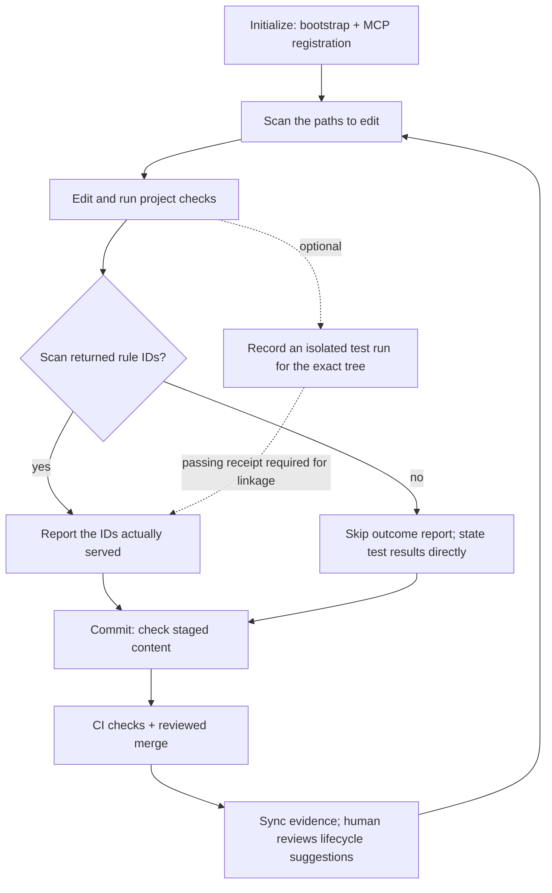

# How Aegis works

Aegis connects project rules, checks and evidence. This guide explains those concepts and follows a change through them. It describes the development branch; the [changelog](../CHANGELOG.md) identifies released changes.

Start with the [README](../README.md) for installation. The [reference](reference.md) lists every command and schema; [architecture](architecture.md), [hosts and hooks](hosts-and-hooks.md), and [agent teams](teams.md) cover their respective setup and implementation boundaries.

## The loop



1. **Initialize.** `aegis init` writes a marked bootstrap block in `AGENTS.md` and registers MCP with the hosts you choose. It preserves text outside that block. Rules remain separate files.
2. **Scan.** Before editing, call `aegis_scan` with the paths you will change. Follow the matching rules and inspect any omitted mandatory rules.
3. **Verify.** Run the project's checks. You may also request an isolated test receipt with `aegis check --record --tests`; it is a separate operation with the [runner limits below](#evidence-and-outcomes).
4. **Report and review.** Report outcomes only for IDs the scan returned. If no rule IDs matched, skip `aegis_report_outcome` and report the real commands and results directly. Commit, run CI, and review the change.
5. **Learn.** `aegis sync` derives rule fitness and proposes changes. A person applies and reviews them; a reported success does not automatically promote a rule.

## Rules and AST patterns

A rule is a markdown file with YAML frontmatter. Its directory names its type:

| Type | Directory | Meaning | Served before advisory rules? |
|---|---|---|---|
| `trap` | `traps/` | a known failure mode to watch for | no |
| `invariant` | `invariants/` | must always hold | yes |
| `gate` | `gates/` | a check that blocks a change until it passes | yes |
| `boundary` | `boundaries/` | a sensitive area that needs elevated review | no |
| `persona` | `personas/` | an idiomatic pattern to follow | no |
| `contract` | `contracts/` | an API or data-shape agreement across services | no |

Any rule that declares `enforcement: gate` is also served first. Type and enforcement decide how a rule is ranked and labeled when it is served; what `aegis check` blocks on is a rule's `forbid_ast` patterns ([Checks](#checks)). Here is a rule that `aegis check` enforces:

```markdown
---
id: no-eval
type: invariant
domain: security
enforcement: gate
hypothesis: Agents reach for eval() to parse input
target_paths:
  - "**/*.py"
forbid_ast:
  calls:
    - name: eval
      builtin: true
    - name: exec
      builtin: true
---
Never call `eval` or `exec` on data. Parse it with `json.loads` or `ast.literal_eval`.
```

- **Required fields**: `id`, `type` and `domain`, plus `enforcement` (`gate` or `advisory`) for invariants and traps. An invariant or gate whose enforcement is not `gate` is a "paper gate": it claims to block and enforces nothing, so `aegis check` fails until it is fixed. `hypothesis`, `prediction` and `falsification` say what the rule expects to prevent and what would prove it wrong.
- **`target_paths`** are globs on repository-relative paths. `*` crosses `/`, `**/` matches zero or more directories, a pattern without `/` also matches the file name alone, matching is case-sensitive everywhere, and there is no substring matching. A rule without `target_paths` applies to no file, except a `forbid_ast` rule, which applies to every file.
- **`forbid_ast`** bans `imports`, `calls` or `decorators`. Setting `builtin: true` on a call predicate targets Python's builtin `eval()` and `exec()` (including `builtins.eval` and `__builtins__.eval`) while allowing method calls such as pandas `df.eval()`, PyTorch `model.eval()` and SQLModel `session.exec()`; omitting `builtin: true` (for example `calls: [eval]`) matches any call or method named `eval`. Aliases count (`sp.run()` after `import subprocess as sp` is `subprocess.run()`), and so do `__import__` and `importlib.import_module` with literal names. Computed names, `getattr` and rebinding by assignment are out of reach, because the check is syntactic. A `forbid_ast` rule skips test files unless its `target_paths` name them. A call entry holds only `name`, `where` and `builtin`; `where` maps argument names (or `#N` positions, joined by `|`) to one of four forms: a scalar, `{in: [...]}`, `{not: <condition>}` (for example `{not: {in: [...]}}`) or `{absent: true|false}`. Any other operator, an empty `where`, the old `unknown` key or `call` alias fails the rule at load instead of letting every file pass. `builtin: true` follows Python scoping: a `def` or import of `eval` in an enclosing scope shadows the builtin. The scope is read as a whole, so a binding anywhere in it counts, even under `if False:`, inside `try:` or after the call, and can hide that scope's `eval()` calls; an assignment, `global` or a parameter does not shadow. A call site with no argument information (non-Python drivers) makes `where` unknown rather than a match or a pass.
- **Creating rules**: `aegis rule create --type trap --name ID --hypothesis "..." --target-paths 'src/**/*.py' --body-file rule.md` writes the frontmatter for you (`--hypothesis` is required). The `aegis_create_rule` MCP tool turns a concern into a drafting prompt for the agent and writes nothing. `forbid_ast` is added by hand.
- **Starter rules**: `aegis init --rules minimal|standard|full` seeds 2, 5 or all 12 of the shipped [rules](../rules/) as `persona` rules with `target_paths: []`. They apply to no file until you name the files each one governs; `aegis status` and `aegis sync` list them until you do. `aegis init` also seeds one active invariant (`.aegis/rules/invariants/no-eval.md`) from day one unless you pass `--rules none-active`.
- **A file that cannot be loaded stops everything**: the scan fails and names it, and `aegis check` blocks, so a partial rule set is never presented as the whole one.

### A rule for your own code

The default `no-eval` rule exercises the whole setup. A more specific rule can ban a call only when an argument is absent. Save this as `.aegis/rules/invariants/no-naive-time.md`, then commit it to the reviewed base before trying it:

```markdown
---
id: no-naive-time
type: invariant
domain: correctness
enforcement: gate
hypothesis: Naive datetimes shift by the server's UTC offset
target_paths: ["src/**/*.py"]
forbid_ast:
  calls:
    - datetime.utcnow
    - name: datetime.now
      where:
        tz: {absent: true}
---
Use `datetime.now(timezone.utc)` with an explicit timezone.
```

For `src/clock.py`, `aegis check src/clock.py` fails on this call:

```python
from datetime import datetime
now = datetime.now()
```

This version passes that rule:

```python
from datetime import datetime, timezone
now = datetime.now(tz=timezone.utc)
```

The check matches syntax, including import aliases; it does not prove that a supplied timezone is semantically correct. A pattern using `where` cannot establish a result when a non-Python driver supplies no argument information.

## Delivery over MCP

**The bootstrap.** `aegis init` writes a small marked `AGENTS.md` block. The MCP server sends the same guidance as its `initialize` instructions, which editing files cannot remove. Rule text is never inlined into an instructions file, so it never pushes a host past its size limit.

**The five tools** (schemas in the [reference](reference.md)):

| Tool | What it does |
|---|---|
| `aegis_scan` | returns the rules that apply to the files about to change and records scan/exposure bookkeeping, serving mandatory rules from the reviewed base commit (`rules_base`) |
| `aegis_report_outcome` | links an outcome to rules served in the session and a passing test receipt for the same tree; otherwise records `claimed`, which earns no credit. A nonempty list of real rule IDs is required |
| `aegis_create_rule` | a prompt for drafting a rule; writes nothing |
| `aegis_list_rules` | every rule with its type, hypothesis and ledger fitness, plus the rules edited since the last `aegis sync` |
| `aegis_capture_insight` | records a redacted human correction at `~/.aegis/insights/<workspace-id>.jsonl` at `suggestion` level; a matching hook-captured prompt of the same host within 30 minutes annotates it, and the capture never counts |

**What a scan returns.** One loader reads every rule; if any file fails to load, the scan fails. Rules are matched to the files, then ranked: gates, invariants and other `enforcement: gate` rules first, but they take at most two of the three slots a scan has by default, so a broad mandatory rule cannot starve every advisory one. Mandatory rules that do not get a slot are named in `omitted_mandatory`. Advisory rules are ranked by ledger fitness, read from the ledger alone: scan, `aegis_list_rules`, `aegis status`, `aegis rule list`, metrics and packs never call GitHub, so in a fresh process they rank without CI-confirmed credit (`aegis sync` and the promote, demote and archive decisions verify it). The whole response is clamped to the token budget, 2,000 estimated tokens by default (`AEGIS_MAX_JIT_TOKENS` or `jit.max_tokens`); a rule that does not fit is counted, never silently dropped. `view: "summary"` or `"ids"` returns less. For the default `no-eval` rule, a summary scan of `app.py` returns:

```json
{
  "relevant_rules_count": 1,
  "relevant_rules": [
    {"name": "no-eval", "type": "invariant", "enforcement": "INVARIANT (must not violate)", "fitness": null}
  ],
  "invariant_warnings_count": 1,
  "invariant_warnings": [{"name": "no-eval", "type": "invariant", "tier": "gate"}],
  "rules_staged": 1,
  "omitted_mandatory_count": 0,
  "omitted_mandatory": [],
  "stale_rules_count": 0,
  "stale_rules": []
}
```

`fitness` is `null` until a rule has a sample large enough to report (no verdicts yet, fewer than 25, or too few triggers to test); the text view prints `Fitness: no evidence yet` for a rule that has never fired. The full view also carries `rules_base`, which says where mandatory rules were read from: `"source": "local-head"` means the repository has no `origin/HEAD`, so they come from your local HEAD and are not review-witnessed.

Without MCP, `aegis scan FILE...` prints the same rules for a person or a shell-only agent, and records the scan as `aegis_scan` does, so it also satisfies the scan-before-edit hook ([Hosts and hooks](hosts-and-hooks.md)).

**No match is a normal result.** An empty `relevant_rules` list does not mean a scan failed, and does not supply an ID for an outcome report. Skip the report when there are no matching IDs. The reporting schema rejects an empty `rules_used` list; inventing an ID or reporting an unrelated rule does not create evidence. A malformed rule or invalid request is an error and must be handled separately.

**Workspace and host identity.** A call binds to the operator's `AEGIS_WORKSPACE` pin, host metadata or MCP roots, a registered workspace, or a bounded walk from the server's working directory. Conflicting sources hold the call instead of choosing another repository. An unresolved workspace returns "not governed here" and may serve a read-only personal rule layer; it writes no repo state. The model cannot choose a workspace or host identity through tool arguments. See [workspace binding](hosts-and-hooks.md#workspace-binding) for precedence and repairs.

## Checks

**Which files.** Files you name; with `--hook` (the pre-commit hook), the staged files, read as staged; or else the working-tree changes (`git diff HEAD` plus staged), or else what the branch adds to its base (`origin/$GITHUB_BASE_REF` in a GitHub pull request, then the branch `origin/HEAD` names, then `main`, `develop` or `master`), or else the last commit. Untracked files are never picked up on their own: `git add` a new file or name it (`aegis check app.py`).

**Layer 1** runs without a network or a model:

- **Checkpoint checks** over the repository: a test file for each source file, hard-coded absolute paths, assertions per test, rules the ledger says misfire, rule conventions and paper gates. They warn unless you pass `--strict`; a paper gate and a rule file that cannot be loaded always block.
- **Security pack and secrets** on what the change introduces: the 7-rule Python security pack and the known-format secret scan run in every `aegis check` (also `--hook` and `--record`), judged against the diff base, so code that was already there is not flagged again. Test paths are exempt but reported, `# aegis: allow[rule]` and `# gitleaks:allow` are honoured, and a baseline never grandfathers these rows. Your own `forbid_ast` rules keep whole-file judgment.
- **Per changed file**: a call-graph check (code that is defined but never wired in), an import guard (in non-test Python files, every import must be standard library, a module or package in the repository, or inside a `try`/`except ImportError`; a third-party import is flagged even when your dependency file lists it) and every `forbid_ast` rule that applies. With an active AST backend, a file a `forbid_ast` rule cannot parse fails. TypeScript/JavaScript and Go files without an enabled driver are skipped, so they have not been parsed or verified. Mutation tests run only with `--full`.
- **Languages**: Python is parsed in process. Drivers for Rust, TypeScript/JavaScript (needs `node`) and Go (needs `go`) ship in the wheel, and `aegis init` turns them on for the languages it detects (`ast.packaged_drivers`). A repository can only opt in to those packaged drivers; any other driver command comes from `~/.aegis/config.json`, so a cloned repo cannot make Aegis run a program it chose.

The Python mutation check applies Aegis-specific suite aliases only when the source is inside an exact top-level `aegis_cli`, `aegis_core`, `aegis_mcp` or `aegis_sdk` package. Generic filename lookup remains available, including for nested and similarly named packages.

**Layer 2** is optional: `aegis check --full --plan "what the change should do" --llm-cmd 'claude -p'`. The plan comes from `--plan`, `--plan-file`, or else the first of `docs/plan.md`, `.aegis/plan.md` and `PLAN.md` in the repository; without one, Layer 2 refuses to run. Any command that reads a prompt on stdin and prints a reply works (`codex exec --skip-git-repo-check`, a script). Aegis builds two prompts, one after the other: a spec reviewer gets the plan, the function signatures (with their docstrings) and the test names (no implementation) and predicts what could go wrong; a code reviewer gets the full text of each changed non-test Python file (`__init__.py` is skipped), the test output and the Layer 1 results, never the plan, together with those predictions, and answers each with claims backed by evidence. An arbiter compares the two by risk category, using Layer 1 as the tiebreaker, without asking a model to judge, and returns `SHIP`, `REVISE` or `BLOCK`.

The verdict is advisory: `aegis check --full` exits on Layer 1 alone, a review that does not complete prints `UNVERIFIED`, and only a model command that cannot run, or a test discovery that fails, still makes the check exit 1.

The command runs in an empty temporary directory, never in the repository, so the code under review cannot steer its reviewer through project config; and it comes only from `--llm-cmd` or `AEGIS_LLM_CMD`, never from a file in the repository. **This sends your plan, the source of the changed non-test Python files (whole files, not the diff; `__init__.py` is skipped), the test names and output and the Layer 1 results to whichever vendor the command calls.**

An advisory model review does not replace independent human review. `aegis check --calibration` scores the arbiter's logged predictions against outcomes with Wilson 95% confidence intervals and Brier skill scores ([Evidence and outcomes](#evidence-and-outcomes)); the predictions are logged and never gate.

### Adopt checks in an existing repository

`aegis check --card` reports languages, active drivers, rule counts and findings. `aegis check --write-baseline` records current eligible findings in `.aegis/baseline.json`; later checks fail on new ones, and `--prune-baseline` drops entries that no longer match. A baseline never grandfathers built-in security or secret findings. With `--base`, the baseline comes from that base, not the change being reviewed. Changes to it require approval when the base has a signing key; otherwise it is self-attested.

`aegis rule export` and `aegis rule import` move rules in digest-checked bundles; packs are not signed. `aegis benchmark` measures scan, hook and check performance, not whether rules improve development outcomes. Experimental host registration and packaging are covered in [hosts and hooks](hosts-and-hooks.md).

Add `--ast-language python` to measure native source parsing at 300, 600, 1,200, 2,500 and 5,000 lines, with matching fixture digests and extraction witnesses. These timings exclude file I/O and leave performance acceptance unevaluated. The corpus also includes TypeScript, JavaScript, Go and Rust fixtures; their native benchmark selections currently report unavailable parsers.

## CI governance

`aegis init --ci` writes `.github/workflows/aegis.yml`: an `aegis-check` job that checks out with `fetch-depth: 0` (so the base branch is there), installs the Aegis version that wrote it, and runs `aegis check` and then `aegis check --ci` with `GH_TOKEN` and `pull-requests: read`, plus an `aegis-sarif` job that uploads code-scanning annotations.

On another CI, check out the full history and run those two commands.

Plain `aegis check` enforces the reviewed rules: in a clone where `origin/HEAD` resolves, a rule is enforced once it is on that branch, so a pull request that deletes a rule and breaks it fails plain `check` there. Where `origin/HEAD` does not resolve, as in CI's checkout, the base is the checked-out commit itself, so plain `check` enforces the pull request's own rules and `aegis check --ci` is what catches a deleted or weakened rule. A rule that is new on the branch is not enforced until it reaches the base. `aegis check --ci` also catches a weakening: it compares mandatory rules against the merge base and passes a rule weakening only when the branch carries a signed `aegis approve` commit.

At tier A it also accepts an approving pull-request review from a person other than the author, when the rules of the pull request's base branch require an approval, code-owner review, stale-review dismissal and approval of the most recent push by someone other than its pusher, and the base `CODEOWNERS` owns every flagged path.

A run whose base and head are the same commit (a push to the base branch, a manual run, a stale branch) prints that nothing was compared instead of PASSED; the pull-request run is the gate.

Without `--no-exec`, `aegis check --ci` runs the repository's tests: it reruns the head commit's `Aegis-Check` trailer snapshot and the fix-commit regression tests, and with `--coverage` or `--perf` the coverage or benchmark command. `aegis check --ci --no-exec` reads git objects only and runs no repository code.

On a pull-request run with a flagged change and no signed approval, `--ci` also starts your `gh` for read-only `gh api` GETs of the repository, the base branch's rules and the pull request's reviews (the job's `GH_TOKEN` with `pull-requests: read`); nothing else in `aegis check` starts `gh`. Review changes under `.aegis/` and to the CI workflow like code.

### Protect the rules and workflows

Trust tiers describe who can change the checks: Tier C is self-attested; Tier B uses a signing key the agent cannot use; Tier A adds separation of duties and code-owner review. `aegis doctor` detects the tier read-only. See [Trust tiers](trust-tiers.md) for setup and limits.

- **Rule integrity and human approvals** (`aegis_scan`, `aegis check --ci`, `aegis approve`): `aegis_scan` serves gates and invariants from the reviewed base commit (`rules_base`), listing branch-local mandatory edits only in `unreviewed_rules`. `aegis check --ci` flags rule weakenings (a deleted, archived or lower-ranked rule, a dropped `target_paths` pattern, a narrowed `forbid_ast` call entry, a widening past the two-mandatory-rule cap). `aegis doctor` checks governance/workflow coverage in `CODEOWNERS`; an unowned file alone is not a `check --ci` failure. When the base branch lists a key in `allowed_signers`, it also fails any change to the governance set (`allowed_signers`, `CODEOWNERS`, workflows, `.aegis` config, team and baseline files at any depth, test infrastructure including root runner modules, and deleted tests) unless the change is signed with `aegis approve` (`Aegis-Approve: <governance tree hash>`) by a key already on the base (an SSH signature only; at Tier B this holds only while the pull request leaves `.github/workflows/**` and aegis alone). Rule edits stay under the weakening check, and `pyproject.toml`, `setup.cfg` and `tox.ini` count only when their pytest section changes. With no key on the base, a governance-file change is only noted and passes; a rule weakening still fails, because nothing can approve it (at tier A a qualifying review can). An approval covers the whole of `pyproject.toml`, `setup.cfg` and `tox.ini`, so after the base changes one of them the approval is re-signed on the new head. Comparing by pytest section leaves the rest of those files ungated by design: a `[project.entry-points.pytest11]` plugin, a dependency change or `tox.ini [testenv] commands` can still change what a test run does.

- **Regression discipline** (`aegis check --ci`): a fix commit is a non-merge commit with a Conventional `fix` subject or a `Fixes:` trailer, with a scope outside `ci, build, docs, deps, release, chore, tests`, that changes a source file; `Closes:` and a `Fixes:` line outside the trailer block do not count. It needs a test that fails on `base` and passes at the pull-request head in an isolated snapshot, or a commit-scoped signed `Aegis-Exempt-Test: <fix-sha> <reason>` approval from `aegis approve --exempt-test`. This is advisory, at warning tier (no setting makes it block): judged once against the head with at most 2 pytest runs, `UNVERIFIED` for fixes whose only tests are not Python, with progress on stderr.

- **Security checks, coverage and perf** (`aegis check --ci [--format github|sarif] [--coverage] [--perf]`): one verdict that the text, JSON (`blocking` lists the causes), GitHub annotations and step summary agree on; delta-evaluated structured `forbid_ast.calls` predicates, the security pack and secret delta of Layer 1, optional `ruff`/`gitleaks` presets named by the user-scope `scanners` key (only findings new against the merge base fail; an UNVERIFIED scanner never blocks), schema-valid SARIF 2.1.0 output with anchored findings only (also `aegis check FILES --format sarif` for Layer 1) and ingest, diff coverage on changed executable lines since merge-base(base, head) under the user-scope `tests.command` (`--coverage`; a report that never changes the exit code, `UNVERIFIED` with a reason when it cannot be measured), and paired interleaved base-vs-head benchmarking (`--perf`: the user-scope `perf.command`, or pytest-benchmark when installed; UNVERIFIED never blocks). `--coverage` and `--perf` exit 2 outside `--ci`. `aegis init --ci` adds an `aegis-sarif` job that uploads the SARIF log to code scanning, with `security-events: write` kept out of the job that runs repository code.

- **Release verification** (`aegis doctor --release <sha>`): verifies the GitHub Actions `verdict` attestation emitted on a push to the default branch, with its source ref pinned to GitHub's default branch, using `gh attestation verify` (`gh >= 2.93.0`), failing closed at Tiers B and C (`agent_editable`: the required check runs the pull request's own workflow) or when `gh` is missing or older.

For example, after committing the `no-eval` rule on `main`, removing its `exec` predicate on a branch makes `aegis check --ci --base main --no-exec` fail the weakening check. Restoring the predicate removes that finding. The example uses `--no-exec`, so it does not run the repository's tests or demonstrate test credit.

When using the generated `.github/workflows/aegis.yml` for credit confirmation, set `ci.workflow` to `"aegis.yml"` in **user-scope** `~/.aegis/config.json`. Its default is `validate.yml`; generating a workflow does not change that setting.

## Evidence and outcomes

A passing deterministic check, an optional recorded test run and a credited rule outcome answer different questions:

| Result | What it establishes | What it does not establish |
|---|---|---|
| `aegis check` passes | The selected files passed Layer 1 under the active rules | That tests ran, or that any rule earned credit |
| `aegis check --record --tests` records a run | Layer 1 and tests were run on an isolated export of the exact git tree | A `recorded` row alone is not success: tests may fail or produce no recognized passing count |
| Outcome report is linked | A passing receipt for the same tree can be linked to exposed rules matching the change | Credit is not confirmed until the landing commit has the configured successful CI run |

A report without a matching passing test receipt is `claimed` and earns no rule credit. `aegis check --record` without `--tests` records Layer 1 only and earns none. If a scan returned no matching rule IDs, skip the outcome report; ordinary project test results remain useful without a rule receipt.

### The test command and its current limits

`tests.command` is read only from `~/.aegis/config.json`, outside the workspace. A repository config cannot select a program to run. The default is `python -m pytest` under the Python running Aegis. To use a different environment, name its **absolute Python interpreter** as the first word of the command; even an absolute `pytest` launcher is otherwise run under Aegis's Python. Python runs use `-s` and that interpreter's site directories, so a pytest installed only in the user site is unavailable.

The receipt runs in an isolated snapshot with a temporary HOME and restricted PATH, rather than your interactive shell environment. It does not install dependencies. User-installed tools such as Cargo/Rustup may therefore be unavailable even when they work in your normal shell.

For a pytest command Aegis requests JUnit output. Otherwise it falls back to the last recognizable timed summary line with counts such as `N passed`. A passing receipt requires exit 0, no timeout, and at least one recognized passing test. Normal `unittest` output (`Ran N tests`, then `OK`) does not supply that count. A Cargo summary may match the text fallback, but there is no native Rust/Python suite aggregation: a combined command can expose only the last recognized summary. **Changing `tests.command` alone does not fix these receipt limitations.** Run and report each native suite explicitly; do not claim combined evidence from a receipt that represents only one suite.

### Landing and confirmation

- **Credit states** (`aegis sync`, `aegis status`): a passing check row is `witnessed`, `landed` once its tree's commit is on the protected branch, and `confirmed` by a successful run, on that commit, of the workflow named in the user-scope `ci.workflow` key of `~/.aegis/config.json` (a bare `.yml` or `.yaml` file name; default `validate.yml`; the repository's config and ledger rows never choose it). A check is `voided` by one of three causes: a CI failure (a failed run of that workflow on the landing commit, or a CI rerun of the head commit's trailer that diverges, reason `ci_divergence`), a lane-gate failure (`aegis check --lane` failing its test-integrity check for that tree, reason `lane_integrity`) or a revert (a commit on the protected branch whose message says `This reverts commit <sha>`, found when `aegis sync` confirms credit, reason `reverted`). Of these, a later CI success supersedes a CI-failure void from a failed run; `void` rows (`ci_divergence`, `lane_integrity`, `reverted`) are terminal.

- **Commit trailers** (`aegis check --ci`): the `Aegis-Check: tree=<tree> exit=<n>` trailer is verified for the head commit only, by rerunning the recorded check on that commit's tree. Only an equal tree whose outcome diverges twice is a failure; a tree mismatch, a head without a trailer or a timed-out rerun is `unbound`. In CI a divergence is a failed job; `record_void` writes the `ci_divergence` void to the ledger of the machine that ran the check, so it applies to a local `check --ci`.

The local ledger is mutable and includes legacy rows and detector replay. Its fitness is not authenticated evidence. A linked report alone is not a CI confirmation; test logs and the configured workflow result must still be inspected.

### Fitness and human review

**Fitness and sample-size states** are computed on read: `aegis sync` evaluates CI-confirmed checks, git detector replay over merged history for `forbid_ast` rules (`caught` vs `leaked`), and human-adjudicated labels, with session-count decay `w = 2^(-delta / H)`, where H is `expiry.half_life_sessions`, over every exposed session (exposure rows carry no liveness flag yet; silence earns no credit in 4.4.0). Each rule reports one of four sample-size states: `untestable`, `insufficient (n=K)`, `inconclusive` or `decided`. Below `n = 25` verdicts (`MIN_N`) no precision number is shown (`reported_score` is empty) and no promotion, demotion, tier change or archive by misfire happens. A landed (leaked) violation is a disposition, not a false positive. Decay counts sessions; calendar days never decay a rule. A plain `aegis check` and native session reports record triggers only, never tp or fp. Frontmatter is not evidence: `prior`, `pack_prior`, `trigger_rate_per_day`, `expected_triggers_per_day` and `expiry.*` are accepted and ignored.

Promotion is suggested only for a promotable rule with enough evidence and reviewed adjudication labels: **at least 25 true-positive labels and no false positives, or at least 42 total labels with at most one false positive**. Those labels must span **at least 3 sessions**, plus **at least 2 repositories or 14 days**. A rule must be at least 30 days old according to its `created` date. A missing or invalid `created` date is treated as age zero and blocks promotion. CI results and replay alone cannot satisfy the label requirement. Incomplete evidence suppresses a decision; adverse evidence can instead produce a demotion or archive suggestion.

`aegis sync` writes derived state and suggestions under the workspace lock. `aegis sync --apply`, `aegis rule promote|demote RULE_ID` and `aegis rule archive` apply explicit lifecycle moves; commit and review them like code. `aegis sync --pr` pushes an `aegis/lifecycle-*` branch with moves and up to three unlabelled replay examples per rule, opens a human-reviewed pull request and never merges it. The recorded rule hash detects edits since sync; it is not a signature and never excludes a rule.

**Adjudication labels.** `aegis rule adjudicate` appends a `tp` or `fp` label to `.aegis/adjudications/<rule-id>.jsonl` in the working tree. The label counts only after a reviewed pull request merges the file to the base branch: `.aegis/adjudications/**` is in the governance set, so `aegis check --ci` asks for the approval, and Aegis reads labels from the reviewed base commit only (last row per example wins). Ledger `adjudication` rows, which any process can write, are read but never counted, so until labels are merged almost no rule is promoted. On a developer machine the reviewed base is whatever the local `origin/HEAD` or `rules.base_ref` points to, and the agent can move both, so a local promotion suggestion is only as trustworthy as those refs; the decision that counts is the reviewed pull request that moves the rule file, which `aegis check --ci` gates.

**Compliance.** `aegis status --compliance` reports each host's scan-before-edit rate from `.aegis/state/activity.jsonl`: per session, how many edited files were scanned first. An edit is a file named in `aegis_report_outcome`, or a file in a commit made during exactly one session. The output states its own limits; a session with no observed edit counts as unknown, never as 0.

With `--json`, the compliance report carries `source`, `aegis_version`, `checked_at` and `scope` before its report fields.

### Human corrections and model predictions

- **Human insights closed loop** (`aegis rule insight add|review|enable`, `aegis_capture_insight`): stores redacted corrections at `~/.aegis/insights/<workspace-id>.jsonl` (`0600`), verifies content-bound `Aegis-Approve-Insight` signatures for human-approved insights (`aegis rule insight add` prints `Aegis-Approve-Insight: <sha256 of the typed text>`; sign a commit carrying that trailer, then re-run the same command with `--commit SHA` to record the insight at level H), lists each counted insight with its top-3 TF-IDF neighbours so the human groups them (no automatic clustering) and turns the group named with `--decision propose --insight ID ...` into an advisory `trap` proposal in `.aegis/proposals/` (with the shared `kind`, the `count`, the insight ids and up to three `<dir>/**` target paths), and measures post-activation recurrence as a rate over heartbeat-alive sessions (at most 1, 95% upper bound, pre-activation baseline), labelled `sessions = all heartbeat-alive sessions in this workspace (not scope-filtered)` in `aegis status` and `aegis sync`. Rule matching and recurrence use fixed similarity thresholds that were set by hand and never measured: cosine 0.15 with a shared path, 0.30 without, and 0.12 for recurrence.

- **Insight capture level** (`insights.capture` in `~/.aegis/config.json`: `off`, `counters` or `excerpts`): narrows what the host hook entry allows (`aegis rule insight enable --host H`, with `--excerpts` to keep excerpts) and never widens it, so the hook runs with the lower of the two. `counters` keeps heartbeats and drops excerpts; `off` writes nothing, not even heartbeats, so a rule activated from insights reports `no_prompt_traffic` in its recurrence measure. A repository `.aegis/config.json`, a user config inside the workspace, or an invalid or unreadable value never changes the mode. In `aegis doctor --json`, `insight_capture.status` and `excerpts` describe the host entry, `capture` is what the hook does, and `capture_source` says whether it comes from the `host entry` or `insights.capture`. `aegis rule insight add` and `aegis_capture_insight` are explicit actions; the key does not govern them.

- **Calibrated Layer-2 arbiter** (`aegis check --calibration`): logs stamped, falsifiable predictions to `.aegis/state/arbiter_predictions.jsonl` (no model text), computes each one's disposition and outcome from git when it is read, and scores them per backend and kind with Wilson 95% confidence intervals and Brier skill scores (log-only; skill claims suppressed below `n_effective >= 100`).

See [Why Aegis is built this way](why-aegis.md) for the reasoning and statistical limits.

## Hosts and doctor

`aegis init` registers hosts and installs the git hook. `aegis hook install --host <host>` adds a host pre-tool hook. They serve different purposes: the git hook checks staged content, while supported host hooks can check scan-before-edit and destructive commands earlier.

Host hooks fail open on Aegis errors and do not see edits made through shell commands. Codex hooks must be trusted in `/hooks`; Antigravity's scan gate records only, and its hooks are unavailable on Windows. A registered hook is not proof that enforcement is active. `aegis doctor` reports registration, unsafe launches, known gaps and the trust tier; review its findings before using `--fix`.

See [Hosts and hooks](hosts-and-hooks.md) for safe registrations, backups, instruction limits, runtime behavior and skill syncing. For parallel worktrees, [Agent teams](teams.md) explains cooperative leases, containment checks and their CI limits.

## Where things live

| Path | Committed? | What it holds |
|---|---|---|
| `.aegis/config.json` | yes | `hosts`, `jit.max_tokens`, `jit.scan_window_s` (how recent a scan must be for the edit hook, [Hosts and hooks](hosts-and-hooks.md)), rule `expiry`, `expiry.half_life_sessions` (the decay half-life H in exposed sessions; a positive integer, default 30), `expiry.epsilon` (the archive threshold; a number between 0 and 1, default 0.01; top-level and `fitness` spellings are ignored with a warning), `ast.packaged_drivers`. It can never name a command: such keys are ignored with a warning. |
| `.aegis/rules/<type>/*.md` | yes | the rules, one file each |
| `.aegis/team.json` | yes | optional: the `shared` globs any lane may change and committed per-lane paths ([Agent teams](teams.md)) |
| `.aegis/baseline.json` | yes | the ratchet baseline that `aegis check --write-baseline` writes ([adopting checks](#adopt-checks-in-an-existing-repository)) |
| `.aegis/adjudications/<rule-id>.jsonl` | yes | `tp` and `fp` labels from `aegis rule adjudicate`; they count once a reviewed pull request merges them to the base branch ([Evidence and outcomes](#evidence-and-outcomes)) |
| `.aegis/proposals/` | if you commit it | draft rule proposals that `aegis rule insight` writes ([Evidence and outcomes](#evidence-and-outcomes)) |
| `.aegis/.gitignore` | yes | ignores `state/` |
| `.aegis/state/` | no | `activity.jsonl` (scans and edits per session; `aegis scan` runs are logged too), `derived.json` (written by `aegis sync`), `lifecycle.jsonl` (rules moved to the archive), `arbiter_predictions.jsonl` (Layer 2 predictions, no model text), `gate_events.jsonl` (`aegis hook safety-gate` decisions), `lock` and `migrate-backup-*/`. In a git repository the outcome ledger is not here: see the `<git common dir>/aegis/` row |
| `AGENTS.md` | yes | one marked bootstrap block; the rest of the file is yours |
| the git hooks directory | no | the `pre-commit` hook (runs `aegis check --hook`) and the `prepare-commit-msg` hook, which adds an `Aegis-Check: tree=<tree> exit=<n>` trailer when a passing check row covers the staged tree ([Evidence and outcomes](#evidence-and-outcomes)) |
| `.claude/skills/`, `.agents/skills/` | yes | skill copies written by `aegis skills sync`, each with an Aegis marker line |
| `refs/aegis/lanes/<lane>` | git ref | a lane's lease, written by `aegis team` |
| `<git common dir>/aegis/` | no | `state/<ws-id>/ledger.jsonl`, the outcome ledger every worktree shares, with its lock (`<ws-id>` names the workspace by its path below the git top level; outside git the ledger is `.aegis/state/ledger.jsonl`), and `events.jsonl`, the events log every worktree shares, with its lock |
| `CLAUDE.md` | yes | an `@AGENTS.md` block, only if the file already existed |
| `~/.aegis/workspaces.json` | user | the repos you ran `aegis init` in on this machine |
| `~/.aegis/link.key` | user | 32 random bytes (`0600` on POSIX) that `aegis init` and `aegis rule insight enable` create (and the first insight capture that carries a session id, when it is missing) to pseudonymize host session ids; it stays on the machine |
| `~/.aegis/insights/<workspace-id>.jsonl` | user | the opt-in redacted corrections of `aegis rule insight` ([Evidence and outcomes](#evidence-and-outcomes)) |
| `~/.aegis/rules/` | user | an optional personal rule layer, served read-only where no repo is governed |
| `~/.aegis/config.json` | user | the only place for command-like settings, `tests.command`, `perf.command`, scanner commands and AST driver commands; also `ci.workflow` for receipt confirmation |
| `~/.claude/settings.json`, `~/.codex/hooks.json`, `~/.codex/rules/aegis.rules`, `~/.gemini/config/hooks.json` | user | the hook entries `aegis hook install --host` writes (or the repository's `.claude/settings.json`, `.codex/hooks.json` and `.agents/hooks.json` with `--scope project`) |
| `~/.aegis/backups/` | user | a copy of each file taken before Aegis changes it, one timestamped folder per run: the host config `aegis init --host` and `aegis uninstall` merge (Antigravity's `mcp_config.json`), the files `aegis doctor --fix` edits, the host hook files `aegis hook install --host`, `aegis rule insight enable` and `uninstall --host` change, and the pre-commit hook `aegis hook install` (or `init`) rewrites |

Aegis reads four variables of its own (hosts and GitHub Actions supply others, such as `CLAUDE_PROJECT_DIR`, `GITHUB_BASE_REF` and `GH_TOKEN`): `AEGIS_WORKSPACE` (pin the server to one repo, which must hold `.aegis/`; `aegis init --pin` writes it into the registration, and the CLI honors it too, as [Delivery over MCP](#delivery-over-mcp) describes), `AEGIS_CLIENT` (host identity, written by `aegis init`), `AEGIS_MAX_JIT_TOKENS` (scan budget) and `AEGIS_LLM_CMD` (the Layer 2 model command).

**The ledger** is `<git common dir>/aegis/state/<ws-id>/ledger.jsonl` (or `.aegis/state/ledger.jsonl` outside git), append-only, one JSON row per event. In git every worktree shares it, and a row also records the absolute path of the work tree that wrote it (`<ws-id>` names the workspace by its path below the git top level, so each `.aegis` workspace of a monorepo has its own).

### The events log

The commands above record what the prune conditions count in an events log: `<git common dir>/aegis/events.jsonl`, shared by every worktree of the repository (`.aegis/state/events.jsonl` outside git), under its own lock. Each row is `{"v":1,"ts","event","worktree","host"?,"result","detail"}`. It holds `lease_claimed` and `lease_denied` (`aegis team`), `lane_check` (`aegis check --lane`), `scan_gate` and `guard_match` (the hooks), `skills_sync`, `partition_check`, `pack_import`, `init_host`, `benchmark`, `baseline_written`, `baseline_check` and `package`. A hook row holds counts, rule ids and results, never command text or file names. Fitness and `aegis status --compliance` never read it, and it is not the ledger. Rows written on a CI runner are lost with the runner unless you upload them.

Command event writes are best effort: a recording error becomes a warning and does not undo the command's result. Hook event logging keeps its separate guard so a logging failure does not replace the host decision.

## Cheat sheet

Flags and defaults for every command are in the [reference](reference.md); this table only maps tasks to commands.

| I want to... | Run |
|---|---|
| set up a repo and register my hosts | `aegis init --host claude-code,codex-cli,antigravity` (or `--host auto`) |
| see what `init` would do | `aegis init --dry-run` |
| check that each host is wired | `aegis doctor` (`--json` for scripts, `--fix` to repair, `--github` for Tier A/B setup, `--release <sha>` for release attestation) |
| see the rules for files I am about to edit | `aegis scan FILE...` |
| check my change | `aegis check` (`--strict` for plain checkpoint warnings; `--record --tests` for an optional test receipt) |
| run the CI weakening, regression and SARIF checks | `aegis check --ci` (`--format github|sarif`, `--coverage`, `--perf`, `--no-exec`) |
| sign a governance change or test exemption | `aegis approve` (or `aegis approve --exempt-test <sha> --reason "..."`) |
| add a model review | `aegis check --full --plan "..." --llm-cmd 'claude -p'` (`aegis check --calibration` to score predictions) |
| write a rule | `aegis rule create --type trap --name ID --hypothesis "..." --target-paths 'src/**/*.py' --body-file rule.md` |
| capture or review human corrections | `aegis rule insight add "..."` / `aegis rule insight review` / `aegis rule insight enable --host claude-code` |
| list rules and their fitness | `aegis rule list` or `aegis status` |
| see how often agents scan before editing | `aegis status --compliance` |
| rebuild fitness and get suggestions | `aegis sync` (`--apply` to apply locally, `--pr` to open an evidence-backed PR) |
| promote or demote one rule | `aegis rule promote RULE_ID` / `aegis rule demote RULE_ID` |
| manage the pre-commit hook | `aegis hook install` / `status` / `uninstall` |
| add or remove a host's pre-tool hook | `aegis hook install --host claude-code` / `aegis hook uninstall --host claude-code` |
| declare a lane's paths | `aegis team claim LANE --paths 'docs/**'` (`aegis team list` to see leases) |
| check what a lane changed | `aegis check --lane LANE` (`--base-policy` for the witnessed form) |
| copy the skills into the repo | `aegis skills sync` (`--dry-run` first) |
| upgrade a v3 workspace | `aegis migrate`, then `aegis migrate --apply`, `aegis init --host ...` and `aegis doctor --fix` |
| remove Aegis from a repo | `aegis uninstall` (keeps `.aegis/`) |
| use Aegis from Python | `from aegis_sdk import Governance; Governance(project_root=".").scan(["app.py"])` |
