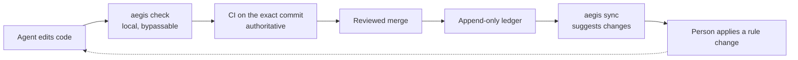

# Why Aegis is built this way: evidence, mistakes, and what changed in v4

This page explains where Aegis's rules came from, what the project measured, what it got wrong, and why v4 looks the way it does. It is written for people deciding whether to trust Aegis, and for contributors deciding what to change next.

**Status.** Written during the v4.0 build (2026-10-15) and checked against the code once waves A, B and C were merged. Where this page describes v4, it describes what that code does; the decisions behind it are in ADR 0005 and ADR 0006, and the [CHANGELOG](../CHANGELOG.md) records each release. Section 6 describes the v4.3 trust and evidence model. What 4.1 to 4.3 add (agent hooks, teams, skills, adoption tools, and trust and evidence) is described in [How Aegis works](how-it-works.md) sections 8–10; here section 6 and the AD-7 row of section 7 were updated as they shipped.

**How to read the numbers.** Every number here is one of two kinds:

- **Re-derived**: computed by a command run at a named commit (`895bbf5` unless the text says otherwise); every such command is listed under [Sources](#sources). Where a figure is a difference of two printed values (a time span or a day count), the comment next to the command says so.
- **Quoted**: taken from a document, with its source and a caveat. Several sources were deleted from the tree in v4; git keeps them. Read one from the v3.3.0 release tag, for example `git show v3.3.0:docs/project/METRICS.md`.

## 1. The problem: a rules file is a gentleman's agreement

Coding agents read instruction files (`AGENTS.md`, `CLAUDE.md`, `.cursorrules`) and then act. Nothing checks that they followed the file. In practice they fail in three ways:

- **They skip rules.** Under task pressure an agent follows the letter of a rule and misses its point. The earliest Aegis notes record an agent "verifying" by re-reading the same file four times.
- **They forget.** Long sessions compact context, and new sessions start from zero. The project's session analysis found the same environment traps rediscovered independently across sessions.
- **They fail open.** A check that crashes, a tool that is missing or a rule that is not loaded looks exactly like "no problem found".

Aegis's own history has examples of all three. The v4 review found that `aegis_scan` returned 0 rules in the author's own session, that the AST gate silently skipped files with a byte-order mark, and that the release gate's "SHIP" receipts were written by the agent being gated (ADR 0005 §1; review H3, H4, H6).

The author's post on this framing is [Your AI agent's rules file is a gentleman's agreement](https://dev.to/nseney1/your-ai-agents-rules-file-is-a-gentlemans-agreement-heres-what-happens-when-you-build-2dml).

So Aegis tries to do three things, in this order of trust:

1. Check deterministically whatever can be checked, in CI on the exact commit.
2. Put the relevant rule in front of the agent at the moment it edits a matching file, instead of hoping it remembers a long instruction file.
3. Keep a local record of outcomes, so a rule that never fires can be found and pruned.

## 2. Where the rules came from

The core rules were not written from best-practice lists. They were extracted from failures.

**The 1,339-step post-mortem.** One real coding session was analyzed step by step. 749 of its 1,339 steps were rework (55.9%, re-derived from the quoted counts). The largest itemized failures, and the rule each one produced:

| Failure | Steps wasted | Rule it produced | Where it lives today |
|---|---|---|---|
| Agent invented game hotkeys instead of checking | 180 | verify UI controls from screenshots, never guess | [providence](../rules/providence.md) §10 |
| Host Python confused with the project venv | 110 | bind `$(VENV)/bin/python` explicitly | [polyglot-standards](../rules/.oracles/polyglot-standards.md) |
| Test polled forever with no timeout | 103 | mock hardware boundaries; time-box polling | [testing](../rules/.oracles/testing.md) |
| A method silently shadowed another | 50 | grep for `def <name>` before defining in large files | [providence](../rules/providence.md) §3 |
| Stale references after a rename | 30 | global grep confirms zero old references | [providence](../rules/providence.md) §3 |

The itemized rows sum to 473 steps (63% of the waste). The other 276 steps happened before step-level tracking existed and were never itemized; 473 + 276 = 749, which matches the quoted total (both re-derived).

*Source*: the evolution log, `docs/architecture/phylogeny.md` "Phase 2", and `docs/project/METRICS.md` "Aggregate Stats" (both at `v3.3.0`). *Caveat*: one session, one developer, classified by the project's own analysis with no second rater. The same session supplied the rules, so it is the "before" baseline for them and not independent evidence that they work.

**Cross-session patterns.** Comparing sessions across projects showed the failures were systemic. The worst session ran 1,579 steps with 8 architectural pivots, 2 safety incidents and zero subagent delegation, and produced zero working autonomous runs. It added rules on premature abstraction, pivot discipline (the Two-Pivot Halt), delegation floors and real-time loop budgets, which now live in [architectural-tenets](../rules/.oracles/architectural-tenets.md) and [subagent-delegation](../rules/subagent-delegation.md). It also added a desktop-automation safety rule, which v4 no longer ships (ADR 0005 D16). *Source*: the evolution log, "Phase 3". *Caveat*: the author's own projects only.

## 3. Design principles

Principles C1–C6 emerged from that work and are listed in the evolution log ("Design Principles"). C7 was learned the hard way: the C7 key is defined in ADR 0005 Appendix A, which cites all seven by these keys, and rests on ADR 0005 H6 and AD-1.

| Key | Principle | In one sentence |
|---|---|---|
| C1 | Evidence over intuition | Every rule traces back to an observed failure; no rule exists "just in case". |
| C2 | Accuracy over speed | An agent never trades correctness for tokens or time. |
| C3 | Rules as a system | Rules reference each other on purpose: providence requires read-before-write, and the refactoring-pilot skill turns that into a phased workflow. |
| C4 | Continuous validation | A rule is never "done"; it is re-checked against new sessions. |
| C5 | Installation completeness | Governance installed at partial fidelity gives false assurance, so every install path deploys rules, skills and hooks with the same completeness. |
| C6 | Hypothesis-driven governance | Every rule and feature states what it predicts, how to measure it, and when to prune it. |
| C7 | Ledger, not frontmatter, for fitness | Outcomes go to an append-only ledger; rule files are never rewritten by the tool that scores them (ADR 0005 H6, AD-1). |

Three ideas survive from the project's earlier mechanism-design notes (`docs/architecture/mechanism_design.md` at `v3.3.0`):

- **External ground truth**: credit should come from signals the agent cannot manufacture, such as CI exit codes and reverts.
- **Graduated enforcement**: a rule earns blocking power (trap, then invariant, then gate) only after evidence.
- **Budget balance**: governance must cost less context than the rework it prevents.

In v3 the first one was claimed but not delivered: an MCP caller could write true- and false-positive signals for any rule (review H4), and pass/fail credit went to every rule whose paths matched (section 5.2).

## 4. What we measured, and how to read it

| Measurement | Number | Source (at `v3.3.0`) | Kind |
|---|---|---|---|
| Waste in the post-mortem session | 749 / 1,339 steps (55.9%) | evolution log, Phase 2 | one session |
| Waste across 17 governed sessions | 1,317 / 7,015 steps (18.8%) | `METRICS.md` "Aggregate Stats" | observational, one developer |
| Same project, weak rules vs "full governance" | 27.6% of 547 steps vs 1.1% of 1,325 steps | `METRICS.md` "Live A/B Validation" | two sessions, one project |
| 66 masked production sessions, ~7 weeks | rules deployed without skills (an installer gap), so the review steps the rules named could not run; no waste rate was reported for it | `METRICS.md` "Expanded Dataset Analysis" | observational, different model family |

The first two percentages are re-derived from the quoted counts. The A/B percentages are quoted: `METRICS.md` gives them with total steps but not the wasted-step counts. Everything else in the table is quoted.

**Limitations** (the first four are paraphrased from the project's research abstract, `docs/research/abstract.md` at `v3.3.0`):

- Differences between the evaluation baselines prevent causal claims.
- Waste classification lacked multi-rater reliability.
- The full rule lifecycle was never validated end to end against human assessment.
- The fitness function optimized for precision and ignored recall (false negatives).
- The "A/B" compares two sessions of the same project (TAB AI) at different times, and the two sessions need not have faced the same task; it is not a controlled experiment. They also differ in subagent model tier (Opus against 100% Flash) and credit use (about 100% against about 12%), per `METRICS.md`.
- Outcome signals in v3 could be written by the agent being measured (review H4), so any fitness number from that period is self-graded.
- Token figures in the old metrics were estimated with a word-count ratio calibrated for one model family, not measured with a tokenizer. This page quotes none of them.

**What the numbers do not show.** They do not show what caused the improvement. `METRICS.md` labels the 1.1% figure "Phase 22", and the evolution log puts Phases 17–21 (rule lineage, promotion and demotion, the evidence pipeline, transcript verification) before Phase 22, so parts of the v3 machinery may already have been in place during the governed session. The data cannot separate the effect of the prose rules from the effect of that machinery, and none of the measurements above isolates either one. v4 keeps the prose rules and the deterministic checks, and removes machinery whose effect was never measured.

## 5. What we got wrong, and what v4 does instead

A multi-lens review graded the code at `9e4d976` (v3.3 plus the first v4 wave) 4/10 on product value and design soundness: "a real problem, a prototype-grade solution, over-built roughly 5-10x and unsound at its centre". Its central finding was that the loop meant to show which rules prove their value measured the wrong thing and was inverted for gates (section 5.2); it also found that receipts were not a security boundary and that Layer 2's adversarial verification was largely unproven. It scored code health, end-to-end behavior and test health 6/10 each, and found the deterministic Layer-1 checks and the zero-dependency, local-first claims genuinely true. The reviewers were AI agents working in separate contexts with the project's own review skills ([adaptive-reviewer](../skills/adaptive-reviewer/SKILL.md), escalated to the Citadel mode of [staff-review](../skills/staff-review/SKILL.md)), not a person or an outside auditor, so the grades are one model-assisted opinion, not an external audit. (This is the adaptive review listed under ADR 0005 "Evidence"; its report is not in the repository.) The specific mistakes:

### 5.1 Self-minted SHIP receipts

Release Gate 4.5 required a "SHIP" receipt before a release. For v2.0, v2.1, v3.0 and v3.3 the receipt was written by hand by the agent being gated. One contained placeholder predictions `p1` to `p6`; the v3.3.0 receipt claims 8 convergences and lists 5. A hand-written evidence file with `verdict: ship` and the current tree hash passed the gate (review H6). *Source*: ADR 0005 §1, fact 1.

**v4**: receipts and the release gate are deleted (ADR 0005 AD-2, §5). A release needs an independent review, CI green on the exact commit SHA, and `aegis check` passing Layer 1; a cross-vendor Layer 2 review is advisory input to the release review and never gates it ([CONTRIBUTING](../CONTRIBUTING.md#releases)). Old receipts are treated as unattested, not rewritten. The pre-tag check is `.github/scripts/ci_green.py <sha>`.

### 5.2 The fitness signal was inverted

v3 credited every rule whose paths matched a change with that run's pass or fail. For a gate this is backwards: a gate that blocked 4 bad commits scored 4 false positives and 1 true positive (ADR 0005 §8b). The review also found that "decay to zero" and the sampling the docs described were not what the code did.

**v4**: promotion is a reviewed change. `aegis sync` rebuilds the scores from the ledger and only *suggests* promotions, demotions and archives; applying one is an explicit step (`aegis sync --apply` or `aegis rule promote`) that shows up in review.

**Fixed since v4.0**: the score itself. A plain `aegis check`, including the pre-commit hook, now records triggers only, never a true or false positive. Credit comes from signals the agent cannot write: a passing `aegis check --record --tests` row bound to the exact git tree and confirmed by CI on the landing commit, detector replay over merged history, and human labels merged to the base branch. A self-report from an MCP client without a matching check row is recorded as `claimed` and earns nothing. The score ranks guidance in scan output and feeds `sync` suggestions; it never moves a rule by itself, and below 25 verdicts a rule shows no score at all (section 6).

### 5.3 Rules disabled themselves

v3 wrote fitness numbers back into each rule file's frontmatter at session close. The integrity manifest was not refreshed afterwards, so the next scan saw an "edited" rule, treated it as tampered, and dropped it, with the message only on stderr. On `main`, 45 of 49 manifest entries were stale; `aegis_scan` in the author's own session returned 0 rules. The same write path lost about 80 of 120 updates under concurrency, because the read-modify-write was not locked. *Source*: ADR 0005 §1, facts 3 and 4; the review's end-to-end lane.

**v4**: the append-only ledger is the only source of truth for outcomes; fitness and rollups are derived views, rebuilt by one writer under one lock (AD-1). MCP handlers, hooks and session close never rewrite rule files; `tests/integration/test_no_rule_writes.py` pins that. The HMAC manifest and its keys are deleted; rules are protected by git review and CI, not by Aegis. `aegis sync` keeps an unsigned hash of each rule file, used only to show which rules were edited since the last sync; it never excludes a rule.

### 5.4 Most of the surface was never used

Across about 690 sessions the author's logs show 73 MCP calls, to only 5 of the 17 tools; 12 tools were never called. No rule was ever promoted, demoted or archived in either governed repository (ADR 0005 §5, from the refactor sweep's count of the author's local session logs).

**v4**: the MCP surface is cut to four tools (`aegis_scan`, `aegis_report_outcome`, `aegis_create_rule`, `aegis_list_rules`; `aegis_capture_insight` later made it five), and the CLI shrinks to the commands in ADR 0005 §5. Receipts, the async job engine (the only daemon thread), the claim and bug registries, the agent-side hook phases and the unreachable code are cut with them. Re-derived: the MCP registry lists 4 tools (5 today), and the Python in the four `aegis_*` packages went from 39,426 lines in 160 files at `9e4d976` to 25,963 lines in 107 files at `41cd3f0`, the merge of waves A, B and C (34.1% fewer). The low point was 22,188 lines in 109 files at `895bbf5` (43.7% fewer), after the cuts and before later waves added the storage layer, `aegis migrate`, `gitsafe`, the host plane and `aegis doctor`. The cut did not last: at `35d8ac21` (develop on 2026-10-23) the same packages are 54,125 lines in 150 files, 37% more than at `9e4d976`, so "fewer lines" describes the low point, not today. The docs were cut the same way: this page replaces the evolution log, the metrics log, the research notes and the archive.

### 5.5 Five resets in about 21 hours

On 2026-10-14 the project rebranded, tagged v2.0.0, v2.1.0 and v3.0.0, then started a v4 "Wave 1" 16 minutes after tagging v3.3.0: five foundational resets in about 21 hours. Over its first 19 days it accumulated 850 commits and 94 tags. Wave 1 was committed with the test suite red, as one commit of about 4,000 added lines with an empty body. *Source*: ADR 0005 §1 and the review. *Re-derived*: the rebrand (`2c85f58`, 02:50) and Wave 1 (`6f47f13`, 23:30) are 20 h 40 min apart; `6f47f13` changed 40 files (+4,267/−3,272 lines) and its message is a subject line only; `9e4d976` has 850 commits since the first one on 2026-09-26, and the repository has 94 tags.

**v4**: the ledger, the config files, the derived view and the workspace registry carry a format version, and `aegis migrate` converts a v3 or `.soma` workspace in place, dry run first and with backups, instead of a clean-slate purge (AD-5). Rule frontmatter does not carry a schema version yet. Further paradigm changes to the rule store, host plane or team model need a new ADR (Two-Pivot Halt, ADR 0005 §9). Every wave is reviewed independently before the next starts, and a tag needs CI green on its SHA (AD-10).

### 5.6 Repository files could run commands

A repository's `.aegis/slots.yaml` named AST-driver commands that `aegis check` executed, and its slot values were inlined into the scan output the agent reads (review H5).

**v4**: one `.aegis/config.json`, and repository config cannot name commands or tool slots. Driver commands come only from packaged templates or user-scope config (ADR 0005 §5 "Config" and D10; ADR 0016 status). Git calls go through `gitsafe`, which switches off what a repository's git config could run; the one other module that starts git, `aegis_core/treeid.py`, applies the same switches itself because it needs a private index. The [repository trust table](../SECURITY.md#repository-trust) lists everything Aegis does run and where it comes from (`tests/unit/core/test_security_policy.py` fails when a module that starts a program has no row there). Repository code runs only where a test or benchmark command does: `aegis check --full`, `aegis check --record --tests`, `aegis check --ci` unless `--no-exec` is given, and `--ci --coverage` and `--ci --perf`.



## 6. v4.3 trust and evidence: label locally, confirm externally, approve humanly

v4.0 removed claims v3 could not back. v4.3 (ADR 0006, [SECURITY.md](../SECURITY.md#trust-tiers)) makes them verifiable rather than dropping them. Its principle is **label locally, confirm externally, approve humanly**: Aegis labels what it observes on the developer's machine (`witness: aegis`), CI on the exact commit confirms outcomes, and approvals the agent cannot produce (a non-author PR review at Tier A, or an `aegis approve` commit signed by a key in the base branch's `allowed_signers` at Tier B, which holds only while the pull request leaves `.github/workflows/**` and aegis alone) gate governance changes. `aegis doctor` detects the repository's trust tier (`A`, `B` or `C` self-attested) read-only and prints it on every report.

| Component (v4.3) | Replaces | What holds (and at which tier) |
|---|---|---|
| Witnessed checks (`aegis check --record [--tests]`) | v3 receipts | Outcomes credited to rules are confirmed by a passing check row for the exact git tree; unwitnessed `aegis_report_outcome` calls are recorded as `claimed` and earn no rule credit |
| Git-witnessed rule integrity (`aegis_scan`, `aegis check --ci`, `aegis approve`) | the HMAC manifest | Gates and invariants bind from the reviewed base branch (`rules_base`); weakening one or leaving a governance/workflow file unowned in `CODEOWNERS` fails `aegis check --ci` without a base-trusted approval (at Tier B, only while the pull request leaves `.github/workflows/**` and aegis alone) |
| Per-rule credit model (`aegis sync [--pr]`) | inverted fitness | Standing comes from CI-confirmed checks, git detector replay (`caught` vs `leaked`), and human-adjudicated labels, reported as `untestable`, `insufficient (n=K)`, `inconclusive` or `decided` with session-count decay |
| Regression discipline in CI (`aegis check --ci`) | the bug registry | Non-merge `fix` commits touching source files require a test that fails on `base` and passes on `head`, or a commit-scoped signed `Aegis-Exempt-Test` approval |
| Calibrated arbiter (`aegis check --calibration`) | the "binding" Layer-2 verdict | Cross-vendor review predictions are logged to `.aegis/state/arbiter_predictions.jsonl`, resolved from git on read and scored per backend and kind with Wilson 95% confidence intervals and Brier skill scores (log-only; skill claims suppressed below `n_effective >= 100`) |
| Security checks and SARIF (`aegis check --format sarif`) | substring "audits" | Delta-evaluated structured `forbid_ast` call predicates, a 7-rule Python security pack and known-format secret scanning that run in every `aegis check` on what a change introduces, optional `ruff`/`gitleaks` presets, and schema-valid SARIF 2.1.0 ingest/output |
| Human-insights loop (`aegis rule insight`, `aegis_capture_insight`) | the unused insight tool | User-scope redacted corrections (`~/.aegis/insights/`) and content-bound `Aegis-Approve-Insight` signatures cluster into `.aegis/proposals/` and track post-activation recurrence |

Why this landed in v4.3 after the v4.0–v4.2 foundation: the review behind ADR 0006 established that nothing on the developer's machine is a reliable witness against a same-user agent, that CI is a trust root only when GitHub enforces it, and that per-rule statistics cannot reach a decision at one developer's volume without detector replay and explicit sample-size states (`insufficient` below `n = 25`).

## 7. Predictions you can check

Each v4 decision carries a falsifiable prediction (principle C6). A failed prediction is a result to act on, not something to explain away; where a decision has a prune condition, the table says what gets removed. The last column says whether the check can be run on the v4.0 code (waves A, B and C merged). Where it cannot, the release that adds it is named.

| Decision | Prediction | How to check | Runnable on v4.0? |
|---|---|---|---|
| AD-1 ledger only | Zero "tampered rule" exclusions and zero lost increments in a 3-process test | After real sessions, `git status --porcelain .aegis/rules` lists no change made by Aegis; `python3 -m pytest tests/integration/test_no_rule_writes.py tests/unit/core/test_ledger.py tests/unit/core/test_locking.py` passes (the last two include 3-process append and lock tests) | Yes |
| AD-2 CI attestation | No release tag without a green CI run on the same SHA | For each tag: `python3 .github/scripts/ci_green.py "$(git rev-list -n1 <tag>)"` exits 0 (needs the `gh` CLI) | Yes |
| AD-3 layered core | Duplicate implementations go to 0, and the import-boundary test stays green | `python3 -m pytest tests/contract/test_import_boundary.py` | Partly. The boundary test runs; counting duplicate implementations needs a new sweep like the one behind ADR 0005 §5 |
| AD-4 workspace binding | In 3 real sessions per host, every scan resolves to the intended repository and none to `$HOME` | An MCP scan appends a row (once per session and set of files), with the source of its binding, to `.aegis/state/activity.jsonl` in the repository it resolved to. After the sessions, every scan should appear in the log of the repository you were working in | Yes, after real sessions |
| AD-5 versioned formats | The next major version ships without a clean-slate purge | Its CHANGELOG entry gives an `aegis migrate` path, not a purge, for every on-disk format it changes | Partly. `aegis migrate` converts v3 and `.soma` workspaces, and the 4.0.0 entry gives that path; rule frontmatter has no schema version yet |
| AD-6 small contract | The contract changes in under 10% of PRs; ghost CLI flags drop to 0 | `git log --oneline -- tests/contract/` against merged PRs (`python3 -m pytest tests/contract` fails on any CLI or MCP surface change until the snapshot is regenerated in the same PR) | Partly. Ghost flags are options the parser registers and `--help` advertises that the code ignores or does not honor, such as the removed `rule create --from-description`. The snapshot tests list every registered flag, and the flags v4 removed have rejection tests, but nothing yet checks that each registered flag is read |
| AD-7 git-native team | In 20 multi-lane sessions, no cross-lane write conflict reaches a merge | `aegis team metrics`: lease denials, and the merges where both sides changed a common path or git reports a conflict. If no lease is denied in 30 days of multi-lane use, leases are dropped and `aegis check --lane` and the merge metrics stay | Not on v4.0. From 4.1.0, after real multi-lane sessions: `aegis team` and leases shipped in 4.1.0 |
| AD-9 bootstrap and JIT | Scan-before-edit rate of at least 80% on each Phase-1 host after 3 sessions | `aegis status --compliance` (it prints the rate per host and per session, and the limits of how edits are observed) | Yes, after real sessions |

New v4.1 and v4.2 features get a prune box before they merge (ADR 0005 Appendix D). Examples: lane leases are pruned after 0 denials in 30 days of multi-lane use; the test-integrity check after 60 days without a finding that a reviewer did not override; the benchmark after it catches no regression in 3 releases; an experimental host row after it stays unverified for 2 minor releases.

## 8. Trade-offs

From ADR 0005 §7, with what each choice costs you.

| Decision | Latency | Complexity | Cost | What you give up |
|---|---|---|---|---|
| Ledger-only fitness (AD-1) | none; `aegis sync` is batch | lower: one writer instead of about 6 | none | fitness shown in rule files is stale until `sync` runs |
| CI attestation (AD-2) | a release waits for CI | lower: receipts deleted | none (free CI) | no offline releases, by design |
| Layered core (AD-3) | none | one-time refactor, then lower | none | merge churn for in-flight branches |
| Workspace resolver (AD-4) | about 1 cached lookup per call | medium | none | `aegis init` once per machine before an Antigravity session can be governed |
| Versioned formats (AD-5) | none | low | none | readers must accept the current and previous format |
| Contract tests (AD-6) | none | lower | none | less "docs match code" coverage, replaced by generated reference docs |
| Git-native team (AD-7) | milliseconds per claim | much lower than a custom swarm package | none | requires git |
| Bootstrap + JIT rules (AD-9) | +1 tool call per edit batch | lower | ADR estimate, not re-measured: 65–190× fewer fixed instruction tokens than inlined rules, 4–11× counting scan payloads | depends on the agent calling the scan tool, hence the measured compliance rate |
| Zero runtime dependencies, no daemons | none | a hand-written YAML subset parser to maintain | none | features that need a library or a background process |

The trade Aegis does not make: it does not claim enforcement it lacks. CI on every PR is the authoritative floor; the local git hook is fast feedback that `--no-verify` skips; per-host agent hooks are best effort and differ by host (AD-8).

## Sources

**Decision records**: ADR 0005 (plan of record), its evidence review, ADR 0003, ADR 0007 (the host plane), and ADR 0012–0016. ADR 0005's appendices hold the delegated decisions D1–D23 and the v4.1/v4.2 scope, which lived in a separate build sheet during the build.

**Deleted documents quoted here**, readable from the v3.3.0 release tag with `git show v3.3.0:<path>` (all four are byte-identical at `895bbf5`; `git diff --stat v3.3.0 895bbf5 -- <the four paths>` prints nothing):

- `docs/architecture/phylogeny.md` (the evolution log): post-mortem, cross-session patterns, design principles;
- `docs/project/METRICS.md`: session telemetry, the A/B comparison, the 66-session dataset;
- `docs/research/abstract.md`: the limitations sentences;
- `docs/architecture/mechanism_design.md`: the three incentive ideas.

**Re-derived** (run from the repository root at `895bbf5`):

```sh
python3 -c "print(749/1339, 180+110+103+50+30, 749-473, 473/749, 1317/7015, 1-25963/39426, 1-22188/39426, 54125/39426-1)"   # 0.559, 473, 276, 0.632, 0.188, 0.341, 0.437, 0.373
git log -1 --format='%h %ci' 2c85f58; git log -1 --format='%h %ci' 6f47f13   # 02:50 and 23:30 on 2026-10-14; 20 h 40 min is their difference
git show --shortstat --format='%B' 6f47f13                                     # the subject line only; 40 files changed, 4267 insertions, 3272 deletions
git rev-list --count 9e4d976; git tag --merged 895bbf5 | wc -l               # 850, 94
git log --reverse --format=%ci 9e4d976 | head -1                               # 2026-09-26; to 2026-10-14 is 19 calendar days, counting both ends
git for-each-ref --format='%(creatordate:iso) %(refname:short)' refs/tags/v3.3.0   # 23:14; 16 min is the difference to 6f47f13 (23:30)
python3 -c "import aegis_mcp.registry as r; print(len(r.TOOL_DEFINITIONS))"   # 4
# Python lines and files under aegis_core, aegis_cli, aegis_mcp, aegis_sdk (all lines, blank and comment lines included):
for rev in 9e4d976 895bbf5 41cd3f0 35d8ac21; do
  git ls-tree -r --name-only $rev -- aegis_core aegis_cli aegis_mcp aegis_sdk | grep -c '\.py$'    # 160, 109, 107, 150 files
  git ls-tree -r --name-only $rev -- aegis_core aegis_cli aegis_mcp aegis_sdk | grep '\.py$' \
    | while read -r f; do git show "$rev:$f"; done | wc -l                                          # 39426, 22188, 25963, 54125 lines
done
```
