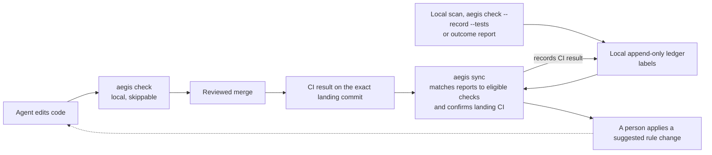

# Why Aegis is built this way

*By Nick Seney. Checked for 4.4.0 against `bed1e4a6` on 2026-10-29. What Aegis does today is in [How Aegis works](how-it-works.md); this page is about how it got that way.*

I wrote this for anyone deciding whether to trust Aegis: where the rules came from, what I measured and how much those numbers are worth, what I got wrong, and why Aegis looks the way it does now.

## 1. The problem

Coding agents read an instruction file (`AGENTS.md`, `CLAUDE.md`, `.cursorrules`) and then go and do things. Nothing checks that they followed it.

My clearest example comes from TAB AI, a reinforcement-learning agent I was training locally to play *They Are Billions*. Think DeepMind and StarCraft II, at hobby scale. In one long session the coding agent needed the game's hotkeys. Instead of checking the settings or a screenshot, it invented them, and that one habit cost 180 steps. I had rules at the time. Nothing put the right one in front of the agent when it mattered, and nothing checked afterwards.

Agents fail a rules file in three ways:

- **They skip rules.** Under pressure an agent follows the letter of a rule and misses the point. My early notes have one "verifying" its work by re-reading the same file four times.
- **They forget.** Long sessions compact their context and new sessions start from zero, so the same environment traps get rediscovered again and again.
- **They fail open.** A check that crashes, a missing tool or a rule that never loaded looks exactly like "no problem found".

Aegis's own history has all three. At one point `aegis_scan` returned zero rules in my own session, a code check silently skipped Python files that started with a byte-order mark, and the release gate's "ship it" receipts were written by the agent being gated (section 4). My first write-up of this is [Your AI agent's rules file is a gentleman's agreement](https://dev.to/nseney1/your-ai-agents-rules-file-is-a-gentlemans-agreement-heres-what-happens-when-you-build-2dml).

## 2. How I got here

I started Aegis for a small reason: I wanted one set of steering files that worked across Gemini, Claude and the other agents. That was Prism, rules plus hooks. The deeper I dug, the more I wondered whether an agent's behavior is shaped more by its guidance than by its training: the model as DNA, the rules as upbringing. People aren't forced to be good; they're raised that way. That became Soma, where I experimented with rules that adapt over time. It was the wrong theory. Training is where behavior forms, and I couldn't fit it in. I dropped the theory and kept what Soma taught me about guardrails.

The timeline, all in 2026:

- **26 September.** First commit, "Gemini Steering Rules": nine rules for Gemini and Antigravity. Within ten minutes it had installers for Copilot and Kiro and a new name, "AI Steering Rules". The same day I turned the TAB AI post-mortem (section 3) into rules.
- **27 September.** Prism, and the first tag, v0.15.0.
- **28 September.** Soma. Everything got a biology name (rules became `genome/`, scripts became `enzymes/`), and the MCP server started. The fitness idea came straight from TAB AI: I was learning reinforcement learning, so scoring rules by reward felt natural.
- **8 October.** v1.0.
- **14 October.** At 2:50 a.m. I renamed Soma to Aegis. That's when I let go of the theory. Later that day I tagged v2.0, v2.1, v3.0, v3.1, v3.2 and v3.3. Sixteen minutes after v3.3 came the first commit of a v4 rewrite, with a failing test and no commit-message body. Counting the rename, v2.0, v2.1, v3.0 and that rewrite, that's five foundational resets in under 21 hours. By that night, 19 days after the first commit, the repository had 850 commits and 94 tags.
- **15 October.** AI reviewers audited the code, and one scored its design 4/10 (section 4). That review pushed me to v4.
- **16 October.** v4.0, 4.1 and 4.2. 4.1.0 was never tagged: its release review found problems, and 4.1.1 shipped the fixes that afternoon.
- **17 October.** 4.3, trust and evidence (section 6).
- **21 October.** 4.3.4. Work on 4.4.0 followed to fix what the 4.3 reviews found.

Why so fast? I was excited, and I trusted what the agents wrote more than I should have. I wasn't reviewing much myself. The rename to Aegis is where I put my own hands on the decisions and the direction. The worst v3 bug, an agent writing its own release receipts, was the same mistake I was making as a maintainer. Much of how Aegis works now is about not repeating it: evidence comes from CI and git, not from anyone's say-so.

## 3. The evidence, and how much it's worth

These numbers come from my own sessions, classified by my own tooling, with no second rater. They're why I wrote the rules. They're not proof that the rules work.

**The TAB AI post-mortem.** 749 of the session's 1,339 steps were rework (55.9%). The biggest items, and the rule each produced:

| What went wrong | Steps | Rule it produced | Where it is now |
|---|---|---|---|
| Invented game hotkeys instead of checking | 180 | Verify UI controls from screenshots or settings; never guess | [providence](../rules/providence.md) §10 |
| Host Python confused with the project's virtualenv | 110 | Call `$(VENV)/bin/python` explicitly | [polyglot-standards](../rules/.oracles/polyglot-standards.md) |
| A test polled forever with no timeout | 103 | Mock hardware; time-box every polling loop | [testing](../rules/.oracles/testing.md) |
| One method silently shadowed another | 50 | Grep for `def <name>` before defining one in a large file | [providence](../rules/providence.md) §3 |
| Stale references after a rename | 30 | Grep for the old name before finishing | [providence](../rules/providence.md) §3 |

Those rows add up to 473 steps. The other 276 came before I tracked steps one by one, and were never itemized.

*Limits:* one session, one developer, my own classification. The old docs give the session's length as 611, then 1,042, then 1,339 steps on the day of the analysis, and another table puts the same 180 hotkey steps in a 1,551-step session. Treat the totals as approximate.

**Seventeen sessions with the rules.** Across 17 sessions from 25 to 27 September, 1,317 of 7,015 steps were waste (18.8%).

*Limits:* the baseline is circular. The post-mortem session is both where the rules came from and the "before" number, so later sessions are scored on exactly the failures the rules were written to catch. The sessions may also overlap. The 17 aren't listed anywhere, so I can't tell whether the TAB AI session is one of them. If it is, it alone holds 749 of the 1,317 wasted steps, and the other 16 wasted 10.0% (568 of 5,676).

**One A/B pair.** Two TAB AI sessions: with weak rules, 27.6% of 547 steps were waste; with the full rule set, 1.1% of 1,325.

*Limits:* two sessions at different times, not necessarily on the same task. Other things changed too. Subagents ran on Opus in the first and entirely on the cheaper Flash tier in the second, and the second used about 12% of the first's credits. The weak-rules session also fed three amendments back into the rules. It's not a controlled experiment, and it can't separate the prose rules from the machinery I was adding at the time.

**What I'm not claiming.** None of this shows what caused the improvement. The v3 scoring counted false alarms but never misses, and its outcome signals could be written by the agent being measured, so any v3 fitness number is self-graded. The old token figures were estimated from word counts, so I don't quote them.

## 4. What I got wrong in v3, and what changed

On 15 October I had AI reviewers, each in a separate context, audit v3.3 plus the first v4 commits. The harshest score was 4/10 on product value and design: "a real problem, a prototype-grade solution, over-built roughly 5-10x and unsound at its centre". An earlier run of the same reviewer gave 5/10. Code health, end-to-end behavior and test health scored 6/10. The deterministic checks held up, and so did the zero-dependency, local-first claims. These are model opinions, not an outside audit, and the report isn't in the repository.

### The agent signed its own release receipts

**Then:** a release needed a "SHIP" receipt. For v2.0, v2.1, v3.0 and v3.3 the agent being gated wrote it by hand. One still had placeholder predictions `p1` to `p6`; the v3.3.0 receipt claims 8 convergences and lists 5. A hand-written file saying `verdict: ship` passed the gate.

**Now:** receipts and that gate are gone. A release needs three things for the exact commit being tagged: an independent review of the release pull request, green CI (`python3 .github/scripts/ci_green.py <sha>`), and an `aegis check` that passes the deterministic checks ([Releases](../CONTRIBUTING.md#releases)).

### Credit pointed the wrong way

**Then:** v3 gave every rule whose paths matched a change that run's pass or fail. For a gate that's backwards: a gate that blocked 4 bad commits scored 4 false positives and 1 true positive.

**Now:** since 4.3.4 a plain `aegis check` records only that a rule was triggered. Check-based credit needs a passing `aegis check --record --tests` that CI confirms on the commit that lands. An agent's own report (`aegis_report_outcome`) without a matching check is stored as "claimed" and earns nothing. Detector replay and legacy ledger rows can still influence local fitness, and an agent running as my user can write them: a local score is a label, not authenticated evidence. Human labels count only after they merge into the reviewed base branch.

`aegis sync` only suggests promotions and demotions. Applying one (`aegis sync --apply` or `aegis rule promote`) is an explicit change that belongs in review. In 4.4.0, promotion recommendations need at least 25 positive human labels with no false positives, or at least 42 labels with at most one false positive. They also need at least three sessions spanning two repositories or 14 days, and a valid `created` date at least 30 days ago; a missing or invalid date blocks promotion ([thresholds](../aegis_core/fitness.py)).

### Rules switched themselves off

**Then:** at session close v3 wrote fitness numbers back into each rule file, but didn't refresh the integrity manifest. The next scan saw an "edited" rule, decided it had been tampered with and dropped it, with the warning only on stderr. On `main`, 45 of 49 manifest entries were stale, and `aegis_scan` returned zero rules in my own session. The same unlocked write path lost about 80 of 120 updates in a concurrency reproduction.

**Now:** outcomes go into an append-only ledger, and scores are rebuilt from it and reviewed labels under a lock. Checks, scans and hooks never rewrite rule files; `tests/integration/test_no_rule_writes.py` holds those paths to that. Explicit rule, sync and migration commands can write them. The signed manifest is gone, and git review and CI protect the rules. Since 4.3, `aegis check --ci` reads gates from the reviewed base branch and fails a pull request that weakens one without an approval. Whether that approval is beyond the agent's reach depends on the trust tier (section 6).

### Most of it was never used

**Then:** my local logs from about 690 sessions show 73 MCP calls, 66 of them in the last two days of that window. Only 5 of the 17 tools were ever called. No rule was ever promoted, demoted or archived in either repository I ran it on.

**Now:** v4.0 shipped 4 MCP tools; 4.3 added a fifth, for capturing insights. The CLI has 15 commands. Receipts, the background job engine (the only daemon thread), the claim and bug registries and the unreachable code were cut, and none of them came back.

### Five resets in a day

**Then:** see 14 October above. The v4 rewrite began as one commit of about 4,000 added lines, with a failing test and no message body.

**Now:** the on-disk formats carry a version, and `aegis migrate` converts an old v3 or Soma workspace in place, dry run first and with backups, instead of a clean-slate purge. A tag needs a review and green CI on its commit. Rule files don't carry a schema version yet.

### Repository files could run commands

**Then:** a repository's `.aegis/slots.yaml` could name commands that `aegis check` ran, and its values were pasted into the scan output the agent reads.

**Now:** repository config (`.aegis/config.json`) can't name commands. They come only from Aegis's packaged templates or your user-level config. Aegis runs git with the repository settings that could start a program switched off. It runs repository tests or benchmarks only when you ask: `aegis check --full`, `aegis check --record --tests`, `aegis check --ci --coverage` and `aegis check --ci --perf`, and the reruns in `aegis check --ci` (`--no-exec` skips those reruns and refuses coverage and perf). [SECURITY.md](../SECURITY.md#repository-trust) lists everything Aegis runs.

### And then it grew back

The cuts took the four Python packages from 39,426 lines to 22,188. At `bed1e4a6` they're at 53,739, 36.3% above where v4 started, and the tests more than doubled (42,476 lines at v3.3, 104,371 now: 2.46 times as many). These counts include blank lines and comments. I see it as trimming the fat to make room for what I need in my own projects: signed approvals and per-rule credit, team lanes, setup across hosts, git safety, `aegis doctor` and the security checks. The cut surface didn't come back, but the size is real, and you should weigh it.

## 5. Why v4 is built this way

1. **Check what you can, where it counts.** CI on the exact commit is the floor. The local git hook gives quick feedback, but `git commit --no-verify` skips it, and hooks inside agent hosts are best effort. Aegis says which is which instead of claiming enforcement it lacks.
2. **Rules just in time.** A short note in `AGENTS.md` tells the agent to call `aegis_scan` before editing, and the scan returns only the rules for those files. That depends on the agent making the call, so Aegis measures how often it does (`aegis status --compliance`).
3. **Separate claims from confirmed evidence.** CI on the commit that lands confirms check-based credit. Local scores and detector replay remain labels an agent can write; its reports without a matching check earn nothing.
4. **People change the rules.** Aegis suggests; applying a change is an explicit step that belongs in a reviewed commit. Checks, scans and hooks never rewrite rule files.

Underneath all four: no runtime dependencies, no daemon and no telemetry. [PRIVACY.md](../PRIVACY.md) describes the outbound data paths and what Aegis stores locally.



## 6. Trust

The 4.3 work started from an uncomfortable finding: nothing on my machine is a reliable witness against an agent running as the same user. It can edit the files, run the commands and write the logs. So Aegis labels what it sees locally, lets CI on the exact commit confirm check-based credit, and uses reviewed or signed approvals for rule weakenings: label locally, confirm externally, approve humanly.

How much of that holds depends on how your repository is set up, and `aegis doctor` tells you your trust tier. At tier A a code owner other than the author approves the pull request, under enforced review rules, and the agent uses its own non-admin identity. At tier B you sign approvals with a key the agent can't use, but a pull request that edits its own workflow or Aegis can change the check that verifies them. A fresh repository is tier C: Aegis detects and records, but does not stop a deliberate agent running as your user.

A rule weakening is always gated by `aegis check --ci`; other governance-file changes are gated only when the base branch lists a key in `allowed_signers`. The check itself must be required to stop a merge. Separately, the regression check asks for a test that fails before a fix and passes after it, or a signed exemption; at warning tier this is advisory and never blocks. The exact conditions and their gaps are in [SECURITY.md](../SECURITY.md#trust-tiers) and [Trust tiers](trust-tiers.md).

## 7. Predictions, and where they stand

Each v4 change came with a prediction that could fail, and a failed one is something to act on, not explain away. The results below were checked on 2026-10-23; they are historical results, not fresh checks of the development commit named above:

| Prediction | How to check | Status |
|---|---|---|
| Checks, scans and hooks do not rewrite rule files, and no outcome is lost when several processes write at once | `python3 -m pytest tests/integration/test_no_rule_writes.py tests/unit/core/test_ledger.py tests/unit/core/test_locking.py` | 73 tests passed on 2026-10-23 |
| No release tag without green CI on its commit | `python3 .github/scripts/ci_green.py "$(git rev-list -n1 <tag>)"` (needs `gh`) | Verified for the eight v4 tags present on 2026-10-23. The publish runs for 4.3.0 and 4.3.3 had failed, and neither version was on PyPI at that check |
| Agents scan before editing at least 80% of the time on each supported host, after 3 sessions | `aegis status --compliance` | No published measurement yet |
| In 20 multi-lane sessions no cross-lane write conflict reaches a merge. Proposed maintainer decision: remove the lease feature after 30 days of multi-lane use with no denial; this is not automatic lease expiry | `aegis team metrics` | Not yet measured over 20 sessions |
| The next major version ships without a clean-slate purge | Its CHANGELOG gives an `aegis migrate` path for every format it changes | Holds for 4.0.0; rule files have no schema version yet |

## Appendix A: Trade-offs

| Decision | What it costs | What you give up |
|---|---|---|
| Outcome rows live in the ledger; human labels live in reviewed files | `aegis sync` is a batch step | Scores in `.aegis/state/derived.json` are as fresh as the last sync |
| CI decides releases | A release waits for CI | Offline releases |
| Rules just in time | One extra tool call per batch of edits | It depends on the agent calling the scan |
| Repository config can't name commands | Test and benchmark commands are set per machine | A repository can't ship its own check commands |
| No runtime dependencies or daemons | A hand-written YAML subset parser to maintain | Features that need a library or a background process |

## Appendix B: Re-deriving the numbers

The v3 sources were deleted in v4, but git keeps them. The post-mortem table and the "four times" note are in `git show v3.3.0:docs/architecture/phylogeny.md`; the 17 sessions and the A/B pair are in `git show v3.3.0:docs/project/METRICS.md`. Three things can't be re-derived from the repository: the MCP usage counts (my local session logs), the review scores (the report isn't published) and the receipt and manifest findings (the review notes behind v4).

From the repository root:

```sh
python3 -c "print(749/1339, 180+110+103+50+30, 749-473, 1317/7015, (1317-749)/(7015-1339), 1-22188/39426, 53739/39426-1, 104371/42476)"
# 0.559  473  276  0.188  0.100  0.437  0.363  2.46
git log -1 --format='%h %ci' 2c85f58   # rename to Aegis: 2026-10-14 02:50
git log -1 --format='%h %ci' 6f47f13   # first v4 commit: 23:30, 20 h 40 min later
git for-each-ref --format='%(creatordate:iso)' refs/tags/v3.3.0   # 23:14, 16 min earlier
git show --shortstat --format='%B' 6f47f13   # subject only; 40 files, +4267 / -3272
git rev-list --count 9e4d976; git tag --merged 9e4d976 | wc -l   # 850, 94
loc() { rev=$1; shift; git ls-tree -r --name-only "$rev" -- "$@" | grep '\.py$' | while IFS= read -r f; do git show "$rev:$f"; done | wc -l; }
for rev in 9e4d976 895bbf5 bed1e4a6; do loc "$rev" aegis_core aegis_cli aegis_mcp aegis_sdk; done   # 39426, 22188, 53739
for rev in v3.3.0 bed1e4a6; do loc "$rev" tests; done                                          # 42476, 104371
python3 -c "import aegis_mcp.registry as r; print(len(r.TOOL_DEFINITIONS))"   # 5
```

## Planned, not shipped

These are future directions, not capabilities of the current release.

- **4.5.0 — multi-language AST:** deeper TypeScript/JavaScript, Go and Rust analysis through a shared normalized AST, with explicit unsupported and unverified results. The packaged drivers available today do not provide this full analysis.
- **4.6.0 — lessons from repository history:** `aegis mine` would turn observed failures and corrections into candidates in one proposal queue for human review. It would not create active rules automatically.
- **4.7.0 — parallel agents in one repository:** improve coordination and review for agents sharing a repository, building on the existing advisory lanes and leases without claiming isolation or autonomous approval.
- **4.8.0 — code-claim checks:** a proposed `aegis claims check FILE` would read `{id, anchor, probe, expect}` claims and report **holds**, **moved**, **no longer holds** or **contradicts** against the current code. It would be stateless, read-only and independent of any plan format.

The 4.8.0 idea must first prove useful in a manual trial that records what its probes catch; if the trial misses most stale claims, drop the feature. It is not project management: no owners, assignees, dates, estimates, priorities, dependency ordering, stored progress or progress UI. Plans and responsibility stay outside Aegis.
